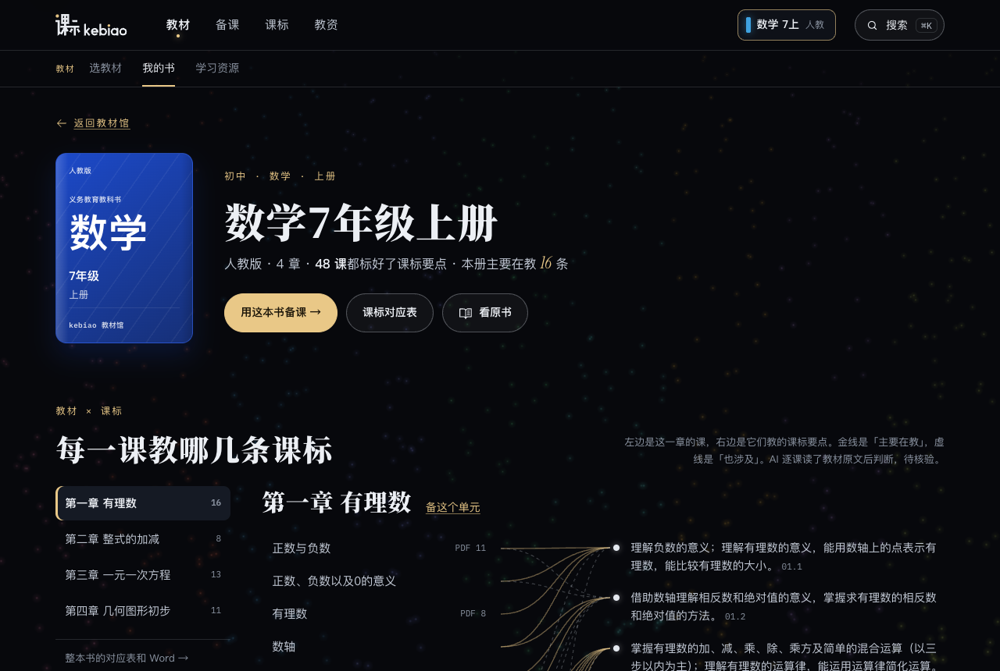

<div align="center">

# China Textbook New

**一至九年级最新版教材 PDF · 2022 课标修订版**

[](#快速找书)
[](#快速找书)
[](#更新)
[](https://www.kebiao.org)

[快速找书](#快速找书) · [配合 kebiao.org 备课](#配合-kebiaoorg-备课) · [怎么下载](#怎么下载) · [和 ChinaTextbook 有什么不同](#和-chinatextbook-有什么不同) · [English](#english)

</div>

从 2024 年秋天开始，义务教育各科陆续换上了根据 2022 年版课程标准修订的新教材。可网上好找的 PDF 大多还是旧印次，想要新版，只能去[国家中小学智慧教育平台](https://basic.smartedu.cn/tchMaterial)一本本找。

我在做 [kebiao.org](https://www.kebiao.org)，一个帮老师查课标、对教材的网站，本来就得把这套新教材整理一遍。整理好了，干脆放在这里，谁要都能直接拿。

现在有 **147** 本，一共 5.4 GB，2026-11-01 更新：

- ✅ **115** 本是 2022 课标修订版，直接取自国家平台，和平台上的文件一模一样。
- ⏳ **28** 本平台还没出修订版，大多是四到六年级和九年级的下册。先放现行版，新版一出来就换。
- ⏳ 还有 **4** 本初中地理图册，平台上没有，用的是现有版本。

## 快速找书

点册名就能下载。带 ⏳ 的是现行版，其余都是修订版。点学科名，能看到这一科每本书的页数、大小，还有去 kebiao.org 和国家平台的链接。

**小学**

| 学科 | 一年级 | 二年级 | 三年级 | 四年级 | 五年级 | 六年级 |
|---|---|---|---|---|---|---|
| [语文](#%E5%B0%8F%E5%AD%A6%E8%AF%AD%E6%96%87) | [上](%E5%B0%8F%E5%AD%A6/%E8%AF%AD%E6%96%87/%E7%BB%9F%E7%BC%96%E7%89%88/%E8%AF%AD%E6%96%87%E4%B8%80%E5%B9%B4%E7%BA%A7%E4%B8%8A%E5%86%8C%C2%B7%E7%BB%9F%E7%BC%96%E7%89%88.pdf) · [下](%E5%B0%8F%E5%AD%A6/%E8%AF%AD%E6%96%87/%E7%BB%9F%E7%BC%96%E7%89%88/%E8%AF%AD%E6%96%87%E4%B8%80%E5%B9%B4%E7%BA%A7%E4%B8%8B%E5%86%8C%C2%B7%E7%BB%9F%E7%BC%96%E7%89%88.pdf) | [上](%E5%B0%8F%E5%AD%A6/%E8%AF%AD%E6%96%87/%E7%BB%9F%E7%BC%96%E7%89%88/%E8%AF%AD%E6%96%87%E4%BA%8C%E5%B9%B4%E7%BA%A7%E4%B8%8A%E5%86%8C%C2%B7%E7%BB%9F%E7%BC%96%E7%89%88.pdf) · [下](%E5%B0%8F%E5%AD%A6/%E8%AF%AD%E6%96%87/%E7%BB%9F%E7%BC%96%E7%89%88/%E8%AF%AD%E6%96%87%E4%BA%8C%E5%B9%B4%E7%BA%A7%E4%B8%8B%E5%86%8C%C2%B7%E7%BB%9F%E7%BC%96%E7%89%88.pdf) | [上](%E5%B0%8F%E5%AD%A6/%E8%AF%AD%E6%96%87/%E7%BB%9F%E7%BC%96%E7%89%88/%E8%AF%AD%E6%96%87%E4%B8%89%E5%B9%B4%E7%BA%A7%E4%B8%8A%E5%86%8C%C2%B7%E7%BB%9F%E7%BC%96%E7%89%88.pdf) · [下](%E5%B0%8F%E5%AD%A6/%E8%AF%AD%E6%96%87/%E7%BB%9F%E7%BC%96%E7%89%88/%E8%AF%AD%E6%96%87%E4%B8%89%E5%B9%B4%E7%BA%A7%E4%B8%8B%E5%86%8C%C2%B7%E7%BB%9F%E7%BC%96%E7%89%88.pdf) | [上](%E5%B0%8F%E5%AD%A6/%E8%AF%AD%E6%96%87/%E7%BB%9F%E7%BC%96%E7%89%88/%E8%AF%AD%E6%96%87%E5%9B%9B%E5%B9%B4%E7%BA%A7%E4%B8%8A%E5%86%8C%C2%B7%E7%BB%9F%E7%BC%96%E7%89%88.pdf) · [下](%E5%B0%8F%E5%AD%A6/%E8%AF%AD%E6%96%87/%E7%BB%9F%E7%BC%96%E7%89%88/%E8%AF%AD%E6%96%87%E5%9B%9B%E5%B9%B4%E7%BA%A7%E4%B8%8B%E5%86%8C%C2%B7%E7%BB%9F%E7%BC%96%E7%89%88.pdf)⏳ | [上](%E5%B0%8F%E5%AD%A6/%E8%AF%AD%E6%96%87/%E7%BB%9F%E7%BC%96%E7%89%88/%E8%AF%AD%E6%96%87%E4%BA%94%E5%B9%B4%E7%BA%A7%E4%B8%8A%E5%86%8C%C2%B7%E7%BB%9F%E7%BC%96%E7%89%88.pdf) · [下](%E5%B0%8F%E5%AD%A6/%E8%AF%AD%E6%96%87/%E7%BB%9F%E7%BC%96%E7%89%88/%E8%AF%AD%E6%96%87%E4%BA%94%E5%B9%B4%E7%BA%A7%E4%B8%8B%E5%86%8C%C2%B7%E7%BB%9F%E7%BC%96%E7%89%88.pdf)⏳ | [上](%E5%B0%8F%E5%AD%A6/%E8%AF%AD%E6%96%87/%E7%BB%9F%E7%BC%96%E7%89%88/%E8%AF%AD%E6%96%87%E5%85%AD%E5%B9%B4%E7%BA%A7%E4%B8%8A%E5%86%8C%C2%B7%E7%BB%9F%E7%BC%96%E7%89%88.pdf) · [下](%E5%B0%8F%E5%AD%A6/%E8%AF%AD%E6%96%87/%E7%BB%9F%E7%BC%96%E7%89%88/%E8%AF%AD%E6%96%87%E5%85%AD%E5%B9%B4%E7%BA%A7%E4%B8%8B%E5%86%8C%C2%B7%E7%BB%9F%E7%BC%96%E7%89%88.pdf)⏳ |
| [数学](#%E5%B0%8F%E5%AD%A6%E6%95%B0%E5%AD%A6) | [上](%E5%B0%8F%E5%AD%A6/%E6%95%B0%E5%AD%A6/%E4%BA%BA%E6%95%99%E7%89%88/%E6%95%B0%E5%AD%A6%E4%B8%80%E5%B9%B4%E7%BA%A7%E4%B8%8A%E5%86%8C%C2%B7%E4%BA%BA%E6%95%99%E7%89%88.pdf) · [下](%E5%B0%8F%E5%AD%A6/%E6%95%B0%E5%AD%A6/%E4%BA%BA%E6%95%99%E7%89%88/%E6%95%B0%E5%AD%A6%E4%B8%80%E5%B9%B4%E7%BA%A7%E4%B8%8B%E5%86%8C%C2%B7%E4%BA%BA%E6%95%99%E7%89%88.pdf) | [上](%E5%B0%8F%E5%AD%A6/%E6%95%B0%E5%AD%A6/%E4%BA%BA%E6%95%99%E7%89%88/%E6%95%B0%E5%AD%A6%E4%BA%8C%E5%B9%B4%E7%BA%A7%E4%B8%8A%E5%86%8C%C2%B7%E4%BA%BA%E6%95%99%E7%89%88.pdf) · [下](%E5%B0%8F%E5%AD%A6/%E6%95%B0%E5%AD%A6/%E4%BA%BA%E6%95%99%E7%89%88/%E6%95%B0%E5%AD%A6%E4%BA%8C%E5%B9%B4%E7%BA%A7%E4%B8%8B%E5%86%8C%C2%B7%E4%BA%BA%E6%95%99%E7%89%88.pdf) | [上](%E5%B0%8F%E5%AD%A6/%E6%95%B0%E5%AD%A6/%E4%BA%BA%E6%95%99%E7%89%88/%E6%95%B0%E5%AD%A6%E4%B8%89%E5%B9%B4%E7%BA%A7%E4%B8%8A%E5%86%8C%C2%B7%E4%BA%BA%E6%95%99%E7%89%88.pdf) · [下](%E5%B0%8F%E5%AD%A6/%E6%95%B0%E5%AD%A6/%E4%BA%BA%E6%95%99%E7%89%88/%E6%95%B0%E5%AD%A6%E4%B8%89%E5%B9%B4%E7%BA%A7%E4%B8%8B%E5%86%8C%C2%B7%E4%BA%BA%E6%95%99%E7%89%88.pdf) | [上](%E5%B0%8F%E5%AD%A6/%E6%95%B0%E5%AD%A6/%E4%BA%BA%E6%95%99%E7%89%88/%E6%95%B0%E5%AD%A6%E5%9B%9B%E5%B9%B4%E7%BA%A7%E4%B8%8A%E5%86%8C%C2%B7%E4%BA%BA%E6%95%99%E7%89%88.pdf) · [下](%E5%B0%8F%E5%AD%A6/%E6%95%B0%E5%AD%A6/%E4%BA%BA%E6%95%99%E7%89%88/%E6%95%B0%E5%AD%A6%E5%9B%9B%E5%B9%B4%E7%BA%A7%E4%B8%8B%E5%86%8C%C2%B7%E4%BA%BA%E6%95%99%E7%89%88.pdf)⏳ | [上](%E5%B0%8F%E5%AD%A6/%E6%95%B0%E5%AD%A6/%E4%BA%BA%E6%95%99%E7%89%88/%E6%95%B0%E5%AD%A6%E4%BA%94%E5%B9%B4%E7%BA%A7%E4%B8%8A%E5%86%8C%C2%B7%E4%BA%BA%E6%95%99%E7%89%88.pdf) · [下](%E5%B0%8F%E5%AD%A6/%E6%95%B0%E5%AD%A6/%E4%BA%BA%E6%95%99%E7%89%88/%E6%95%B0%E5%AD%A6%E4%BA%94%E5%B9%B4%E7%BA%A7%E4%B8%8B%E5%86%8C%C2%B7%E4%BA%BA%E6%95%99%E7%89%88.pdf)⏳ | [上](%E5%B0%8F%E5%AD%A6/%E6%95%B0%E5%AD%A6/%E4%BA%BA%E6%95%99%E7%89%88/%E6%95%B0%E5%AD%A6%E5%85%AD%E5%B9%B4%E7%BA%A7%E4%B8%8A%E5%86%8C%C2%B7%E4%BA%BA%E6%95%99%E7%89%88.pdf) · [下](%E5%B0%8F%E5%AD%A6/%E6%95%B0%E5%AD%A6/%E4%BA%BA%E6%95%99%E7%89%88/%E6%95%B0%E5%AD%A6%E5%85%AD%E5%B9%B4%E7%BA%A7%E4%B8%8B%E5%86%8C%C2%B7%E4%BA%BA%E6%95%99%E7%89%88.pdf)⏳ |
| [英语](#%E5%B0%8F%E5%AD%A6%E8%8B%B1%E8%AF%AD) |  |  | [上](%E5%B0%8F%E5%AD%A6/%E8%8B%B1%E8%AF%AD/%E4%BA%BA%E6%95%99%E7%89%88%20PEP%EF%BC%88%E4%B8%89%E5%B9%B4%E7%BA%A7%E8%B5%B7%E7%82%B9%EF%BC%89/%E8%8B%B1%E8%AF%AD%E4%B8%89%E5%B9%B4%E7%BA%A7%E4%B8%8A%E5%86%8C%C2%B7%E4%BA%BA%E6%95%99%E7%89%88%20PEP%EF%BC%88%E4%B8%89%E5%B9%B4%E7%BA%A7%E8%B5%B7%E7%82%B9%EF%BC%89.pdf) · [下](%E5%B0%8F%E5%AD%A6/%E8%8B%B1%E8%AF%AD/%E4%BA%BA%E6%95%99%E7%89%88%20PEP%EF%BC%88%E4%B8%89%E5%B9%B4%E7%BA%A7%E8%B5%B7%E7%82%B9%EF%BC%89/%E8%8B%B1%E8%AF%AD%E4%B8%89%E5%B9%B4%E7%BA%A7%E4%B8%8B%E5%86%8C%C2%B7%E4%BA%BA%E6%95%99%E7%89%88%20PEP%EF%BC%88%E4%B8%89%E5%B9%B4%E7%BA%A7%E8%B5%B7%E7%82%B9%EF%BC%89.pdf) | [上](%E5%B0%8F%E5%AD%A6/%E8%8B%B1%E8%AF%AD/%E4%BA%BA%E6%95%99%E7%89%88%20PEP%EF%BC%88%E4%B8%89%E5%B9%B4%E7%BA%A7%E8%B5%B7%E7%82%B9%EF%BC%89/%E8%8B%B1%E8%AF%AD%E5%9B%9B%E5%B9%B4%E7%BA%A7%E4%B8%8A%E5%86%8C%C2%B7%E4%BA%BA%E6%95%99%E7%89%88%20PEP%EF%BC%88%E4%B8%89%E5%B9%B4%E7%BA%A7%E8%B5%B7%E7%82%B9%EF%BC%89.pdf) · [下](%E5%B0%8F%E5%AD%A6/%E8%8B%B1%E8%AF%AD/%E4%BA%BA%E6%95%99%E7%89%88%20PEP%EF%BC%88%E4%B8%89%E5%B9%B4%E7%BA%A7%E8%B5%B7%E7%82%B9%EF%BC%89/%E8%8B%B1%E8%AF%AD%E5%9B%9B%E5%B9%B4%E7%BA%A7%E4%B8%8B%E5%86%8C%C2%B7%E4%BA%BA%E6%95%99%E7%89%88%20PEP%EF%BC%88%E4%B8%89%E5%B9%B4%E7%BA%A7%E8%B5%B7%E7%82%B9%EF%BC%89.pdf) | [上](%E5%B0%8F%E5%AD%A6/%E8%8B%B1%E8%AF%AD/%E4%BA%BA%E6%95%99%E7%89%88%20PEP%EF%BC%88%E4%B8%89%E5%B9%B4%E7%BA%A7%E8%B5%B7%E7%82%B9%EF%BC%89/%E8%8B%B1%E8%AF%AD%E4%BA%94%E5%B9%B4%E7%BA%A7%E4%B8%8A%E5%86%8C%C2%B7%E4%BA%BA%E6%95%99%E7%89%88%20PEP%EF%BC%88%E4%B8%89%E5%B9%B4%E7%BA%A7%E8%B5%B7%E7%82%B9%EF%BC%89.pdf) · [下](%E5%B0%8F%E5%AD%A6/%E8%8B%B1%E8%AF%AD/%E4%BA%BA%E6%95%99%E7%89%88%20PEP%EF%BC%88%E4%B8%89%E5%B9%B4%E7%BA%A7%E8%B5%B7%E7%82%B9%EF%BC%89/%E8%8B%B1%E8%AF%AD%E4%BA%94%E5%B9%B4%E7%BA%A7%E4%B8%8B%E5%86%8C%C2%B7%E4%BA%BA%E6%95%99%E7%89%88%20PEP%EF%BC%88%E4%B8%89%E5%B9%B4%E7%BA%A7%E8%B5%B7%E7%82%B9%EF%BC%89.pdf)⏳ | [上](%E5%B0%8F%E5%AD%A6/%E8%8B%B1%E8%AF%AD/%E4%BA%BA%E6%95%99%E7%89%88%20PEP%EF%BC%88%E4%B8%89%E5%B9%B4%E7%BA%A7%E8%B5%B7%E7%82%B9%EF%BC%89/%E8%8B%B1%E8%AF%AD%E5%85%AD%E5%B9%B4%E7%BA%A7%E4%B8%8A%E5%86%8C%C2%B7%E4%BA%BA%E6%95%99%E7%89%88%20PEP%EF%BC%88%E4%B8%89%E5%B9%B4%E7%BA%A7%E8%B5%B7%E7%82%B9%EF%BC%89.pdf) · [下](%E5%B0%8F%E5%AD%A6/%E8%8B%B1%E8%AF%AD/%E4%BA%BA%E6%95%99%E7%89%88%20PEP%EF%BC%88%E4%B8%89%E5%B9%B4%E7%BA%A7%E8%B5%B7%E7%82%B9%EF%BC%89/%E8%8B%B1%E8%AF%AD%E5%85%AD%E5%B9%B4%E7%BA%A7%E4%B8%8B%E5%86%8C%C2%B7%E4%BA%BA%E6%95%99%E7%89%88%20PEP%EF%BC%88%E4%B8%89%E5%B9%B4%E7%BA%A7%E8%B5%B7%E7%82%B9%EF%BC%89.pdf)⏳ |
| [道德与法治](#%E5%B0%8F%E5%AD%A6%E9%81%93%E5%BE%B7%E4%B8%8E%E6%B3%95%E6%B2%BB) | [上](%E5%B0%8F%E5%AD%A6/%E9%81%93%E5%BE%B7%E4%B8%8E%E6%B3%95%E6%B2%BB/%E7%BB%9F%E7%BC%96%E7%89%88/%E9%81%93%E5%BE%B7%E4%B8%8E%E6%B3%95%E6%B2%BB%E4%B8%80%E5%B9%B4%E7%BA%A7%E4%B8%8A%E5%86%8C%C2%B7%E7%BB%9F%E7%BC%96%E7%89%88.pdf) · [下](%E5%B0%8F%E5%AD%A6/%E9%81%93%E5%BE%B7%E4%B8%8E%E6%B3%95%E6%B2%BB/%E7%BB%9F%E7%BC%96%E7%89%88/%E9%81%93%E5%BE%B7%E4%B8%8E%E6%B3%95%E6%B2%BB%E4%B8%80%E5%B9%B4%E7%BA%A7%E4%B8%8B%E5%86%8C%C2%B7%E7%BB%9F%E7%BC%96%E7%89%88.pdf) | [上](%E5%B0%8F%E5%AD%A6/%E9%81%93%E5%BE%B7%E4%B8%8E%E6%B3%95%E6%B2%BB/%E7%BB%9F%E7%BC%96%E7%89%88/%E9%81%93%E5%BE%B7%E4%B8%8E%E6%B3%95%E6%B2%BB%E4%BA%8C%E5%B9%B4%E7%BA%A7%E4%B8%8A%E5%86%8C%C2%B7%E7%BB%9F%E7%BC%96%E7%89%88.pdf) · [下](%E5%B0%8F%E5%AD%A6/%E9%81%93%E5%BE%B7%E4%B8%8E%E6%B3%95%E6%B2%BB/%E7%BB%9F%E7%BC%96%E7%89%88/%E9%81%93%E5%BE%B7%E4%B8%8E%E6%B3%95%E6%B2%BB%E4%BA%8C%E5%B9%B4%E7%BA%A7%E4%B8%8B%E5%86%8C%C2%B7%E7%BB%9F%E7%BC%96%E7%89%88.pdf) | [上](%E5%B0%8F%E5%AD%A6/%E9%81%93%E5%BE%B7%E4%B8%8E%E6%B3%95%E6%B2%BB/%E7%BB%9F%E7%BC%96%E7%89%88/%E9%81%93%E5%BE%B7%E4%B8%8E%E6%B3%95%E6%B2%BB%E4%B8%89%E5%B9%B4%E7%BA%A7%E4%B8%8A%E5%86%8C%C2%B7%E7%BB%9F%E7%BC%96%E7%89%88.pdf) · [下](%E5%B0%8F%E5%AD%A6/%E9%81%93%E5%BE%B7%E4%B8%8E%E6%B3%95%E6%B2%BB/%E7%BB%9F%E7%BC%96%E7%89%88/%E9%81%93%E5%BE%B7%E4%B8%8E%E6%B3%95%E6%B2%BB%E4%B8%89%E5%B9%B4%E7%BA%A7%E4%B8%8B%E5%86%8C%C2%B7%E7%BB%9F%E7%BC%96%E7%89%88.pdf) | [上](%E5%B0%8F%E5%AD%A6/%E9%81%93%E5%BE%B7%E4%B8%8E%E6%B3%95%E6%B2%BB/%E7%BB%9F%E7%BC%96%E7%89%88/%E9%81%93%E5%BE%B7%E4%B8%8E%E6%B3%95%E6%B2%BB%E5%9B%9B%E5%B9%B4%E7%BA%A7%E4%B8%8A%E5%86%8C%C2%B7%E7%BB%9F%E7%BC%96%E7%89%88.pdf) · [下](%E5%B0%8F%E5%AD%A6/%E9%81%93%E5%BE%B7%E4%B8%8E%E6%B3%95%E6%B2%BB/%E7%BB%9F%E7%BC%96%E7%89%88/%E9%81%93%E5%BE%B7%E4%B8%8E%E6%B3%95%E6%B2%BB%E5%9B%9B%E5%B9%B4%E7%BA%A7%E4%B8%8B%E5%86%8C%C2%B7%E7%BB%9F%E7%BC%96%E7%89%88.pdf)⏳ | [上](%E5%B0%8F%E5%AD%A6/%E9%81%93%E5%BE%B7%E4%B8%8E%E6%B3%95%E6%B2%BB/%E7%BB%9F%E7%BC%96%E7%89%88/%E9%81%93%E5%BE%B7%E4%B8%8E%E6%B3%95%E6%B2%BB%E4%BA%94%E5%B9%B4%E7%BA%A7%E4%B8%8A%E5%86%8C%C2%B7%E7%BB%9F%E7%BC%96%E7%89%88.pdf) · [下](%E5%B0%8F%E5%AD%A6/%E9%81%93%E5%BE%B7%E4%B8%8E%E6%B3%95%E6%B2%BB/%E7%BB%9F%E7%BC%96%E7%89%88/%E9%81%93%E5%BE%B7%E4%B8%8E%E6%B3%95%E6%B2%BB%E4%BA%94%E5%B9%B4%E7%BA%A7%E4%B8%8B%E5%86%8C%C2%B7%E7%BB%9F%E7%BC%96%E7%89%88.pdf)⏳ | [上](%E5%B0%8F%E5%AD%A6/%E9%81%93%E5%BE%B7%E4%B8%8E%E6%B3%95%E6%B2%BB/%E7%BB%9F%E7%BC%96%E7%89%88/%E9%81%93%E5%BE%B7%E4%B8%8E%E6%B3%95%E6%B2%BB%E5%85%AD%E5%B9%B4%E7%BA%A7%E4%B8%8A%E5%86%8C%C2%B7%E7%BB%9F%E7%BC%96%E7%89%88.pdf) · [下](%E5%B0%8F%E5%AD%A6/%E9%81%93%E5%BE%B7%E4%B8%8E%E6%B3%95%E6%B2%BB/%E7%BB%9F%E7%BC%96%E7%89%88/%E9%81%93%E5%BE%B7%E4%B8%8E%E6%B3%95%E6%B2%BB%E5%85%AD%E5%B9%B4%E7%BA%A7%E4%B8%8B%E5%86%8C%C2%B7%E7%BB%9F%E7%BC%96%E7%89%88.pdf)⏳ |
| [科学](#%E5%B0%8F%E5%AD%A6%E7%A7%91%E5%AD%A6) | [上](https://github.com/NBrangerF/China-Textbook-New/releases/download/big-files/primary-science-g1-1.pdf) · [下](%E5%B0%8F%E5%AD%A6/%E7%A7%91%E5%AD%A6/%E6%95%99%E7%A7%91%E7%89%88/%E7%A7%91%E5%AD%A6%E4%B8%80%E5%B9%B4%E7%BA%A7%E4%B8%8B%E5%86%8C%C2%B7%E6%95%99%E7%A7%91%E7%89%88.pdf) | [上](https://github.com/NBrangerF/China-Textbook-New/releases/download/big-files/primary-science-g2-1.pdf) · [下](%E5%B0%8F%E5%AD%A6/%E7%A7%91%E5%AD%A6/%E6%95%99%E7%A7%91%E7%89%88/%E7%A7%91%E5%AD%A6%E4%BA%8C%E5%B9%B4%E7%BA%A7%E4%B8%8B%E5%86%8C%C2%B7%E6%95%99%E7%A7%91%E7%89%88.pdf) | [上](https://github.com/NBrangerF/China-Textbook-New/releases/download/big-files/primary-science-g3-1.pdf) · [下](https://github.com/NBrangerF/China-Textbook-New/releases/download/big-files/primary-science-g3-2.pdf) | [上](https://github.com/NBrangerF/China-Textbook-New/releases/download/big-files/primary-science-g4-1.pdf) · [下](%E5%B0%8F%E5%AD%A6/%E7%A7%91%E5%AD%A6/%E6%95%99%E7%A7%91%E7%89%88/%E7%A7%91%E5%AD%A6%E5%9B%9B%E5%B9%B4%E7%BA%A7%E4%B8%8B%E5%86%8C%C2%B7%E6%95%99%E7%A7%91%E7%89%88.pdf)⏳ | [上](https://github.com/NBrangerF/China-Textbook-New/releases/download/big-files/primary-science-g5-1.pdf) · [下](%E5%B0%8F%E5%AD%A6/%E7%A7%91%E5%AD%A6/%E6%95%99%E7%A7%91%E7%89%88/%E7%A7%91%E5%AD%A6%E4%BA%94%E5%B9%B4%E7%BA%A7%E4%B8%8B%E5%86%8C%C2%B7%E6%95%99%E7%A7%91%E7%89%88.pdf)⏳ | [上](https://github.com/NBrangerF/China-Textbook-New/releases/download/big-files/primary-science-g6-1.pdf) · [下](%E5%B0%8F%E5%AD%A6/%E7%A7%91%E5%AD%A6/%E6%95%99%E7%A7%91%E7%89%88/%E7%A7%91%E5%AD%A6%E5%85%AD%E5%B9%B4%E7%BA%A7%E4%B8%8B%E5%86%8C%C2%B7%E6%95%99%E7%A7%91%E7%89%88.pdf)⏳ |
| [体育与健康](#%E5%B0%8F%E5%AD%A6%E4%BD%93%E8%82%B2%E4%B8%8E%E5%81%A5%E5%BA%B7) | [全一册](%E5%B0%8F%E5%AD%A6/%E4%BD%93%E8%82%B2%E4%B8%8E%E5%81%A5%E5%BA%B7/%E4%BA%BA%E6%95%99%E7%89%88%EF%BC%882022%E8%AF%BE%E6%A0%87%E5%AD%A6%E7%94%9F%E7%94%A8%E4%B9%A6%EF%BC%89/%E4%BD%93%E8%82%B2%E4%B8%8E%E5%81%A5%E5%BA%B7%E4%B8%80%E5%B9%B4%E7%BA%A7%E5%85%A8%E4%B8%80%E5%86%8C%C2%B7%E4%BA%BA%E6%95%99%E7%89%88%EF%BC%882022%E8%AF%BE%E6%A0%87%E5%AD%A6%E7%94%9F%E7%94%A8%E4%B9%A6%EF%BC%89.pdf) | [全一册](%E5%B0%8F%E5%AD%A6/%E4%BD%93%E8%82%B2%E4%B8%8E%E5%81%A5%E5%BA%B7/%E4%BA%BA%E6%95%99%E7%89%88%EF%BC%882022%E8%AF%BE%E6%A0%87%E5%AD%A6%E7%94%9F%E7%94%A8%E4%B9%A6%EF%BC%89/%E4%BD%93%E8%82%B2%E4%B8%8E%E5%81%A5%E5%BA%B7%E4%BA%8C%E5%B9%B4%E7%BA%A7%E5%85%A8%E4%B8%80%E5%86%8C%C2%B7%E4%BA%BA%E6%95%99%E7%89%88%EF%BC%882022%E8%AF%BE%E6%A0%87%E5%AD%A6%E7%94%9F%E7%94%A8%E4%B9%A6%EF%BC%89.pdf) | [全一册](%E5%B0%8F%E5%AD%A6/%E4%BD%93%E8%82%B2%E4%B8%8E%E5%81%A5%E5%BA%B7/%E4%BA%BA%E6%95%99%E7%89%88%EF%BC%882022%E8%AF%BE%E6%A0%87%E5%AD%A6%E7%94%9F%E7%94%A8%E4%B9%A6%EF%BC%89/%E4%BD%93%E8%82%B2%E4%B8%8E%E5%81%A5%E5%BA%B7%E4%B8%89%E5%B9%B4%E7%BA%A7%E5%85%A8%E4%B8%80%E5%86%8C%C2%B7%E4%BA%BA%E6%95%99%E7%89%88%EF%BC%882022%E8%AF%BE%E6%A0%87%E5%AD%A6%E7%94%9F%E7%94%A8%E4%B9%A6%EF%BC%89.pdf) | [全一册](%E5%B0%8F%E5%AD%A6/%E4%BD%93%E8%82%B2%E4%B8%8E%E5%81%A5%E5%BA%B7/%E4%BA%BA%E6%95%99%E7%89%88%EF%BC%882022%E8%AF%BE%E6%A0%87%E5%AD%A6%E7%94%9F%E7%94%A8%E4%B9%A6%EF%BC%89/%E4%BD%93%E8%82%B2%E4%B8%8E%E5%81%A5%E5%BA%B7%E5%9B%9B%E5%B9%B4%E7%BA%A7%E5%85%A8%E4%B8%80%E5%86%8C%C2%B7%E4%BA%BA%E6%95%99%E7%89%88%EF%BC%882022%E8%AF%BE%E6%A0%87%E5%AD%A6%E7%94%9F%E7%94%A8%E4%B9%A6%EF%BC%89.pdf) | [全一册](%E5%B0%8F%E5%AD%A6/%E4%BD%93%E8%82%B2%E4%B8%8E%E5%81%A5%E5%BA%B7/%E4%BA%BA%E6%95%99%E7%89%88%EF%BC%882022%E8%AF%BE%E6%A0%87%E5%AD%A6%E7%94%9F%E7%94%A8%E4%B9%A6%EF%BC%89/%E4%BD%93%E8%82%B2%E4%B8%8E%E5%81%A5%E5%BA%B7%E4%BA%94%E5%B9%B4%E7%BA%A7%E5%85%A8%E4%B8%80%E5%86%8C%C2%B7%E4%BA%BA%E6%95%99%E7%89%88%EF%BC%882022%E8%AF%BE%E6%A0%87%E5%AD%A6%E7%94%9F%E7%94%A8%E4%B9%A6%EF%BC%89.pdf) | [全一册](%E5%B0%8F%E5%AD%A6/%E4%BD%93%E8%82%B2%E4%B8%8E%E5%81%A5%E5%BA%B7/%E4%BA%BA%E6%95%99%E7%89%88%EF%BC%882022%E8%AF%BE%E6%A0%87%E5%AD%A6%E7%94%9F%E7%94%A8%E4%B9%A6%EF%BC%89/%E4%BD%93%E8%82%B2%E4%B8%8E%E5%81%A5%E5%BA%B7%E5%85%AD%E5%B9%B4%E7%BA%A7%E5%85%A8%E4%B8%80%E5%86%8C%C2%B7%E4%BA%BA%E6%95%99%E7%89%88%EF%BC%882022%E8%AF%BE%E6%A0%87%E5%AD%A6%E7%94%9F%E7%94%A8%E4%B9%A6%EF%BC%89.pdf) |
| [音乐](#%E5%B0%8F%E5%AD%A6%E9%9F%B3%E4%B9%90) | [上](%E5%B0%8F%E5%AD%A6/%E9%9F%B3%E4%B9%90/%E4%BA%BA%E9%9F%B3%E7%89%88%EF%BC%88%E7%AE%80%E8%B0%B1%EF%BC%8C%E8%B5%B5%E5%AD%A3%E5%B9%B3%E3%80%81%E6%9D%9C%E6%B0%B8%E5%AF%BF%EF%BC%89/%E9%9F%B3%E4%B9%90%E4%B8%80%E5%B9%B4%E7%BA%A7%E4%B8%8A%E5%86%8C%C2%B7%E4%BA%BA%E9%9F%B3%E7%89%88%EF%BC%88%E7%AE%80%E8%B0%B1%EF%BC%8C%E8%B5%B5%E5%AD%A3%E5%B9%B3%E3%80%81%E6%9D%9C%E6%B0%B8%E5%AF%BF%EF%BC%89.pdf) · [下](%E5%B0%8F%E5%AD%A6/%E9%9F%B3%E4%B9%90/%E4%BA%BA%E9%9F%B3%E7%89%88%EF%BC%88%E7%AE%80%E8%B0%B1%EF%BC%8C%E8%B5%B5%E5%AD%A3%E5%B9%B3%E3%80%81%E6%9D%9C%E6%B0%B8%E5%AF%BF%EF%BC%89/%E9%9F%B3%E4%B9%90%E4%B8%80%E5%B9%B4%E7%BA%A7%E4%B8%8B%E5%86%8C%C2%B7%E4%BA%BA%E9%9F%B3%E7%89%88%EF%BC%88%E7%AE%80%E8%B0%B1%EF%BC%8C%E8%B5%B5%E5%AD%A3%E5%B9%B3%E3%80%81%E6%9D%9C%E6%B0%B8%E5%AF%BF%EF%BC%89.pdf) | [上](%E5%B0%8F%E5%AD%A6/%E9%9F%B3%E4%B9%90/%E4%BA%BA%E9%9F%B3%E7%89%88%EF%BC%88%E7%AE%80%E8%B0%B1%EF%BC%8C%E8%B5%B5%E5%AD%A3%E5%B9%B3%E3%80%81%E6%9D%9C%E6%B0%B8%E5%AF%BF%EF%BC%89/%E9%9F%B3%E4%B9%90%E4%BA%8C%E5%B9%B4%E7%BA%A7%E4%B8%8A%E5%86%8C%C2%B7%E4%BA%BA%E9%9F%B3%E7%89%88%EF%BC%88%E7%AE%80%E8%B0%B1%EF%BC%8C%E8%B5%B5%E5%AD%A3%E5%B9%B3%E3%80%81%E6%9D%9C%E6%B0%B8%E5%AF%BF%EF%BC%89.pdf) · [下](%E5%B0%8F%E5%AD%A6/%E9%9F%B3%E4%B9%90/%E4%BA%BA%E9%9F%B3%E7%89%88%EF%BC%88%E7%AE%80%E8%B0%B1%EF%BC%8C%E8%B5%B5%E5%AD%A3%E5%B9%B3%E3%80%81%E6%9D%9C%E6%B0%B8%E5%AF%BF%EF%BC%89/%E9%9F%B3%E4%B9%90%E4%BA%8C%E5%B9%B4%E7%BA%A7%E4%B8%8B%E5%86%8C%C2%B7%E4%BA%BA%E9%9F%B3%E7%89%88%EF%BC%88%E7%AE%80%E8%B0%B1%EF%BC%8C%E8%B5%B5%E5%AD%A3%E5%B9%B3%E3%80%81%E6%9D%9C%E6%B0%B8%E5%AF%BF%EF%BC%89.pdf) | [上](%E5%B0%8F%E5%AD%A6/%E9%9F%B3%E4%B9%90/%E4%BA%BA%E9%9F%B3%E7%89%88%EF%BC%88%E7%AE%80%E8%B0%B1%EF%BC%8C%E8%B5%B5%E5%AD%A3%E5%B9%B3%E3%80%81%E6%9D%9C%E6%B0%B8%E5%AF%BF%EF%BC%89/%E9%9F%B3%E4%B9%90%E4%B8%89%E5%B9%B4%E7%BA%A7%E4%B8%8A%E5%86%8C%C2%B7%E4%BA%BA%E9%9F%B3%E7%89%88%EF%BC%88%E7%AE%80%E8%B0%B1%EF%BC%8C%E8%B5%B5%E5%AD%A3%E5%B9%B3%E3%80%81%E6%9D%9C%E6%B0%B8%E5%AF%BF%EF%BC%89.pdf) · [下](%E5%B0%8F%E5%AD%A6/%E9%9F%B3%E4%B9%90/%E4%BA%BA%E9%9F%B3%E7%89%88%EF%BC%88%E7%AE%80%E8%B0%B1%EF%BC%8C%E8%B5%B5%E5%AD%A3%E5%B9%B3%E3%80%81%E6%9D%9C%E6%B0%B8%E5%AF%BF%EF%BC%89/%E9%9F%B3%E4%B9%90%E4%B8%89%E5%B9%B4%E7%BA%A7%E4%B8%8B%E5%86%8C%C2%B7%E4%BA%BA%E9%9F%B3%E7%89%88%EF%BC%88%E7%AE%80%E8%B0%B1%EF%BC%8C%E8%B5%B5%E5%AD%A3%E5%B9%B3%E3%80%81%E6%9D%9C%E6%B0%B8%E5%AF%BF%EF%BC%89.pdf) | [上](%E5%B0%8F%E5%AD%A6/%E9%9F%B3%E4%B9%90/%E4%BA%BA%E9%9F%B3%E7%89%88%EF%BC%88%E7%AE%80%E8%B0%B1%EF%BC%8C%E5%90%B4%E6%96%8C%EF%BC%89/%E9%9F%B3%E4%B9%90%E5%9B%9B%E5%B9%B4%E7%BA%A7%E4%B8%8A%E5%86%8C%C2%B7%E4%BA%BA%E9%9F%B3%E7%89%88%EF%BC%88%E7%AE%80%E8%B0%B1%EF%BC%8C%E5%90%B4%E6%96%8C%EF%BC%89.pdf)⏳ · [下](%E5%B0%8F%E5%AD%A6/%E9%9F%B3%E4%B9%90/%E4%BA%BA%E9%9F%B3%E7%89%88%EF%BC%88%E7%AE%80%E8%B0%B1%EF%BC%8C%E5%90%B4%E6%96%8C%EF%BC%89/%E9%9F%B3%E4%B9%90%E5%9B%9B%E5%B9%B4%E7%BA%A7%E4%B8%8B%E5%86%8C%C2%B7%E4%BA%BA%E9%9F%B3%E7%89%88%EF%BC%88%E7%AE%80%E8%B0%B1%EF%BC%8C%E5%90%B4%E6%96%8C%EF%BC%89.pdf)⏳ | [上](%E5%B0%8F%E5%AD%A6/%E9%9F%B3%E4%B9%90/%E4%BA%BA%E9%9F%B3%E7%89%88%EF%BC%88%E7%AE%80%E8%B0%B1%EF%BC%8C%E5%90%B4%E6%96%8C%EF%BC%89/%E9%9F%B3%E4%B9%90%E4%BA%94%E5%B9%B4%E7%BA%A7%E4%B8%8A%E5%86%8C%C2%B7%E4%BA%BA%E9%9F%B3%E7%89%88%EF%BC%88%E7%AE%80%E8%B0%B1%EF%BC%8C%E5%90%B4%E6%96%8C%EF%BC%89.pdf)⏳ · [下](%E5%B0%8F%E5%AD%A6/%E9%9F%B3%E4%B9%90/%E4%BA%BA%E9%9F%B3%E7%89%88%EF%BC%88%E7%AE%80%E8%B0%B1%EF%BC%8C%E5%90%B4%E6%96%8C%EF%BC%89/%E9%9F%B3%E4%B9%90%E4%BA%94%E5%B9%B4%E7%BA%A7%E4%B8%8B%E5%86%8C%C2%B7%E4%BA%BA%E9%9F%B3%E7%89%88%EF%BC%88%E7%AE%80%E8%B0%B1%EF%BC%8C%E5%90%B4%E6%96%8C%EF%BC%89.pdf)⏳ | [上](%E5%B0%8F%E5%AD%A6/%E9%9F%B3%E4%B9%90/%E4%BA%BA%E9%9F%B3%E7%89%88%EF%BC%88%E7%AE%80%E8%B0%B1%EF%BC%8C%E8%B5%B5%E5%AD%A3%E5%B9%B3%E3%80%81%E6%9D%9C%E6%B0%B8%E5%AF%BF%EF%BC%89/%E9%9F%B3%E4%B9%90%E5%85%AD%E5%B9%B4%E7%BA%A7%E4%B8%8A%E5%86%8C%C2%B7%E4%BA%BA%E9%9F%B3%E7%89%88%EF%BC%88%E7%AE%80%E8%B0%B1%EF%BC%8C%E8%B5%B5%E5%AD%A3%E5%B9%B3%E3%80%81%E6%9D%9C%E6%B0%B8%E5%AF%BF%EF%BC%89.pdf) · [下](%E5%B0%8F%E5%AD%A6/%E9%9F%B3%E4%B9%90/%E4%BA%BA%E9%9F%B3%E7%89%88%EF%BC%88%E7%AE%80%E8%B0%B1%EF%BC%8C%E5%90%B4%E6%96%8C%EF%BC%89/%E9%9F%B3%E4%B9%90%E5%85%AD%E5%B9%B4%E7%BA%A7%E4%B8%8B%E5%86%8C%C2%B7%E4%BA%BA%E9%9F%B3%E7%89%88%EF%BC%88%E7%AE%80%E8%B0%B1%EF%BC%8C%E5%90%B4%E6%96%8C%EF%BC%89.pdf)⏳ |
| [美术](#%E5%B0%8F%E5%AD%A6%E7%BE%8E%E6%9C%AF) | [上](%E5%B0%8F%E5%AD%A6/%E7%BE%8E%E6%9C%AF/%E4%BA%BA%E7%BE%8E%E7%89%88%EF%BC%88%E6%9D%A8%E5%8A%9B%EF%BC%89/%E7%BE%8E%E6%9C%AF%E4%B8%80%E5%B9%B4%E7%BA%A7%E4%B8%8A%E5%86%8C%C2%B7%E4%BA%BA%E7%BE%8E%E7%89%88%EF%BC%88%E6%9D%A8%E5%8A%9B%EF%BC%89.pdf) · [下](https://github.com/NBrangerF/China-Textbook-New/releases/download/big-files/primary-art-g1-2.pdf) | [上](%E5%B0%8F%E5%AD%A6/%E7%BE%8E%E6%9C%AF/%E4%BA%BA%E7%BE%8E%E7%89%88%EF%BC%88%E6%9D%A8%E5%8A%9B%EF%BC%89/%E7%BE%8E%E6%9C%AF%E4%BA%8C%E5%B9%B4%E7%BA%A7%E4%B8%8A%E5%86%8C%C2%B7%E4%BA%BA%E7%BE%8E%E7%89%88%EF%BC%88%E6%9D%A8%E5%8A%9B%EF%BC%89.pdf) · [下](%E5%B0%8F%E5%AD%A6/%E7%BE%8E%E6%9C%AF/%E4%BA%BA%E7%BE%8E%E7%89%88%EF%BC%88%E6%9D%A8%E5%8A%9B%EF%BC%89/%E7%BE%8E%E6%9C%AF%E4%BA%8C%E5%B9%B4%E7%BA%A7%E4%B8%8B%E5%86%8C%C2%B7%E4%BA%BA%E7%BE%8E%E7%89%88%EF%BC%88%E6%9D%A8%E5%8A%9B%EF%BC%89.pdf) | [上](%E5%B0%8F%E5%AD%A6/%E7%BE%8E%E6%9C%AF/%E4%BA%BA%E7%BE%8E%E7%89%88%EF%BC%88%E6%9D%A8%E5%8A%9B%EF%BC%89/%E7%BE%8E%E6%9C%AF%E4%B8%89%E5%B9%B4%E7%BA%A7%E4%B8%8A%E5%86%8C%C2%B7%E4%BA%BA%E7%BE%8E%E7%89%88%EF%BC%88%E6%9D%A8%E5%8A%9B%EF%BC%89.pdf) · [下](https://github.com/NBrangerF/China-Textbook-New/releases/download/big-files/primary-art-g3-2.pdf) | [上](%E5%B0%8F%E5%AD%A6/%E7%BE%8E%E6%9C%AF/%E4%BA%BA%E7%BE%8E%E7%89%88%EF%BC%88%E6%9D%A8%E5%8A%9B%EF%BC%89/%E7%BE%8E%E6%9C%AF%E5%9B%9B%E5%B9%B4%E7%BA%A7%E4%B8%8A%E5%86%8C%C2%B7%E4%BA%BA%E7%BE%8E%E7%89%88%EF%BC%88%E6%9D%A8%E5%8A%9B%EF%BC%89.pdf) · [下](%E5%B0%8F%E5%AD%A6/%E7%BE%8E%E6%9C%AF/%E4%BA%BA%E7%BE%8E%E7%89%88%EF%BC%88%E5%B8%B8%E9%94%90%E4%BC%A6%E3%80%81%E6%AC%A7%E4%BA%AC%E6%B5%B7%EF%BC%89/%E7%BE%8E%E6%9C%AF%E5%9B%9B%E5%B9%B4%E7%BA%A7%E4%B8%8B%E5%86%8C%C2%B7%E4%BA%BA%E7%BE%8E%E7%89%88%EF%BC%88%E5%B8%B8%E9%94%90%E4%BC%A6%E3%80%81%E6%AC%A7%E4%BA%AC%E6%B5%B7%EF%BC%89.pdf)⏳ | [上](%E5%B0%8F%E5%AD%A6/%E7%BE%8E%E6%9C%AF/%E4%BA%BA%E7%BE%8E%E7%89%88%EF%BC%88%E6%9D%A8%E5%8A%9B%EF%BC%89/%E7%BE%8E%E6%9C%AF%E4%BA%94%E5%B9%B4%E7%BA%A7%E4%B8%8A%E5%86%8C%C2%B7%E4%BA%BA%E7%BE%8E%E7%89%88%EF%BC%88%E6%9D%A8%E5%8A%9B%EF%BC%89.pdf) · [下](%E5%B0%8F%E5%AD%A6/%E7%BE%8E%E6%9C%AF/%E4%BA%BA%E7%BE%8E%E7%89%88%EF%BC%88%E5%B8%B8%E9%94%90%E4%BC%A6%E3%80%81%E6%AC%A7%E4%BA%AC%E6%B5%B7%EF%BC%89/%E7%BE%8E%E6%9C%AF%E4%BA%94%E5%B9%B4%E7%BA%A7%E4%B8%8B%E5%86%8C%C2%B7%E4%BA%BA%E7%BE%8E%E7%89%88%EF%BC%88%E5%B8%B8%E9%94%90%E4%BC%A6%E3%80%81%E6%AC%A7%E4%BA%AC%E6%B5%B7%EF%BC%89.pdf)⏳ | [上](%E5%B0%8F%E5%AD%A6/%E7%BE%8E%E6%9C%AF/%E4%BA%BA%E7%BE%8E%E7%89%88%EF%BC%88%E6%9D%A8%E5%8A%9B%EF%BC%89/%E7%BE%8E%E6%9C%AF%E5%85%AD%E5%B9%B4%E7%BA%A7%E4%B8%8A%E5%86%8C%C2%B7%E4%BA%BA%E7%BE%8E%E7%89%88%EF%BC%88%E6%9D%A8%E5%8A%9B%EF%BC%89.pdf) · [下](%E5%B0%8F%E5%AD%A6/%E7%BE%8E%E6%9C%AF/%E4%BA%BA%E7%BE%8E%E7%89%88%EF%BC%88%E5%B8%B8%E9%94%90%E4%BC%A6%E3%80%81%E6%AC%A7%E4%BA%AC%E6%B5%B7%EF%BC%89/%E7%BE%8E%E6%9C%AF%E5%85%AD%E5%B9%B4%E7%BA%A7%E4%B8%8B%E5%86%8C%C2%B7%E4%BA%BA%E7%BE%8E%E7%89%88%EF%BC%88%E5%B8%B8%E9%94%90%E4%BC%A6%E3%80%81%E6%AC%A7%E4%BA%AC%E6%B5%B7%EF%BC%89.pdf)⏳ |

**初中**

| 学科 | 七年级 | 八年级 | 九年级 |
|---|---|---|---|
| [语文](#%E5%88%9D%E4%B8%AD%E8%AF%AD%E6%96%87) | [上](%E5%88%9D%E4%B8%AD/%E8%AF%AD%E6%96%87/%E7%BB%9F%E7%BC%96%E7%89%88/%E8%AF%AD%E6%96%87%E4%B8%83%E5%B9%B4%E7%BA%A7%E4%B8%8A%E5%86%8C%C2%B7%E7%BB%9F%E7%BC%96%E7%89%88.pdf) · [下](%E5%88%9D%E4%B8%AD/%E8%AF%AD%E6%96%87/%E7%BB%9F%E7%BC%96%E7%89%88/%E8%AF%AD%E6%96%87%E4%B8%83%E5%B9%B4%E7%BA%A7%E4%B8%8B%E5%86%8C%C2%B7%E7%BB%9F%E7%BC%96%E7%89%88.pdf) | [上](%E5%88%9D%E4%B8%AD/%E8%AF%AD%E6%96%87/%E7%BB%9F%E7%BC%96%E7%89%88/%E8%AF%AD%E6%96%87%E5%85%AB%E5%B9%B4%E7%BA%A7%E4%B8%8A%E5%86%8C%C2%B7%E7%BB%9F%E7%BC%96%E7%89%88.pdf) · [下](%E5%88%9D%E4%B8%AD/%E8%AF%AD%E6%96%87/%E7%BB%9F%E7%BC%96%E7%89%88/%E8%AF%AD%E6%96%87%E5%85%AB%E5%B9%B4%E7%BA%A7%E4%B8%8B%E5%86%8C%C2%B7%E7%BB%9F%E7%BC%96%E7%89%88.pdf) | [上](%E5%88%9D%E4%B8%AD/%E8%AF%AD%E6%96%87/%E7%BB%9F%E7%BC%96%E7%89%88/%E8%AF%AD%E6%96%87%E4%B9%9D%E5%B9%B4%E7%BA%A7%E4%B8%8A%E5%86%8C%C2%B7%E7%BB%9F%E7%BC%96%E7%89%88.pdf) · [下](%E5%88%9D%E4%B8%AD/%E8%AF%AD%E6%96%87/%E7%BB%9F%E7%BC%96%E7%89%88/%E8%AF%AD%E6%96%87%E4%B9%9D%E5%B9%B4%E7%BA%A7%E4%B8%8B%E5%86%8C%C2%B7%E7%BB%9F%E7%BC%96%E7%89%88.pdf)⏳ |
| [数学](#%E5%88%9D%E4%B8%AD%E6%95%B0%E5%AD%A6) | [上](%E5%88%9D%E4%B8%AD/%E6%95%B0%E5%AD%A6/%E4%BA%BA%E6%95%99%E7%89%88/%E6%95%B0%E5%AD%A6%E4%B8%83%E5%B9%B4%E7%BA%A7%E4%B8%8A%E5%86%8C%C2%B7%E4%BA%BA%E6%95%99%E7%89%88.pdf) · [下](%E5%88%9D%E4%B8%AD/%E6%95%B0%E5%AD%A6/%E4%BA%BA%E6%95%99%E7%89%88/%E6%95%B0%E5%AD%A6%E4%B8%83%E5%B9%B4%E7%BA%A7%E4%B8%8B%E5%86%8C%C2%B7%E4%BA%BA%E6%95%99%E7%89%88.pdf) | [上](%E5%88%9D%E4%B8%AD/%E6%95%B0%E5%AD%A6/%E4%BA%BA%E6%95%99%E7%89%88/%E6%95%B0%E5%AD%A6%E5%85%AB%E5%B9%B4%E7%BA%A7%E4%B8%8A%E5%86%8C%C2%B7%E4%BA%BA%E6%95%99%E7%89%88.pdf) · [下](%E5%88%9D%E4%B8%AD/%E6%95%B0%E5%AD%A6/%E4%BA%BA%E6%95%99%E7%89%88/%E6%95%B0%E5%AD%A6%E5%85%AB%E5%B9%B4%E7%BA%A7%E4%B8%8B%E5%86%8C%C2%B7%E4%BA%BA%E6%95%99%E7%89%88.pdf) | [上](%E5%88%9D%E4%B8%AD/%E6%95%B0%E5%AD%A6/%E4%BA%BA%E6%95%99%E7%89%88/%E6%95%B0%E5%AD%A6%E4%B9%9D%E5%B9%B4%E7%BA%A7%E4%B8%8A%E5%86%8C%C2%B7%E4%BA%BA%E6%95%99%E7%89%88.pdf) · [下](%E5%88%9D%E4%B8%AD/%E6%95%B0%E5%AD%A6/%E4%BA%BA%E6%95%99%E7%89%88/%E6%95%B0%E5%AD%A6%E4%B9%9D%E5%B9%B4%E7%BA%A7%E4%B8%8B%E5%86%8C%C2%B7%E4%BA%BA%E6%95%99%E7%89%88.pdf)⏳ |
| [英语](#%E5%88%9D%E4%B8%AD%E8%8B%B1%E8%AF%AD) | [上](%E5%88%9D%E4%B8%AD/%E8%8B%B1%E8%AF%AD/%E4%BA%BA%E6%95%99%E7%89%88/%E8%8B%B1%E8%AF%AD%E4%B8%83%E5%B9%B4%E7%BA%A7%E4%B8%8A%E5%86%8C%C2%B7%E4%BA%BA%E6%95%99%E7%89%88.pdf) · [下](%E5%88%9D%E4%B8%AD/%E8%8B%B1%E8%AF%AD/%E4%BA%BA%E6%95%99%E7%89%88/%E8%8B%B1%E8%AF%AD%E4%B8%83%E5%B9%B4%E7%BA%A7%E4%B8%8B%E5%86%8C%C2%B7%E4%BA%BA%E6%95%99%E7%89%88.pdf) | [上](%E5%88%9D%E4%B8%AD/%E8%8B%B1%E8%AF%AD/%E4%BA%BA%E6%95%99%E7%89%88/%E8%8B%B1%E8%AF%AD%E5%85%AB%E5%B9%B4%E7%BA%A7%E4%B8%8A%E5%86%8C%C2%B7%E4%BA%BA%E6%95%99%E7%89%88.pdf) · [下](%E5%88%9D%E4%B8%AD/%E8%8B%B1%E8%AF%AD/%E4%BA%BA%E6%95%99%E7%89%88/%E8%8B%B1%E8%AF%AD%E5%85%AB%E5%B9%B4%E7%BA%A7%E4%B8%8B%E5%86%8C%C2%B7%E4%BA%BA%E6%95%99%E7%89%88.pdf) | [上](%E5%88%9D%E4%B8%AD/%E8%8B%B1%E8%AF%AD/%E4%BA%BA%E6%95%99%E7%89%88/%E8%8B%B1%E8%AF%AD%E4%B9%9D%E5%B9%B4%E7%BA%A7%E4%B8%8A%E5%86%8C%C2%B7%E4%BA%BA%E6%95%99%E7%89%88.pdf) |
| [道德与法治](#%E5%88%9D%E4%B8%AD%E9%81%93%E5%BE%B7%E4%B8%8E%E6%B3%95%E6%B2%BB) | [上](%E5%88%9D%E4%B8%AD/%E9%81%93%E5%BE%B7%E4%B8%8E%E6%B3%95%E6%B2%BB/%E7%BB%9F%E7%BC%96%E7%89%88/%E9%81%93%E5%BE%B7%E4%B8%8E%E6%B3%95%E6%B2%BB%E4%B8%83%E5%B9%B4%E7%BA%A7%E4%B8%8A%E5%86%8C%C2%B7%E7%BB%9F%E7%BC%96%E7%89%88.pdf) · [下](%E5%88%9D%E4%B8%AD/%E9%81%93%E5%BE%B7%E4%B8%8E%E6%B3%95%E6%B2%BB/%E7%BB%9F%E7%BC%96%E7%89%88/%E9%81%93%E5%BE%B7%E4%B8%8E%E6%B3%95%E6%B2%BB%E4%B8%83%E5%B9%B4%E7%BA%A7%E4%B8%8B%E5%86%8C%C2%B7%E7%BB%9F%E7%BC%96%E7%89%88.pdf) | [上](%E5%88%9D%E4%B8%AD/%E9%81%93%E5%BE%B7%E4%B8%8E%E6%B3%95%E6%B2%BB/%E7%BB%9F%E7%BC%96%E7%89%88/%E9%81%93%E5%BE%B7%E4%B8%8E%E6%B3%95%E6%B2%BB%E5%85%AB%E5%B9%B4%E7%BA%A7%E4%B8%8A%E5%86%8C%C2%B7%E7%BB%9F%E7%BC%96%E7%89%88.pdf) · [下](%E5%88%9D%E4%B8%AD/%E9%81%93%E5%BE%B7%E4%B8%8E%E6%B3%95%E6%B2%BB/%E7%BB%9F%E7%BC%96%E7%89%88/%E9%81%93%E5%BE%B7%E4%B8%8E%E6%B3%95%E6%B2%BB%E5%85%AB%E5%B9%B4%E7%BA%A7%E4%B8%8B%E5%86%8C%C2%B7%E7%BB%9F%E7%BC%96%E7%89%88.pdf) | [上](%E5%88%9D%E4%B8%AD/%E9%81%93%E5%BE%B7%E4%B8%8E%E6%B3%95%E6%B2%BB/%E7%BB%9F%E7%BC%96%E7%89%88/%E9%81%93%E5%BE%B7%E4%B8%8E%E6%B3%95%E6%B2%BB%E4%B9%9D%E5%B9%B4%E7%BA%A7%E4%B8%8A%E5%86%8C%C2%B7%E7%BB%9F%E7%BC%96%E7%89%88.pdf) · [下](%E5%88%9D%E4%B8%AD/%E9%81%93%E5%BE%B7%E4%B8%8E%E6%B3%95%E6%B2%BB/%E7%BB%9F%E7%BC%96%E7%89%88/%E9%81%93%E5%BE%B7%E4%B8%8E%E6%B3%95%E6%B2%BB%E4%B9%9D%E5%B9%B4%E7%BA%A7%E4%B8%8B%E5%86%8C%C2%B7%E7%BB%9F%E7%BC%96%E7%89%88.pdf)⏳ |
| [历史](#%E5%88%9D%E4%B8%AD%E5%8E%86%E5%8F%B2) | [上](%E5%88%9D%E4%B8%AD/%E5%8E%86%E5%8F%B2/%E7%BB%9F%E7%BC%96%E7%89%88/%E5%8E%86%E5%8F%B2%E4%B8%83%E5%B9%B4%E7%BA%A7%E4%B8%8A%E5%86%8C%C2%B7%E7%BB%9F%E7%BC%96%E7%89%88.pdf) · [下](%E5%88%9D%E4%B8%AD/%E5%8E%86%E5%8F%B2/%E7%BB%9F%E7%BC%96%E7%89%88/%E5%8E%86%E5%8F%B2%E4%B8%83%E5%B9%B4%E7%BA%A7%E4%B8%8B%E5%86%8C%C2%B7%E7%BB%9F%E7%BC%96%E7%89%88.pdf) | [上](%E5%88%9D%E4%B8%AD/%E5%8E%86%E5%8F%B2/%E7%BB%9F%E7%BC%96%E7%89%88/%E5%8E%86%E5%8F%B2%E5%85%AB%E5%B9%B4%E7%BA%A7%E4%B8%8A%E5%86%8C%C2%B7%E7%BB%9F%E7%BC%96%E7%89%88.pdf) · [下](%E5%88%9D%E4%B8%AD/%E5%8E%86%E5%8F%B2/%E7%BB%9F%E7%BC%96%E7%89%88/%E5%8E%86%E5%8F%B2%E5%85%AB%E5%B9%B4%E7%BA%A7%E4%B8%8B%E5%86%8C%C2%B7%E7%BB%9F%E7%BC%96%E7%89%88.pdf) | [上](%E5%88%9D%E4%B8%AD/%E5%8E%86%E5%8F%B2/%E7%BB%9F%E7%BC%96%E7%89%88/%E5%8E%86%E5%8F%B2%E4%B9%9D%E5%B9%B4%E7%BA%A7%E4%B8%8A%E5%86%8C%C2%B7%E7%BB%9F%E7%BC%96%E7%89%88.pdf) · [下](%E5%88%9D%E4%B8%AD/%E5%8E%86%E5%8F%B2/%E7%BB%9F%E7%BC%96%E7%89%88/%E5%8E%86%E5%8F%B2%E4%B9%9D%E5%B9%B4%E7%BA%A7%E4%B8%8B%E5%86%8C%C2%B7%E7%BB%9F%E7%BC%96%E7%89%88.pdf)⏳ |
| [地理](#%E5%88%9D%E4%B8%AD%E5%9C%B0%E7%90%86) | [上](%E5%88%9D%E4%B8%AD/%E5%9C%B0%E7%90%86/%E4%BA%BA%E6%95%99%E7%89%88/%E5%9C%B0%E7%90%86%E4%B8%83%E5%B9%B4%E7%BA%A7%E4%B8%8A%E5%86%8C%C2%B7%E4%BA%BA%E6%95%99%E7%89%88.pdf) · [下](%E5%88%9D%E4%B8%AD/%E5%9C%B0%E7%90%86/%E4%BA%BA%E6%95%99%E7%89%88/%E5%9C%B0%E7%90%86%E4%B8%83%E5%B9%B4%E7%BA%A7%E4%B8%8B%E5%86%8C%C2%B7%E4%BA%BA%E6%95%99%E7%89%88.pdf) | [上](%E5%88%9D%E4%B8%AD/%E5%9C%B0%E7%90%86/%E4%BA%BA%E6%95%99%E7%89%88/%E5%9C%B0%E7%90%86%E5%85%AB%E5%B9%B4%E7%BA%A7%E4%B8%8A%E5%86%8C%C2%B7%E4%BA%BA%E6%95%99%E7%89%88.pdf) · [下](%E5%88%9D%E4%B8%AD/%E5%9C%B0%E7%90%86/%E4%BA%BA%E6%95%99%E7%89%88/%E5%9C%B0%E7%90%86%E5%85%AB%E5%B9%B4%E7%BA%A7%E4%B8%8B%E5%86%8C%C2%B7%E4%BA%BA%E6%95%99%E7%89%88.pdf) |  |
| [地理图册](#%E5%88%9D%E4%B8%AD%E5%9C%B0%E7%90%86%E5%9B%BE%E5%86%8C) | [上](%E5%88%9D%E4%B8%AD/%E5%9C%B0%E7%90%86%E5%9B%BE%E5%86%8C/%E9%85%8D%E5%A5%97%E4%BA%BA%E6%95%99%E7%89%88/%E5%9C%B0%E7%90%86%E5%9B%BE%E5%86%8C%E4%B8%83%E5%B9%B4%E7%BA%A7%E4%B8%8A%E5%86%8C%C2%B7%E9%85%8D%E5%A5%97%E4%BA%BA%E6%95%99%E7%89%88.pdf)⏳ · [下](%E5%88%9D%E4%B8%AD/%E5%9C%B0%E7%90%86%E5%9B%BE%E5%86%8C/%E9%85%8D%E5%A5%97%E4%BA%BA%E6%95%99%E7%89%88/%E5%9C%B0%E7%90%86%E5%9B%BE%E5%86%8C%E4%B8%83%E5%B9%B4%E7%BA%A7%E4%B8%8B%E5%86%8C%C2%B7%E9%85%8D%E5%A5%97%E4%BA%BA%E6%95%99%E7%89%88.pdf)⏳ | [上](%E5%88%9D%E4%B8%AD/%E5%9C%B0%E7%90%86%E5%9B%BE%E5%86%8C/%E9%85%8D%E5%A5%97%E4%BA%BA%E6%95%99%E7%89%88/%E5%9C%B0%E7%90%86%E5%9B%BE%E5%86%8C%E5%85%AB%E5%B9%B4%E7%BA%A7%E4%B8%8A%E5%86%8C%C2%B7%E9%85%8D%E5%A5%97%E4%BA%BA%E6%95%99%E7%89%88.pdf)⏳ · [下](%E5%88%9D%E4%B8%AD/%E5%9C%B0%E7%90%86%E5%9B%BE%E5%86%8C/%E9%85%8D%E5%A5%97%E4%BA%BA%E6%95%99%E7%89%88/%E5%9C%B0%E7%90%86%E5%9B%BE%E5%86%8C%E5%85%AB%E5%B9%B4%E7%BA%A7%E4%B8%8B%E5%86%8C%C2%B7%E9%85%8D%E5%A5%97%E4%BA%BA%E6%95%99%E7%89%88.pdf)⏳ |  |
| [物理](#%E5%88%9D%E4%B8%AD%E7%89%A9%E7%90%86) |  | [上](%E5%88%9D%E4%B8%AD/%E7%89%A9%E7%90%86/%E4%BA%BA%E6%95%99%E7%89%88/%E7%89%A9%E7%90%86%E5%85%AB%E5%B9%B4%E7%BA%A7%E4%B8%8A%E5%86%8C%C2%B7%E4%BA%BA%E6%95%99%E7%89%88.pdf) · [下](%E5%88%9D%E4%B8%AD/%E7%89%A9%E7%90%86/%E4%BA%BA%E6%95%99%E7%89%88/%E7%89%A9%E7%90%86%E5%85%AB%E5%B9%B4%E7%BA%A7%E4%B8%8B%E5%86%8C%C2%B7%E4%BA%BA%E6%95%99%E7%89%88.pdf) | [全一册](%E5%88%9D%E4%B8%AD/%E7%89%A9%E7%90%86/%E4%BA%BA%E6%95%99%E7%89%88/%E7%89%A9%E7%90%86%E4%B9%9D%E5%B9%B4%E7%BA%A7%E5%85%A8%E4%B8%80%E5%86%8C%C2%B7%E4%BA%BA%E6%95%99%E7%89%88.pdf) |
| [化学](#%E5%88%9D%E4%B8%AD%E5%8C%96%E5%AD%A6) |  |  | [上](%E5%88%9D%E4%B8%AD/%E5%8C%96%E5%AD%A6/%E4%BA%BA%E6%95%99%E7%89%88/%E5%8C%96%E5%AD%A6%E4%B9%9D%E5%B9%B4%E7%BA%A7%E4%B8%8A%E5%86%8C%C2%B7%E4%BA%BA%E6%95%99%E7%89%88.pdf) · [下](%E5%88%9D%E4%B8%AD/%E5%8C%96%E5%AD%A6/%E4%BA%BA%E6%95%99%E7%89%88/%E5%8C%96%E5%AD%A6%E4%B9%9D%E5%B9%B4%E7%BA%A7%E4%B8%8B%E5%86%8C%C2%B7%E4%BA%BA%E6%95%99%E7%89%88.pdf) |
| [生物学](#%E5%88%9D%E4%B8%AD%E7%94%9F%E7%89%A9%E5%AD%A6) | [上](%E5%88%9D%E4%B8%AD/%E7%94%9F%E7%89%A9%E5%AD%A6/%E4%BA%BA%E6%95%99%E7%89%88/%E7%94%9F%E7%89%A9%E5%AD%A6%E4%B8%83%E5%B9%B4%E7%BA%A7%E4%B8%8A%E5%86%8C%C2%B7%E4%BA%BA%E6%95%99%E7%89%88.pdf) · [下](%E5%88%9D%E4%B8%AD/%E7%94%9F%E7%89%A9%E5%AD%A6/%E4%BA%BA%E6%95%99%E7%89%88/%E7%94%9F%E7%89%A9%E5%AD%A6%E4%B8%83%E5%B9%B4%E7%BA%A7%E4%B8%8B%E5%86%8C%C2%B7%E4%BA%BA%E6%95%99%E7%89%88.pdf) | [上](%E5%88%9D%E4%B8%AD/%E7%94%9F%E7%89%A9%E5%AD%A6/%E4%BA%BA%E6%95%99%E7%89%88/%E7%94%9F%E7%89%A9%E5%AD%A6%E5%85%AB%E5%B9%B4%E7%BA%A7%E4%B8%8A%E5%86%8C%C2%B7%E4%BA%BA%E6%95%99%E7%89%88.pdf) · [下](%E5%88%9D%E4%B8%AD/%E7%94%9F%E7%89%A9%E5%AD%A6/%E4%BA%BA%E6%95%99%E7%89%88/%E7%94%9F%E7%89%A9%E5%AD%A6%E5%85%AB%E5%B9%B4%E7%BA%A7%E4%B8%8B%E5%86%8C%C2%B7%E4%BA%BA%E6%95%99%E7%89%88.pdf) |  |
| [体育与健康](#%E5%88%9D%E4%B8%AD%E4%BD%93%E8%82%B2%E4%B8%8E%E5%81%A5%E5%BA%B7) | [全一册](%E5%88%9D%E4%B8%AD/%E4%BD%93%E8%82%B2%E4%B8%8E%E5%81%A5%E5%BA%B7/%E4%BA%BA%E6%95%99%E7%89%88/%E4%BD%93%E8%82%B2%E4%B8%8E%E5%81%A5%E5%BA%B7%E4%B8%83%E5%B9%B4%E7%BA%A7%E5%85%A8%E4%B8%80%E5%86%8C%C2%B7%E4%BA%BA%E6%95%99%E7%89%88.pdf) | [全一册](%E5%88%9D%E4%B8%AD/%E4%BD%93%E8%82%B2%E4%B8%8E%E5%81%A5%E5%BA%B7/%E4%BA%BA%E6%95%99%E7%89%88/%E4%BD%93%E8%82%B2%E4%B8%8E%E5%81%A5%E5%BA%B7%E5%85%AB%E5%B9%B4%E7%BA%A7%E5%85%A8%E4%B8%80%E5%86%8C%C2%B7%E4%BA%BA%E6%95%99%E7%89%88.pdf) | [全一册](%E5%88%9D%E4%B8%AD/%E4%BD%93%E8%82%B2%E4%B8%8E%E5%81%A5%E5%BA%B7/%E4%BA%BA%E6%95%99%E7%89%88/%E4%BD%93%E8%82%B2%E4%B8%8E%E5%81%A5%E5%BA%B7%E4%B9%9D%E5%B9%B4%E7%BA%A7%E5%85%A8%E4%B8%80%E5%86%8C%C2%B7%E4%BA%BA%E6%95%99%E7%89%88.pdf) |
| [音乐](#%E5%88%9D%E4%B8%AD%E9%9F%B3%E4%B9%90) | [上](%E5%88%9D%E4%B8%AD/%E9%9F%B3%E4%B9%90/%E4%BA%BA%E9%9F%B3%E7%89%88%EF%BC%88%E7%AE%80%E8%B0%B1%EF%BC%8C%E8%B5%B5%E5%AD%A3%E5%B9%B3%E3%80%81%E6%9D%9C%E6%B0%B8%E5%AF%BF%EF%BC%89/%E9%9F%B3%E4%B9%90%E4%B8%83%E5%B9%B4%E7%BA%A7%E4%B8%8A%E5%86%8C%C2%B7%E4%BA%BA%E9%9F%B3%E7%89%88%EF%BC%88%E7%AE%80%E8%B0%B1%EF%BC%8C%E8%B5%B5%E5%AD%A3%E5%B9%B3%E3%80%81%E6%9D%9C%E6%B0%B8%E5%AF%BF%EF%BC%89.pdf) · [下](%E5%88%9D%E4%B8%AD/%E9%9F%B3%E4%B9%90/%E4%BA%BA%E9%9F%B3%E7%89%88%EF%BC%88%E7%AE%80%E8%B0%B1%EF%BC%8C%E8%B5%B5%E5%AD%A3%E5%B9%B3%E3%80%81%E6%9D%9C%E6%B0%B8%E5%AF%BF%EF%BC%89/%E9%9F%B3%E4%B9%90%E4%B8%83%E5%B9%B4%E7%BA%A7%E4%B8%8B%E5%86%8C%C2%B7%E4%BA%BA%E9%9F%B3%E7%89%88%EF%BC%88%E7%AE%80%E8%B0%B1%EF%BC%8C%E8%B5%B5%E5%AD%A3%E5%B9%B3%E3%80%81%E6%9D%9C%E6%B0%B8%E5%AF%BF%EF%BC%89.pdf) | [上](%E5%88%9D%E4%B8%AD/%E9%9F%B3%E4%B9%90/%E4%BA%BA%E9%9F%B3%E7%89%88%EF%BC%88%E7%AE%80%E8%B0%B1%EF%BC%8C%E8%B5%B5%E5%AD%A3%E5%B9%B3%E3%80%81%E6%9D%9C%E6%B0%B8%E5%AF%BF%EF%BC%89/%E9%9F%B3%E4%B9%90%E5%85%AB%E5%B9%B4%E7%BA%A7%E4%B8%8A%E5%86%8C%C2%B7%E4%BA%BA%E9%9F%B3%E7%89%88%EF%BC%88%E7%AE%80%E8%B0%B1%EF%BC%8C%E8%B5%B5%E5%AD%A3%E5%B9%B3%E3%80%81%E6%9D%9C%E6%B0%B8%E5%AF%BF%EF%BC%89.pdf) · [下](%E5%88%9D%E4%B8%AD/%E9%9F%B3%E4%B9%90/%E4%BA%BA%E9%9F%B3%E7%89%88%EF%BC%88%E7%AE%80%E8%B0%B1%EF%BC%8C%E8%B5%B5%E5%AD%A3%E5%B9%B3%E3%80%81%E6%9D%9C%E6%B0%B8%E5%AF%BF%EF%BC%89/%E9%9F%B3%E4%B9%90%E5%85%AB%E5%B9%B4%E7%BA%A7%E4%B8%8B%E5%86%8C%C2%B7%E4%BA%BA%E9%9F%B3%E7%89%88%EF%BC%88%E7%AE%80%E8%B0%B1%EF%BC%8C%E8%B5%B5%E5%AD%A3%E5%B9%B3%E3%80%81%E6%9D%9C%E6%B0%B8%E5%AF%BF%EF%BC%89.pdf) | [上](%E5%88%9D%E4%B8%AD/%E9%9F%B3%E4%B9%90/%E4%BA%BA%E9%9F%B3%E7%89%88%EF%BC%88%E7%AE%80%E8%B0%B1%EF%BC%8C%E8%B5%B5%E5%AD%A3%E5%B9%B3%E3%80%81%E6%9D%9C%E6%B0%B8%E5%AF%BF%EF%BC%89/%E9%9F%B3%E4%B9%90%E4%B9%9D%E5%B9%B4%E7%BA%A7%E4%B8%8A%E5%86%8C%C2%B7%E4%BA%BA%E9%9F%B3%E7%89%88%EF%BC%88%E7%AE%80%E8%B0%B1%EF%BC%8C%E8%B5%B5%E5%AD%A3%E5%B9%B3%E3%80%81%E6%9D%9C%E6%B0%B8%E5%AF%BF%EF%BC%89.pdf) · [下](%E5%88%9D%E4%B8%AD/%E9%9F%B3%E4%B9%90/%E4%BA%BA%E9%9F%B3%E7%89%88%EF%BC%88%E7%AE%80%E8%B0%B1%EF%BC%8C%E5%90%B4%E6%96%8C%EF%BC%89/%E9%9F%B3%E4%B9%90%E4%B9%9D%E5%B9%B4%E7%BA%A7%E4%B8%8B%E5%86%8C%C2%B7%E4%BA%BA%E9%9F%B3%E7%89%88%EF%BC%88%E7%AE%80%E8%B0%B1%EF%BC%8C%E5%90%B4%E6%96%8C%EF%BC%89.pdf)⏳ |
| [美术](#%E5%88%9D%E4%B8%AD%E7%BE%8E%E6%9C%AF) | [上](%E5%88%9D%E4%B8%AD/%E7%BE%8E%E6%9C%AF/%E4%BA%BA%E7%BE%8E%E7%89%88%EF%BC%88%E6%9D%8E%E6%BB%A2%EF%BC%89/%E7%BE%8E%E6%9C%AF%E4%B8%83%E5%B9%B4%E7%BA%A7%E4%B8%8A%E5%86%8C%C2%B7%E4%BA%BA%E7%BE%8E%E7%89%88%EF%BC%88%E6%9D%8E%E6%BB%A2%EF%BC%89.pdf) · [下](%E5%88%9D%E4%B8%AD/%E7%BE%8E%E6%9C%AF/%E4%BA%BA%E7%BE%8E%E7%89%88%EF%BC%88%E6%9D%8E%E6%BB%A2%EF%BC%89/%E7%BE%8E%E6%9C%AF%E4%B8%83%E5%B9%B4%E7%BA%A7%E4%B8%8B%E5%86%8C%C2%B7%E4%BA%BA%E7%BE%8E%E7%89%88%EF%BC%88%E6%9D%8E%E6%BB%A2%EF%BC%89.pdf) | [上](%E5%88%9D%E4%B8%AD/%E7%BE%8E%E6%9C%AF/%E4%BA%BA%E7%BE%8E%E7%89%88%EF%BC%88%E6%9D%8E%E6%BB%A2%EF%BC%89/%E7%BE%8E%E6%9C%AF%E5%85%AB%E5%B9%B4%E7%BA%A7%E4%B8%8A%E5%86%8C%C2%B7%E4%BA%BA%E7%BE%8E%E7%89%88%EF%BC%88%E6%9D%8E%E6%BB%A2%EF%BC%89.pdf) · [下](https://github.com/NBrangerF/China-Textbook-New/releases/download/big-files/junior-art-g8-2.pdf) | [上](%E5%88%9D%E4%B8%AD/%E7%BE%8E%E6%9C%AF/%E4%BA%BA%E7%BE%8E%E7%89%88%EF%BC%88%E6%9D%8E%E6%BB%A2%EF%BC%89/%E7%BE%8E%E6%9C%AF%E4%B9%9D%E5%B9%B4%E7%BA%A7%E4%B8%8A%E5%86%8C%C2%B7%E4%BA%BA%E7%BE%8E%E7%89%88%EF%BC%88%E6%9D%8E%E6%BB%A2%EF%BC%89.pdf) · [下](%E5%88%9D%E4%B8%AD/%E7%BE%8E%E6%9C%AF/%E4%BA%BA%E7%BE%8E%E7%89%88%EF%BC%88%E5%B8%B8%E9%94%90%E4%BC%A6%E3%80%81%E6%AC%A7%E4%BA%AC%E6%B5%B7%EF%BC%89/%E7%BE%8E%E6%9C%AF%E4%B9%9D%E5%B9%B4%E7%BA%A7%E4%B8%8B%E5%86%8C%C2%B7%E4%BA%BA%E7%BE%8E%E7%89%88%EF%BC%88%E5%B8%B8%E9%94%90%E4%BC%A6%E3%80%81%E6%AC%A7%E4%BA%AC%E6%B5%B7%EF%BC%89.pdf)⏳ |


## 配合 kebiao.org 备课

[kebiao.org](https://www.kebiao.org) 用的就是这套教材。打开一本书，你会看到：

- **每一课在教哪几条课标**：AI 逐课读了课文，对着这个年级的课标要点，标出这一课「主要在教」和「也涉及」的，每条都附上课文原话和页码，整本还能导出成 Word。这一步是机器做的，人工核对还在进行，发现不对的地方欢迎告诉我。
- **从某一课开始备课**：AI 照着课标，帮你起一份教案草稿。
- **在线看原书**：懒得下载，就直接在网页上翻。

[](https://www.kebiao.org/textbooks/ed_006d5ed61c055eb63857)

<sub>上图是 kebiao.org 上的人教版数学七年级上册。金线连着这一课主要在教的课标要点，虚线是也涉及的。</sub>

这里有 143 本书在 kebiao.org 上有自己的页面，在[详细目录](#详细目录)里点「课标对应」就能过去。

## 怎么下载

- **下一本**：在上面点册名，进去以后点右上角的下载按钮。
- **超过 95 MB 的 10 本**：GitHub 不收超过 100 MB 的文件，所以这几本在仓库里拆成了几段（`.pdf.part1`、`.pdf.part2`……）。不过上面的链接下载的是放在 [Release](https://github.com/NBrangerF/China-Textbook-New/releases/tag/big-files) 里的整本，不用自己拼。如果克隆了整个仓库，运行 `python3 scripts/merge_parts.py` 就能拼好，顺便校验。想手动拼也行：
  - macOS / Linux：`cat 书名.pdf.part* > 书名.pdf`
  - Windows：`copy /b 书名.pdf.part1+书名.pdf.part2+书名.pdf.part3 书名.pdf`
- **只要某几科**，不用把整个仓库拉下来：

  ```bash
  git clone --filter=blob:none --sparse https://github.com/NBrangerF/China-Textbook-New.git
  cd China-Textbook-New
  git sparse-checkout set 小学/数学 初中/数学
  ```

- **全都要**：`git clone https://github.com/NBrangerF/China-Textbook-New.git`。大约 5.4 GB，网慢的话，建议只拿要用的学科。

## 和 ChinaTextbook 有什么不同

[TapXWorld/ChinaTextbook](https://github.com/TapXWorld/ChinaTextbook) 帮过很多人，kebiao 早先的教材也有不少来自那里。只是义务教育这部分很久没更新了：小学语文、数学停在 2024 年 6 月，初中语文、数学停在 2023 年 3 月，大多还是旧印次。

这个仓库只管义务教育这一段，把它换成最新版，另外多做了几件事：

- 每本都标明是修订版（✅）还是现行版（⏳）。
- 124 本直接取自国家平台，和平台记录的 MD5 一致，附平台原页链接。另外 23 本平台还没有新版，或者平台不提供，沿用 ChinaTextbook 的现行版，也都标了出来。
- 每本的 SHA-256、页数、大小都记在 `SHA256SUMS.txt` 和 `catalog.json` 里。
- 只有超过 95 MB 的 10 本才拆分，点链接下的还是整本，不用另装合并程序。
- 平台一出新版，`scripts/check_updates.py` 就能查出该换哪几本。
- 每本书都链到 kebiao.org，能看到每一课对应的课标。

## 详细目录

每科先收了一个版本。想要别的版本，[提个 Issue](https://github.com/NBrangerF/China-Textbook-New/issues) 告诉我。✅ 是修订版，⏳ 是现行版。「课标对应」打开这本书在 kebiao.org 上的页面，「平台原页」打开它在国家中小学智慧教育平台上的原页。

### 小学

<a name="小学语文"></a>

#### 小学语文 · 统编版　<sub>[打开文件夹](%E5%B0%8F%E5%AD%A6/%E8%AF%AD%E6%96%87)</sub>

| 年级 | 上册 | 下册 |
|---|---|---|
| 一年级 | ✅ [上册](%E5%B0%8F%E5%AD%A6/%E8%AF%AD%E6%96%87/%E7%BB%9F%E7%BC%96%E7%89%88/%E8%AF%AD%E6%96%87%E4%B8%80%E5%B9%B4%E7%BA%A7%E4%B8%8A%E5%86%8C%C2%B7%E7%BB%9F%E7%BC%96%E7%89%88.pdf) · 118 页 · 18 MB<br>[课标对应](https://www.kebiao.org/textbooks/ed_6f5882dc3ce287c83613) · [平台原页](https://basic.smartedu.cn/tchMaterial/detail?contentType=assets_document&contentId=1c73b348-e8b6-47d6-84b0-6dbacbe28268&catalogType=tchMaterial&subCatalog=dzjc) | ✅ [下册](%E5%B0%8F%E5%AD%A6/%E8%AF%AD%E6%96%87/%E7%BB%9F%E7%BC%96%E7%89%88/%E8%AF%AD%E6%96%87%E4%B8%80%E5%B9%B4%E7%BA%A7%E4%B8%8B%E5%86%8C%C2%B7%E7%BB%9F%E7%BC%96%E7%89%88.pdf) · 127 页 · 16 MB<br>[课标对应](https://www.kebiao.org/textbooks/ed_0a6e1c6b5a1b0a6964d7) · [平台原页](https://basic.smartedu.cn/tchMaterial/detail?contentType=assets_document&contentId=b87e153f-a64c-451a-aa6c-6ed9ac7d6821&catalogType=tchMaterial&subCatalog=dzjc) |
| 二年级 | ✅ [上册](%E5%B0%8F%E5%AD%A6/%E8%AF%AD%E6%96%87/%E7%BB%9F%E7%BC%96%E7%89%88/%E8%AF%AD%E6%96%87%E4%BA%8C%E5%B9%B4%E7%BA%A7%E4%B8%8A%E5%86%8C%C2%B7%E7%BB%9F%E7%BC%96%E7%89%88.pdf) · 126 页 · 19 MB<br>[课标对应](https://www.kebiao.org/textbooks/ed_b6fd1fcab83cfe42492b) · [平台原页](https://basic.smartedu.cn/tchMaterial/detail?contentType=assets_document&contentId=2ce8f153-7bff-4c97-b6db-9aac414fea19&catalogType=tchMaterial&subCatalog=dzjc) | ✅ [下册](%E5%B0%8F%E5%AD%A6/%E8%AF%AD%E6%96%87/%E7%BB%9F%E7%BC%96%E7%89%88/%E8%AF%AD%E6%96%87%E4%BA%8C%E5%B9%B4%E7%BA%A7%E4%B8%8B%E5%86%8C%C2%B7%E7%BB%9F%E7%BC%96%E7%89%88.pdf) · 130 页 · 20 MB<br>[课标对应](https://www.kebiao.org/textbooks/ed_4a114a6b7c341f1d8ddf) · [平台原页](https://basic.smartedu.cn/tchMaterial/detail?contentType=assets_document&contentId=0f93b83e-b3c2-4a5d-8acd-ea460ab962d4&catalogType=tchMaterial&subCatalog=dzjc) |
| 三年级 | ✅ [上册](%E5%B0%8F%E5%AD%A6/%E8%AF%AD%E6%96%87/%E7%BB%9F%E7%BC%96%E7%89%88/%E8%AF%AD%E6%96%87%E4%B8%89%E5%B9%B4%E7%BA%A7%E4%B8%8A%E5%86%8C%C2%B7%E7%BB%9F%E7%BC%96%E7%89%88.pdf) · 123 页 · 18 MB<br>[课标对应](https://www.kebiao.org/textbooks/ed_d2ad540d24538183615d) · [平台原页](https://basic.smartedu.cn/tchMaterial/detail?contentType=assets_document&contentId=837f368e-fd4e-404a-ae3f-342d75bc0227&catalogType=tchMaterial&subCatalog=dzjc) | ✅ [下册](%E5%B0%8F%E5%AD%A6/%E8%AF%AD%E6%96%87/%E7%BB%9F%E7%BC%96%E7%89%88/%E8%AF%AD%E6%96%87%E4%B8%89%E5%B9%B4%E7%BA%A7%E4%B8%8B%E5%86%8C%C2%B7%E7%BB%9F%E7%BC%96%E7%89%88.pdf) · 126 页 · 14 MB<br>[课标对应](https://www.kebiao.org/textbooks/ed_fd12a07ca60f79e50bb8) · [平台原页](https://basic.smartedu.cn/tchMaterial/detail?contentType=assets_document&contentId=8e107655-5128-451f-84e5-d158725c537b&catalogType=tchMaterial&subCatalog=dzjc) |
| 四年级 | ✅ [上册](%E5%B0%8F%E5%AD%A6/%E8%AF%AD%E6%96%87/%E7%BB%9F%E7%BC%96%E7%89%88/%E8%AF%AD%E6%96%87%E5%9B%9B%E5%B9%B4%E7%BA%A7%E4%B8%8A%E5%86%8C%C2%B7%E7%BB%9F%E7%BC%96%E7%89%88.pdf) · 138 页 · 19 MB<br>[课标对应](https://www.kebiao.org/textbooks/ed_61e94d087b64c600ad3f) · [平台原页](https://basic.smartedu.cn/tchMaterial/detail?contentType=assets_document&contentId=5cd7e623-5c38-4602-871a-3fba8a551db2&catalogType=tchMaterial&subCatalog=dzjc) | ⏳ [下册](%E5%B0%8F%E5%AD%A6/%E8%AF%AD%E6%96%87/%E7%BB%9F%E7%BC%96%E7%89%88/%E8%AF%AD%E6%96%87%E5%9B%9B%E5%B9%B4%E7%BA%A7%E4%B8%8B%E5%86%8C%C2%B7%E7%BB%9F%E7%BC%96%E7%89%88.pdf) · 151 页 · 17 MB<br>[课标对应](https://www.kebiao.org/textbooks/ed_f224aa5dcbf9093eee05) · [平台原页](https://basic.smartedu.cn/tchMaterial/detail?contentType=assets_document&contentId=53d6315e-5f90-42c4-904f-2d4e95fe99ed&catalogType=tchMaterial&subCatalog=dzjc) |
| 五年级 | ✅ [上册](%E5%B0%8F%E5%AD%A6/%E8%AF%AD%E6%96%87/%E7%BB%9F%E7%BC%96%E7%89%88/%E8%AF%AD%E6%96%87%E4%BA%94%E5%B9%B4%E7%BA%A7%E4%B8%8A%E5%86%8C%C2%B7%E7%BB%9F%E7%BC%96%E7%89%88.pdf) · 130 页 · 16 MB<br>[课标对应](https://www.kebiao.org/textbooks/ed_9d4028e2ab482520d0aa) · [平台原页](https://basic.smartedu.cn/tchMaterial/detail?contentType=assets_document&contentId=aabf2e4a-3ceb-4e86-8804-22c10223cc57&catalogType=tchMaterial&subCatalog=dzjc) | ⏳ [下册](%E5%B0%8F%E5%AD%A6/%E8%AF%AD%E6%96%87/%E7%BB%9F%E7%BC%96%E7%89%88/%E8%AF%AD%E6%96%87%E4%BA%94%E5%B9%B4%E7%BA%A7%E4%B8%8B%E5%86%8C%C2%B7%E7%BB%9F%E7%BC%96%E7%89%88.pdf) · 131 页 · 24 MB<br>[课标对应](https://www.kebiao.org/textbooks/ed_6c94586d24eda166162b) · [平台原页](https://basic.smartedu.cn/tchMaterial/detail?contentType=assets_document&contentId=98172dc9-8fba-4da6-9fae-6a3d1166f038&catalogType=tchMaterial&subCatalog=dzjc) |
| 六年级 | ✅ [上册](%E5%B0%8F%E5%AD%A6/%E8%AF%AD%E6%96%87/%E7%BB%9F%E7%BC%96%E7%89%88/%E8%AF%AD%E6%96%87%E5%85%AD%E5%B9%B4%E7%BA%A7%E4%B8%8A%E5%86%8C%C2%B7%E7%BB%9F%E7%BC%96%E7%89%88.pdf) · 138 页 · 20 MB<br>[课标对应](https://www.kebiao.org/textbooks/ed_a0ba1d8afed523f42f3f) · [平台原页](https://basic.smartedu.cn/tchMaterial/detail?contentType=assets_document&contentId=2e3dc199-9c42-486b-bbee-7731bd0ee227&catalogType=tchMaterial&subCatalog=dzjc) | ⏳ [下册](%E5%B0%8F%E5%AD%A6/%E8%AF%AD%E6%96%87/%E7%BB%9F%E7%BC%96%E7%89%88/%E8%AF%AD%E6%96%87%E5%85%AD%E5%B9%B4%E7%BA%A7%E4%B8%8B%E5%86%8C%C2%B7%E7%BB%9F%E7%BC%96%E7%89%88.pdf) · 130 页 · 14 MB<br>[课标对应](https://www.kebiao.org/textbooks/ed_65220055b0e922eb6a1e) · [平台原页](https://basic.smartedu.cn/tchMaterial/detail?contentType=assets_document&contentId=06422d77-21f1-45c3-b409-fa2947eee424&catalogType=tchMaterial&subCatalog=dzjc) |

<a name="小学数学"></a>

#### 小学数学 · 人教版　<sub>[打开文件夹](%E5%B0%8F%E5%AD%A6/%E6%95%B0%E5%AD%A6)</sub>

| 年级 | 上册 | 下册 |
|---|---|---|
| 一年级 | ✅ [上册](%E5%B0%8F%E5%AD%A6/%E6%95%B0%E5%AD%A6/%E4%BA%BA%E6%95%99%E7%89%88/%E6%95%B0%E5%AD%A6%E4%B8%80%E5%B9%B4%E7%BA%A7%E4%B8%8A%E5%86%8C%C2%B7%E4%BA%BA%E6%95%99%E7%89%88.pdf) · 118 页 · 23 MB<br>[课标对应](https://www.kebiao.org/textbooks/ed_390c425094d7420b8aec) · [平台原页](https://basic.smartedu.cn/tchMaterial/detail?contentType=assets_document&contentId=c3e06fe4-c6b3-49cb-8727-4f8ff69bbfbc&catalogType=tchMaterial&subCatalog=dzjc) | ✅ [下册](%E5%B0%8F%E5%AD%A6/%E6%95%B0%E5%AD%A6/%E4%BA%BA%E6%95%99%E7%89%88/%E6%95%B0%E5%AD%A6%E4%B8%80%E5%B9%B4%E7%BA%A7%E4%B8%8B%E5%86%8C%C2%B7%E4%BA%BA%E6%95%99%E7%89%88.pdf) · 98 页 · 18 MB<br>[课标对应](https://www.kebiao.org/textbooks/ed_0104742f3f9d88bc5c04) · [平台原页](https://basic.smartedu.cn/tchMaterial/detail?contentType=assets_document&contentId=6bf8ae7e-d987-40b4-8fb3-bbb98fcb50b5&catalogType=tchMaterial&subCatalog=dzjc) |
| 二年级 | ✅ [上册](%E5%B0%8F%E5%AD%A6/%E6%95%B0%E5%AD%A6/%E4%BA%BA%E6%95%99%E7%89%88/%E6%95%B0%E5%AD%A6%E4%BA%8C%E5%B9%B4%E7%BA%A7%E4%B8%8A%E5%86%8C%C2%B7%E4%BA%BA%E6%95%99%E7%89%88.pdf) · 107 页 · 18 MB<br>[课标对应](https://www.kebiao.org/textbooks/ed_22e1b88b6b37064c3b0f) · [平台原页](https://basic.smartedu.cn/tchMaterial/detail?contentType=assets_document&contentId=8cfc5a2a-425c-4b9a-a97c-e78d4a4c1e3a&catalogType=tchMaterial&subCatalog=dzjc) | ✅ [下册](%E5%B0%8F%E5%AD%A6/%E6%95%B0%E5%AD%A6/%E4%BA%BA%E6%95%99%E7%89%88/%E6%95%B0%E5%AD%A6%E4%BA%8C%E5%B9%B4%E7%BA%A7%E4%B8%8B%E5%86%8C%C2%B7%E4%BA%BA%E6%95%99%E7%89%88.pdf) · 106 页 · 14 MB<br>[课标对应](https://www.kebiao.org/textbooks/ed_53a4df4ad1d6428c5988) · [平台原页](https://basic.smartedu.cn/tchMaterial/detail?contentType=assets_document&contentId=c1897b18-b302-4e8d-9fd4-40915c4b05c2&catalogType=tchMaterial&subCatalog=dzjc) |
| 三年级 | ✅ [上册](%E5%B0%8F%E5%AD%A6/%E6%95%B0%E5%AD%A6/%E4%BA%BA%E6%95%99%E7%89%88/%E6%95%B0%E5%AD%A6%E4%B8%89%E5%B9%B4%E7%BA%A7%E4%B8%8A%E5%86%8C%C2%B7%E4%BA%BA%E6%95%99%E7%89%88.pdf) · 114 页 · 26 MB<br>[课标对应](https://www.kebiao.org/textbooks/ed_f589d57b7a6621f69e55) · [平台原页](https://basic.smartedu.cn/tchMaterial/detail?contentType=assets_document&contentId=33c8d495-9862-4e19-aab9-61d2af08608a&catalogType=tchMaterial&subCatalog=dzjc) | ✅ [下册](%E5%B0%8F%E5%AD%A6/%E6%95%B0%E5%AD%A6/%E4%BA%BA%E6%95%99%E7%89%88/%E6%95%B0%E5%AD%A6%E4%B8%89%E5%B9%B4%E7%BA%A7%E4%B8%8B%E5%86%8C%C2%B7%E4%BA%BA%E6%95%99%E7%89%88.pdf) · 114 页 · 12 MB<br>[课标对应](https://www.kebiao.org/textbooks/ed_833ce42b24662dbd40af) · [平台原页](https://basic.smartedu.cn/tchMaterial/detail?contentType=assets_document&contentId=8666a8bd-a0e7-49aa-ba07-bf419ceead24&catalogType=tchMaterial&subCatalog=dzjc) |
| 四年级 | ✅ [上册](%E5%B0%8F%E5%AD%A6/%E6%95%B0%E5%AD%A6/%E4%BA%BA%E6%95%99%E7%89%88/%E6%95%B0%E5%AD%A6%E5%9B%9B%E5%B9%B4%E7%BA%A7%E4%B8%8A%E5%86%8C%C2%B7%E4%BA%BA%E6%95%99%E7%89%88.pdf) · 127 页 · 16 MB<br>[课标对应](https://www.kebiao.org/textbooks/ed_dda80e43104244896faa) · [平台原页](https://basic.smartedu.cn/tchMaterial/detail?contentType=assets_document&contentId=654e3d1e-c995-4340-81c5-abd7881d835b&catalogType=tchMaterial&subCatalog=dzjc) | ⏳ [下册](%E5%B0%8F%E5%AD%A6/%E6%95%B0%E5%AD%A6/%E4%BA%BA%E6%95%99%E7%89%88/%E6%95%B0%E5%AD%A6%E5%9B%9B%E5%B9%B4%E7%BA%A7%E4%B8%8B%E5%86%8C%C2%B7%E4%BA%BA%E6%95%99%E7%89%88.pdf) · 123 页 · 15 MB<br>[课标对应](https://www.kebiao.org/textbooks/ed_e8d4a6502261fd8416ff) |
| 五年级 | ✅ [上册](%E5%B0%8F%E5%AD%A6/%E6%95%B0%E5%AD%A6/%E4%BA%BA%E6%95%99%E7%89%88/%E6%95%B0%E5%AD%A6%E4%BA%94%E5%B9%B4%E7%BA%A7%E4%B8%8A%E5%86%8C%C2%B7%E4%BA%BA%E6%95%99%E7%89%88.pdf) · 126 页 · 17 MB<br>[课标对应](https://www.kebiao.org/textbooks/ed_6f696b62cd631c35e5d0) · [平台原页](https://basic.smartedu.cn/tchMaterial/detail?contentType=assets_document&contentId=d0d6252f-2233-4f66-9ac9-440638d56fec&catalogType=tchMaterial&subCatalog=dzjc) | ⏳ [下册](%E5%B0%8F%E5%AD%A6/%E6%95%B0%E5%AD%A6/%E4%BA%BA%E6%95%99%E7%89%88/%E6%95%B0%E5%AD%A6%E4%BA%94%E5%B9%B4%E7%BA%A7%E4%B8%8B%E5%86%8C%C2%B7%E4%BA%BA%E6%95%99%E7%89%88.pdf) · 131 页 · 15 MB<br>[课标对应](https://www.kebiao.org/textbooks/ed_1bb9d396d4d884aee79e) |
| 六年级 | ✅ [上册](%E5%B0%8F%E5%AD%A6/%E6%95%B0%E5%AD%A6/%E4%BA%BA%E6%95%99%E7%89%88/%E6%95%B0%E5%AD%A6%E5%85%AD%E5%B9%B4%E7%BA%A7%E4%B8%8A%E5%86%8C%C2%B7%E4%BA%BA%E6%95%99%E7%89%88.pdf) · 126 页 · 22 MB<br>[课标对应](https://www.kebiao.org/textbooks/ed_1ba8117dec0624e11c0e) · [平台原页](https://basic.smartedu.cn/tchMaterial/detail?contentType=assets_document&contentId=845136d4-e27b-4e7e-b9a9-00cadf4f9e20&catalogType=tchMaterial&subCatalog=dzjc) | ⏳ [下册](%E5%B0%8F%E5%AD%A6/%E6%95%B0%E5%AD%A6/%E4%BA%BA%E6%95%99%E7%89%88/%E6%95%B0%E5%AD%A6%E5%85%AD%E5%B9%B4%E7%BA%A7%E4%B8%8B%E5%86%8C%C2%B7%E4%BA%BA%E6%95%99%E7%89%88.pdf) · 122 页 · 13 MB<br>[课标对应](https://www.kebiao.org/textbooks/ed_10296c173573f69db498) |

<a name="小学英语"></a>

#### 小学英语 · 人教版 PEP（三年级起点）　<sub>[打开文件夹](%E5%B0%8F%E5%AD%A6/%E8%8B%B1%E8%AF%AD)</sub>

| 年级 | 上册 | 下册 |
|---|---|---|
| 三年级 | ✅ [上册](%E5%B0%8F%E5%AD%A6/%E8%8B%B1%E8%AF%AD/%E4%BA%BA%E6%95%99%E7%89%88%20PEP%EF%BC%88%E4%B8%89%E5%B9%B4%E7%BA%A7%E8%B5%B7%E7%82%B9%EF%BC%89/%E8%8B%B1%E8%AF%AD%E4%B8%89%E5%B9%B4%E7%BA%A7%E4%B8%8A%E5%86%8C%C2%B7%E4%BA%BA%E6%95%99%E7%89%88%20PEP%EF%BC%88%E4%B8%89%E5%B9%B4%E7%BA%A7%E8%B5%B7%E7%82%B9%EF%BC%89.pdf) · 98 页 · 21 MB<br>[课标对应](https://www.kebiao.org/textbooks/ed_97b9c1a173bf9c3f5fea) · [平台原页](https://basic.smartedu.cn/tchMaterial/detail?contentType=assets_document&contentId=dd6173ba-579a-356e-900c-cb53e152229c&catalogType=tchMaterial&subCatalog=dzjc) | ✅ [下册](%E5%B0%8F%E5%AD%A6/%E8%8B%B1%E8%AF%AD/%E4%BA%BA%E6%95%99%E7%89%88%20PEP%EF%BC%88%E4%B8%89%E5%B9%B4%E7%BA%A7%E8%B5%B7%E7%82%B9%EF%BC%89/%E8%8B%B1%E8%AF%AD%E4%B8%89%E5%B9%B4%E7%BA%A7%E4%B8%8B%E5%86%8C%C2%B7%E4%BA%BA%E6%95%99%E7%89%88%20PEP%EF%BC%88%E4%B8%89%E5%B9%B4%E7%BA%A7%E8%B5%B7%E7%82%B9%EF%BC%89.pdf) · 98 页 · 17 MB<br>[课标对应](https://www.kebiao.org/textbooks/ed_bd2c45b5e8fc08bf234e) · [平台原页](https://basic.smartedu.cn/tchMaterial/detail?contentType=assets_document&contentId=9eb54ff2-1c7b-4441-abff-c44b714a2302&catalogType=tchMaterial&subCatalog=dzjc) |
| 四年级 | ✅ [上册](%E5%B0%8F%E5%AD%A6/%E8%8B%B1%E8%AF%AD/%E4%BA%BA%E6%95%99%E7%89%88%20PEP%EF%BC%88%E4%B8%89%E5%B9%B4%E7%BA%A7%E8%B5%B7%E7%82%B9%EF%BC%89/%E8%8B%B1%E8%AF%AD%E5%9B%9B%E5%B9%B4%E7%BA%A7%E4%B8%8A%E5%86%8C%C2%B7%E4%BA%BA%E6%95%99%E7%89%88%20PEP%EF%BC%88%E4%B8%89%E5%B9%B4%E7%BA%A7%E8%B5%B7%E7%82%B9%EF%BC%89.pdf) · 94 页 · 20 MB<br>[课标对应](https://www.kebiao.org/textbooks/ed_14d3051be175a07856d0) · [平台原页](https://basic.smartedu.cn/tchMaterial/detail?contentType=assets_document&contentId=be6e00c8-0068-8453-927f-646f6f753a5a&catalogType=tchMaterial&subCatalog=dzjc) | ✅ [下册](%E5%B0%8F%E5%AD%A6/%E8%8B%B1%E8%AF%AD/%E4%BA%BA%E6%95%99%E7%89%88%20PEP%EF%BC%88%E4%B8%89%E5%B9%B4%E7%BA%A7%E8%B5%B7%E7%82%B9%EF%BC%89/%E8%8B%B1%E8%AF%AD%E5%9B%9B%E5%B9%B4%E7%BA%A7%E4%B8%8B%E5%86%8C%C2%B7%E4%BA%BA%E6%95%99%E7%89%88%20PEP%EF%BC%88%E4%B8%89%E5%B9%B4%E7%BA%A7%E8%B5%B7%E7%82%B9%EF%BC%89.pdf) · 98 页 · 18 MB<br>[课标对应](https://www.kebiao.org/textbooks/ed_33e1117f4e3b64658cf7) · [平台原页](https://basic.smartedu.cn/tchMaterial/detail?contentType=assets_document&contentId=18b54350-f833-4b5c-a1b9-ebbf02cf4545&catalogType=tchMaterial&subCatalog=dzjc) |
| 五年级 | ✅ [上册](%E5%B0%8F%E5%AD%A6/%E8%8B%B1%E8%AF%AD/%E4%BA%BA%E6%95%99%E7%89%88%20PEP%EF%BC%88%E4%B8%89%E5%B9%B4%E7%BA%A7%E8%B5%B7%E7%82%B9%EF%BC%89/%E8%8B%B1%E8%AF%AD%E4%BA%94%E5%B9%B4%E7%BA%A7%E4%B8%8A%E5%86%8C%C2%B7%E4%BA%BA%E6%95%99%E7%89%88%20PEP%EF%BC%88%E4%B8%89%E5%B9%B4%E7%BA%A7%E8%B5%B7%E7%82%B9%EF%BC%89.pdf) · 95 页 · 13 MB<br>[课标对应](https://www.kebiao.org/textbooks/ed_90f2374ef0262b495d15) · [平台原页](https://basic.smartedu.cn/tchMaterial/detail?contentType=assets_document&contentId=9f1cda77-2dc7-442b-82f1-97243f7ec39d&catalogType=tchMaterial&subCatalog=dzjc) | ⏳ [下册](%E5%B0%8F%E5%AD%A6/%E8%8B%B1%E8%AF%AD/%E4%BA%BA%E6%95%99%E7%89%88%20PEP%EF%BC%88%E4%B8%89%E5%B9%B4%E7%BA%A7%E8%B5%B7%E7%82%B9%EF%BC%89/%E8%8B%B1%E8%AF%AD%E4%BA%94%E5%B9%B4%E7%BA%A7%E4%B8%8B%E5%86%8C%C2%B7%E4%BA%BA%E6%95%99%E7%89%88%20PEP%EF%BC%88%E4%B8%89%E5%B9%B4%E7%BA%A7%E8%B5%B7%E7%82%B9%EF%BC%89.pdf) · 87 页 · 9 MB<br>[课标对应](https://www.kebiao.org/textbooks/ed_78c753ec351358d87f55) |
| 六年级 | ✅ [上册](%E5%B0%8F%E5%AD%A6/%E8%8B%B1%E8%AF%AD/%E4%BA%BA%E6%95%99%E7%89%88%20PEP%EF%BC%88%E4%B8%89%E5%B9%B4%E7%BA%A7%E8%B5%B7%E7%82%B9%EF%BC%89/%E8%8B%B1%E8%AF%AD%E5%85%AD%E5%B9%B4%E7%BA%A7%E4%B8%8A%E5%86%8C%C2%B7%E4%BA%BA%E6%95%99%E7%89%88%20PEP%EF%BC%88%E4%B8%89%E5%B9%B4%E7%BA%A7%E8%B5%B7%E7%82%B9%EF%BC%89.pdf) · 99 页 · 14 MB<br>[课标对应](https://www.kebiao.org/textbooks/ed_4fea6fca40d21be4914c) · [平台原页](https://basic.smartedu.cn/tchMaterial/detail?contentType=assets_document&contentId=9e2878bf-964d-47fb-85ba-937cf61159a5&catalogType=tchMaterial&subCatalog=dzjc) | ⏳ [下册](%E5%B0%8F%E5%AD%A6/%E8%8B%B1%E8%AF%AD/%E4%BA%BA%E6%95%99%E7%89%88%20PEP%EF%BC%88%E4%B8%89%E5%B9%B4%E7%BA%A7%E8%B5%B7%E7%82%B9%EF%BC%89/%E8%8B%B1%E8%AF%AD%E5%85%AD%E5%B9%B4%E7%BA%A7%E4%B8%8B%E5%86%8C%C2%B7%E4%BA%BA%E6%95%99%E7%89%88%20PEP%EF%BC%88%E4%B8%89%E5%B9%B4%E7%BA%A7%E8%B5%B7%E7%82%B9%EF%BC%89.pdf) · 78 页 · 9 MB<br>[课标对应](https://www.kebiao.org/textbooks/ed_dfebe6a6e8107355cb57) |

<a name="小学道德与法治"></a>

#### 小学道德与法治 · 统编版　<sub>[打开文件夹](%E5%B0%8F%E5%AD%A6/%E9%81%93%E5%BE%B7%E4%B8%8E%E6%B3%95%E6%B2%BB)</sub>

| 年级 | 上册 | 下册 |
|---|---|---|
| 一年级 | ✅ [上册](%E5%B0%8F%E5%AD%A6/%E9%81%93%E5%BE%B7%E4%B8%8E%E6%B3%95%E6%B2%BB/%E7%BB%9F%E7%BC%96%E7%89%88/%E9%81%93%E5%BE%B7%E4%B8%8E%E6%B3%95%E6%B2%BB%E4%B8%80%E5%B9%B4%E7%BA%A7%E4%B8%8A%E5%86%8C%C2%B7%E7%BB%9F%E7%BC%96%E7%89%88.pdf) · 70 页 · 23 MB<br>[课标对应](https://www.kebiao.org/textbooks/ed_f7992bf9ce09b3760ce8) · [平台原页](https://basic.smartedu.cn/tchMaterial/detail?contentType=assets_document&contentId=bdc00134-465d-454b-a541-dcd0cec4d86e&catalogType=tchMaterial&subCatalog=dzjc) | ✅ [下册](%E5%B0%8F%E5%AD%A6/%E9%81%93%E5%BE%B7%E4%B8%8E%E6%B3%95%E6%B2%BB/%E7%BB%9F%E7%BC%96%E7%89%88/%E9%81%93%E5%BE%B7%E4%B8%8E%E6%B3%95%E6%B2%BB%E4%B8%80%E5%B9%B4%E7%BA%A7%E4%B8%8B%E5%86%8C%C2%B7%E7%BB%9F%E7%BC%96%E7%89%88.pdf) · 70 页 · 31 MB<br>[课标对应](https://www.kebiao.org/textbooks/ed_cfcb4ce7864d417c80b2) · [平台原页](https://basic.smartedu.cn/tchMaterial/detail?contentType=assets_document&contentId=1e04e52e-41df-4689-b12a-f3b7315a4243&catalogType=tchMaterial&subCatalog=dzjc) |
| 二年级 | ✅ [上册](%E5%B0%8F%E5%AD%A6/%E9%81%93%E5%BE%B7%E4%B8%8E%E6%B3%95%E6%B2%BB/%E7%BB%9F%E7%BC%96%E7%89%88/%E9%81%93%E5%BE%B7%E4%B8%8E%E6%B3%95%E6%B2%BB%E4%BA%8C%E5%B9%B4%E7%BA%A7%E4%B8%8A%E5%86%8C%C2%B7%E7%BB%9F%E7%BC%96%E7%89%88.pdf) · 74 页 · 38 MB<br>[课标对应](https://www.kebiao.org/textbooks/ed_e0415d58f2a7c2ec1a23) · [平台原页](https://basic.smartedu.cn/tchMaterial/detail?contentType=assets_document&contentId=cfdc0cbb-d23a-4b1d-ab28-a4d59b991dc6&catalogType=tchMaterial&subCatalog=dzjc) | ✅ [下册](%E5%B0%8F%E5%AD%A6/%E9%81%93%E5%BE%B7%E4%B8%8E%E6%B3%95%E6%B2%BB/%E7%BB%9F%E7%BC%96%E7%89%88/%E9%81%93%E5%BE%B7%E4%B8%8E%E6%B3%95%E6%B2%BB%E4%BA%8C%E5%B9%B4%E7%BA%A7%E4%B8%8B%E5%86%8C%C2%B7%E7%BB%9F%E7%BC%96%E7%89%88.pdf) · 70 页 · 25 MB<br>[课标对应](https://www.kebiao.org/textbooks/ed_7ac003a6d2fbc0550980) · [平台原页](https://basic.smartedu.cn/tchMaterial/detail?contentType=assets_document&contentId=9d7e48c5-1d0c-4bad-99b6-d30f6f6d5d07&catalogType=tchMaterial&subCatalog=dzjc) |
| 三年级 | ✅ [上册](%E5%B0%8F%E5%AD%A6/%E9%81%93%E5%BE%B7%E4%B8%8E%E6%B3%95%E6%B2%BB/%E7%BB%9F%E7%BC%96%E7%89%88/%E9%81%93%E5%BE%B7%E4%B8%8E%E6%B3%95%E6%B2%BB%E4%B8%89%E5%B9%B4%E7%BA%A7%E4%B8%8A%E5%86%8C%C2%B7%E7%BB%9F%E7%BC%96%E7%89%88.pdf) · 95 页 · 18 MB<br>[课标对应](https://www.kebiao.org/textbooks/ed_49c68a8031fd5b545d9f) · [平台原页](https://basic.smartedu.cn/tchMaterial/detail?contentType=assets_document&contentId=87b8e557-b0b8-4456-ab8d-9d48bbdf302c&catalogType=tchMaterial&subCatalog=dzjc) | ✅ [下册](%E5%B0%8F%E5%AD%A6/%E9%81%93%E5%BE%B7%E4%B8%8E%E6%B3%95%E6%B2%BB/%E7%BB%9F%E7%BC%96%E7%89%88/%E9%81%93%E5%BE%B7%E4%B8%8E%E6%B3%95%E6%B2%BB%E4%B8%89%E5%B9%B4%E7%BA%A7%E4%B8%8B%E5%86%8C%C2%B7%E7%BB%9F%E7%BC%96%E7%89%88.pdf) · 86 页 · 19 MB<br>[课标对应](https://www.kebiao.org/textbooks/ed_abbd5db6223f36ab3c5c) · [平台原页](https://basic.smartedu.cn/tchMaterial/detail?contentType=assets_document&contentId=298c4008-cc8e-4ab4-ba45-a52c346e7a26&catalogType=tchMaterial&subCatalog=dzjc) |
| 四年级 | ✅ [上册](%E5%B0%8F%E5%AD%A6/%E9%81%93%E5%BE%B7%E4%B8%8E%E6%B3%95%E6%B2%BB/%E7%BB%9F%E7%BC%96%E7%89%88/%E9%81%93%E5%BE%B7%E4%B8%8E%E6%B3%95%E6%B2%BB%E5%9B%9B%E5%B9%B4%E7%BA%A7%E4%B8%8A%E5%86%8C%C2%B7%E7%BB%9F%E7%BC%96%E7%89%88.pdf) · 94 页 · 35 MB<br>[课标对应](https://www.kebiao.org/textbooks/ed_b23dbf8aedd84cd3888f) · [平台原页](https://basic.smartedu.cn/tchMaterial/detail?contentType=assets_document&contentId=d0b4fc66-7de6-4e81-b965-7cc6f34a48be&catalogType=tchMaterial&subCatalog=dzjc) | ⏳ [下册](%E5%B0%8F%E5%AD%A6/%E9%81%93%E5%BE%B7%E4%B8%8E%E6%B3%95%E6%B2%BB/%E7%BB%9F%E7%BC%96%E7%89%88/%E9%81%93%E5%BE%B7%E4%B8%8E%E6%B3%95%E6%B2%BB%E5%9B%9B%E5%B9%B4%E7%BA%A7%E4%B8%8B%E5%86%8C%C2%B7%E7%BB%9F%E7%BC%96%E7%89%88.pdf) · 103 页 · 28 MB<br>[课标对应](https://www.kebiao.org/textbooks/ed_7751decca7f37a1d323e) · [平台原页](https://basic.smartedu.cn/tchMaterial/detail?contentType=assets_document&contentId=2e9e59bd-c983-46e2-ad5d-4840ea0a0f5a&catalogType=tchMaterial&subCatalog=dzjc) |
| 五年级 | ✅ [上册](%E5%B0%8F%E5%AD%A6/%E9%81%93%E5%BE%B7%E4%B8%8E%E6%B3%95%E6%B2%BB/%E7%BB%9F%E7%BC%96%E7%89%88/%E9%81%93%E5%BE%B7%E4%B8%8E%E6%B3%95%E6%B2%BB%E4%BA%94%E5%B9%B4%E7%BA%A7%E4%B8%8A%E5%86%8C%C2%B7%E7%BB%9F%E7%BC%96%E7%89%88.pdf) · 82 页 · 20 MB<br>[课标对应](https://www.kebiao.org/textbooks/ed_4d47affde4a27f50be6c) · [平台原页](https://basic.smartedu.cn/tchMaterial/detail?contentType=assets_document&contentId=5f380546-7207-4ac7-b3e0-1f66dc9fd575&catalogType=tchMaterial&subCatalog=dzjc) | ⏳ [下册](%E5%B0%8F%E5%AD%A6/%E9%81%93%E5%BE%B7%E4%B8%8E%E6%B3%95%E6%B2%BB/%E7%BB%9F%E7%BC%96%E7%89%88/%E9%81%93%E5%BE%B7%E4%B8%8E%E6%B3%95%E6%B2%BB%E4%BA%94%E5%B9%B4%E7%BA%A7%E4%B8%8B%E5%86%8C%C2%B7%E7%BB%9F%E7%BC%96%E7%89%88.pdf) · 102 页 · 13 MB<br>[课标对应](https://www.kebiao.org/textbooks/ed_0e50b2c3cab704574a20) · [平台原页](https://basic.smartedu.cn/tchMaterial/detail?contentType=assets_document&contentId=b0d10d30-4837-452d-9221-599f230d237e&catalogType=tchMaterial&subCatalog=dzjc) |
| 六年级 | ✅ [上册](%E5%B0%8F%E5%AD%A6/%E9%81%93%E5%BE%B7%E4%B8%8E%E6%B3%95%E6%B2%BB/%E7%BB%9F%E7%BC%96%E7%89%88/%E9%81%93%E5%BE%B7%E4%B8%8E%E6%B3%95%E6%B2%BB%E5%85%AD%E5%B9%B4%E7%BA%A7%E4%B8%8A%E5%86%8C%C2%B7%E7%BB%9F%E7%BC%96%E7%89%88.pdf) · 71 页 · 11 MB<br>[课标对应](https://www.kebiao.org/textbooks/ed_4b8e96b92c39d6040f80) · [平台原页](https://basic.smartedu.cn/tchMaterial/detail?contentType=assets_document&contentId=c6ce4c92-b125-48cb-9b5b-4d336f28f242&catalogType=tchMaterial&subCatalog=dzjc) | ⏳ [下册](%E5%B0%8F%E5%AD%A6/%E9%81%93%E5%BE%B7%E4%B8%8E%E6%B3%95%E6%B2%BB/%E7%BB%9F%E7%BC%96%E7%89%88/%E9%81%93%E5%BE%B7%E4%B8%8E%E6%B3%95%E6%B2%BB%E5%85%AD%E5%B9%B4%E7%BA%A7%E4%B8%8B%E5%86%8C%C2%B7%E7%BB%9F%E7%BC%96%E7%89%88.pdf) · 89 页 · 14 MB<br>[课标对应](https://www.kebiao.org/textbooks/ed_1717f6091df4cebdd9ec) · [平台原页](https://basic.smartedu.cn/tchMaterial/detail?contentType=assets_document&contentId=4c7f4f5d-ff5a-47db-98be-92d38009172a&catalogType=tchMaterial&subCatalog=dzjc) |

<a name="小学科学"></a>

#### 小学科学 · 教科版　<sub>[打开文件夹](%E5%B0%8F%E5%AD%A6/%E7%A7%91%E5%AD%A6)</sub>

| 年级 | 上册 | 下册 |
|---|---|---|
| 一年级 | ✅ [上册](https://github.com/NBrangerF/China-Textbook-New/releases/download/big-files/primary-science-g1-1.pdf) · 56 页 · 231 MB<br>[课标对应](https://www.kebiao.org/textbooks/ed_39bf03d33b98808ec109) · [平台原页](https://basic.smartedu.cn/tchMaterial/detail?contentType=assets_document&contentId=5082db8c-82e3-4253-be5a-36a4cc7473a6&catalogType=tchMaterial&subCatalog=dzjc) | ✅ [下册](%E5%B0%8F%E5%AD%A6/%E7%A7%91%E5%AD%A6/%E6%95%99%E7%A7%91%E7%89%88/%E7%A7%91%E5%AD%A6%E4%B8%80%E5%B9%B4%E7%BA%A7%E4%B8%8B%E5%86%8C%C2%B7%E6%95%99%E7%A7%91%E7%89%88.pdf) · 58 页 · 59 MB<br>[课标对应](https://www.kebiao.org/textbooks/ed_39fb4fecf2598e480a00) · [平台原页](https://basic.smartedu.cn/tchMaterial/detail?contentType=assets_document&contentId=6747ab99-ffe6-4414-a4ba-e8de1e9a6b5f&catalogType=tchMaterial&subCatalog=dzjc) |
| 二年级 | ✅ [上册](https://github.com/NBrangerF/China-Textbook-New/releases/download/big-files/primary-science-g2-1.pdf) · 58 页 · 236 MB<br>[课标对应](https://www.kebiao.org/textbooks/ed_235f10f3b881f14da2dd) · [平台原页](https://basic.smartedu.cn/tchMaterial/detail?contentType=assets_document&contentId=a27e1141-eb30-4030-a1df-0051cc737afc&catalogType=tchMaterial&subCatalog=dzjc) | ✅ [下册](%E5%B0%8F%E5%AD%A6/%E7%A7%91%E5%AD%A6/%E6%95%99%E7%A7%91%E7%89%88/%E7%A7%91%E5%AD%A6%E4%BA%8C%E5%B9%B4%E7%BA%A7%E4%B8%8B%E5%86%8C%C2%B7%E6%95%99%E7%A7%91%E7%89%88.pdf) · 58 页 · 19 MB<br>[课标对应](https://www.kebiao.org/textbooks/ed_49615055e95c20adfa72) · [平台原页](https://basic.smartedu.cn/tchMaterial/detail?contentType=assets_document&contentId=d1e7490c-c9e3-42cc-8235-858af14b4a20&catalogType=tchMaterial&subCatalog=dzjc) |
| 三年级 | ✅ [上册](https://github.com/NBrangerF/China-Textbook-New/releases/download/big-files/primary-science-g3-1.pdf) · 94 页 · 138 MB<br>[课标对应](https://www.kebiao.org/textbooks/ed_b38444051a56cb65e2a2) · [平台原页](https://basic.smartedu.cn/tchMaterial/detail?contentType=assets_document&contentId=c8959f5d-8cb6-4624-aebc-df78b612b332&catalogType=tchMaterial&subCatalog=dzjc) | ✅ [下册](https://github.com/NBrangerF/China-Textbook-New/releases/download/big-files/primary-science-g3-2.pdf) · 94 页 · 111 MB<br>[课标对应](https://www.kebiao.org/textbooks/ed_8f339370bc6f93bec508) · [平台原页](https://basic.smartedu.cn/tchMaterial/detail?contentType=assets_document&contentId=67a740b6-4ebe-4965-82cf-6d0e1772d14b&catalogType=tchMaterial&subCatalog=dzjc) |
| 四年级 | ✅ [上册](https://github.com/NBrangerF/China-Textbook-New/releases/download/big-files/primary-science-g4-1.pdf) · 94 页 · 242 MB<br>[课标对应](https://www.kebiao.org/textbooks/ed_0757779aa18e19943225) · [平台原页](https://basic.smartedu.cn/tchMaterial/detail?contentType=assets_document&contentId=de850b37-08a3-40d5-8aa7-7791f08179e0&catalogType=tchMaterial&subCatalog=dzjc) | ⏳ [下册](%E5%B0%8F%E5%AD%A6/%E7%A7%91%E5%AD%A6/%E6%95%99%E7%A7%91%E7%89%88/%E7%A7%91%E5%AD%A6%E5%9B%9B%E5%B9%B4%E7%BA%A7%E4%B8%8B%E5%86%8C%C2%B7%E6%95%99%E7%A7%91%E7%89%88.pdf) · 65 页 · 25 MB<br>[课标对应](https://www.kebiao.org/textbooks/ed_fdd69e27f13a56c2ba4c) |
| 五年级 | ✅ [上册](https://github.com/NBrangerF/China-Textbook-New/releases/download/big-files/primary-science-g5-1.pdf) · 138 页 · 374 MB<br>[课标对应](https://www.kebiao.org/textbooks/ed_771c90ecf7861f3b0ba4) · [平台原页](https://basic.smartedu.cn/tchMaterial/detail?contentType=assets_document&contentId=4f4b95e8-022c-4685-a126-cc3bded02620&catalogType=tchMaterial&subCatalog=dzjc) | ⏳ [下册](%E5%B0%8F%E5%AD%A6/%E7%A7%91%E5%AD%A6/%E6%95%99%E7%A7%91%E7%89%88/%E7%A7%91%E5%AD%A6%E4%BA%94%E5%B9%B4%E7%BA%A7%E4%B8%8B%E5%86%8C%C2%B7%E6%95%99%E7%A7%91%E7%89%88.pdf) · 81 页 · 33 MB<br>[课标对应](https://www.kebiao.org/textbooks/ed_7c85e6846ee2baf665b7) |
| 六年级 | ✅ [上册](https://github.com/NBrangerF/China-Textbook-New/releases/download/big-files/primary-science-g6-1.pdf) · 138 页 · 194 MB<br>[课标对应](https://www.kebiao.org/textbooks/ed_a04b8a546cf314368898) · [平台原页](https://basic.smartedu.cn/tchMaterial/detail?contentType=assets_document&contentId=89bce7a4-35e0-48a0-a29a-f9b97f14354d&catalogType=tchMaterial&subCatalog=dzjc) | ⏳ [下册](%E5%B0%8F%E5%AD%A6/%E7%A7%91%E5%AD%A6/%E6%95%99%E7%A7%91%E7%89%88/%E7%A7%91%E5%AD%A6%E5%85%AD%E5%B9%B4%E7%BA%A7%E4%B8%8B%E5%86%8C%C2%B7%E6%95%99%E7%A7%91%E7%89%88.pdf) · 81 页 · 35 MB<br>[课标对应](https://www.kebiao.org/textbooks/ed_5d8c5902b781b5de5f03) |

<a name="小学体育与健康"></a>

#### 小学体育与健康 · 人教版（2022课标学生用书）　<sub>[打开文件夹](%E5%B0%8F%E5%AD%A6/%E4%BD%93%E8%82%B2%E4%B8%8E%E5%81%A5%E5%BA%B7)</sub>

| 年级 | 全一册 |
|---|---|
| 一年级 | ✅ [全一册](%E5%B0%8F%E5%AD%A6/%E4%BD%93%E8%82%B2%E4%B8%8E%E5%81%A5%E5%BA%B7/%E4%BA%BA%E6%95%99%E7%89%88%EF%BC%882022%E8%AF%BE%E6%A0%87%E5%AD%A6%E7%94%9F%E7%94%A8%E4%B9%A6%EF%BC%89/%E4%BD%93%E8%82%B2%E4%B8%8E%E5%81%A5%E5%BA%B7%E4%B8%80%E5%B9%B4%E7%BA%A7%E5%85%A8%E4%B8%80%E5%86%8C%C2%B7%E4%BA%BA%E6%95%99%E7%89%88%EF%BC%882022%E8%AF%BE%E6%A0%87%E5%AD%A6%E7%94%9F%E7%94%A8%E4%B9%A6%EF%BC%89.pdf) · 51 页 · 21 MB<br>[课标对应](https://www.kebiao.org/textbooks/ed_729e6607eab953ee2165) · [平台原页](https://basic.smartedu.cn/tchMaterial/detail?contentType=thematic_course&contentId=e3f6f6e0-7784-f55a-5148-caf5f284f575&catalogType=tchMaterial&subCatalog=dzjc) |
| 二年级 | ✅ [全一册](%E5%B0%8F%E5%AD%A6/%E4%BD%93%E8%82%B2%E4%B8%8E%E5%81%A5%E5%BA%B7/%E4%BA%BA%E6%95%99%E7%89%88%EF%BC%882022%E8%AF%BE%E6%A0%87%E5%AD%A6%E7%94%9F%E7%94%A8%E4%B9%A6%EF%BC%89/%E4%BD%93%E8%82%B2%E4%B8%8E%E5%81%A5%E5%BA%B7%E4%BA%8C%E5%B9%B4%E7%BA%A7%E5%85%A8%E4%B8%80%E5%86%8C%C2%B7%E4%BA%BA%E6%95%99%E7%89%88%EF%BC%882022%E8%AF%BE%E6%A0%87%E5%AD%A6%E7%94%9F%E7%94%A8%E4%B9%A6%EF%BC%89.pdf) · 51 页 · 10 MB<br>[课标对应](https://www.kebiao.org/textbooks/ed_c6389a9109e39310cf86) · [平台原页](https://basic.smartedu.cn/tchMaterial/detail?contentType=thematic_course&contentId=a45e840b-a012-3a01-713a-c89fa34ec041&catalogType=tchMaterial&subCatalog=dzjc) |
| 三年级 | ✅ [全一册](%E5%B0%8F%E5%AD%A6/%E4%BD%93%E8%82%B2%E4%B8%8E%E5%81%A5%E5%BA%B7/%E4%BA%BA%E6%95%99%E7%89%88%EF%BC%882022%E8%AF%BE%E6%A0%87%E5%AD%A6%E7%94%9F%E7%94%A8%E4%B9%A6%EF%BC%89/%E4%BD%93%E8%82%B2%E4%B8%8E%E5%81%A5%E5%BA%B7%E4%B8%89%E5%B9%B4%E7%BA%A7%E5%85%A8%E4%B8%80%E5%86%8C%C2%B7%E4%BA%BA%E6%95%99%E7%89%88%EF%BC%882022%E8%AF%BE%E6%A0%87%E5%AD%A6%E7%94%9F%E7%94%A8%E4%B9%A6%EF%BC%89.pdf) · 51 页 · 8 MB<br>[课标对应](https://www.kebiao.org/textbooks/ed_032926ad81d86eb77eb2) · [平台原页](https://basic.smartedu.cn/tchMaterial/detail?contentType=thematic_course&contentId=88300dd7-a514-692b-0b4f-6c95c4949eb0&catalogType=tchMaterial&subCatalog=dzjc) |
| 四年级 | ✅ [全一册](%E5%B0%8F%E5%AD%A6/%E4%BD%93%E8%82%B2%E4%B8%8E%E5%81%A5%E5%BA%B7/%E4%BA%BA%E6%95%99%E7%89%88%EF%BC%882022%E8%AF%BE%E6%A0%87%E5%AD%A6%E7%94%9F%E7%94%A8%E4%B9%A6%EF%BC%89/%E4%BD%93%E8%82%B2%E4%B8%8E%E5%81%A5%E5%BA%B7%E5%9B%9B%E5%B9%B4%E7%BA%A7%E5%85%A8%E4%B8%80%E5%86%8C%C2%B7%E4%BA%BA%E6%95%99%E7%89%88%EF%BC%882022%E8%AF%BE%E6%A0%87%E5%AD%A6%E7%94%9F%E7%94%A8%E4%B9%A6%EF%BC%89.pdf) · 51 页 · 8 MB<br>[课标对应](https://www.kebiao.org/textbooks/ed_a55f3aca2c3963472bc9) · [平台原页](https://basic.smartedu.cn/tchMaterial/detail?contentType=thematic_course&contentId=e2fb1cf3-80e1-b1fc-e433-5ac5786acf5b&catalogType=tchMaterial&subCatalog=dzjc) |
| 五年级 | ✅ [全一册](%E5%B0%8F%E5%AD%A6/%E4%BD%93%E8%82%B2%E4%B8%8E%E5%81%A5%E5%BA%B7/%E4%BA%BA%E6%95%99%E7%89%88%EF%BC%882022%E8%AF%BE%E6%A0%87%E5%AD%A6%E7%94%9F%E7%94%A8%E4%B9%A6%EF%BC%89/%E4%BD%93%E8%82%B2%E4%B8%8E%E5%81%A5%E5%BA%B7%E4%BA%94%E5%B9%B4%E7%BA%A7%E5%85%A8%E4%B8%80%E5%86%8C%C2%B7%E4%BA%BA%E6%95%99%E7%89%88%EF%BC%882022%E8%AF%BE%E6%A0%87%E5%AD%A6%E7%94%9F%E7%94%A8%E4%B9%A6%EF%BC%89.pdf) · 71 页 · 9 MB<br>[课标对应](https://www.kebiao.org/textbooks/ed_f29b2a400362deb01c18) · [平台原页](https://basic.smartedu.cn/tchMaterial/detail?contentType=thematic_course&contentId=db454455-5304-f652-2b3e-ab859c1b425a&catalogType=tchMaterial&subCatalog=dzjc) |
| 六年级 | ✅ [全一册](%E5%B0%8F%E5%AD%A6/%E4%BD%93%E8%82%B2%E4%B8%8E%E5%81%A5%E5%BA%B7/%E4%BA%BA%E6%95%99%E7%89%88%EF%BC%882022%E8%AF%BE%E6%A0%87%E5%AD%A6%E7%94%9F%E7%94%A8%E4%B9%A6%EF%BC%89/%E4%BD%93%E8%82%B2%E4%B8%8E%E5%81%A5%E5%BA%B7%E5%85%AD%E5%B9%B4%E7%BA%A7%E5%85%A8%E4%B8%80%E5%86%8C%C2%B7%E4%BA%BA%E6%95%99%E7%89%88%EF%BC%882022%E8%AF%BE%E6%A0%87%E5%AD%A6%E7%94%9F%E7%94%A8%E4%B9%A6%EF%BC%89.pdf) · 63 页 · 7 MB<br>[课标对应](https://www.kebiao.org/textbooks/ed_8bab438fd4937fe33573) · [平台原页](https://basic.smartedu.cn/tchMaterial/detail?contentType=thematic_course&contentId=2de21a35-02c2-58ae-8f4c-7f2d2c0898d8&catalogType=tchMaterial&subCatalog=dzjc) |

<a name="小学音乐"></a>

#### 小学音乐 · 人音版（简谱，赵季平、杜永寿）　<sub>[打开文件夹](%E5%B0%8F%E5%AD%A6/%E9%9F%B3%E4%B9%90)</sub>

| 年级 | 上册 | 下册 |
|---|---|---|
| 一年级 | ✅ [上册](%E5%B0%8F%E5%AD%A6/%E9%9F%B3%E4%B9%90/%E4%BA%BA%E9%9F%B3%E7%89%88%EF%BC%88%E7%AE%80%E8%B0%B1%EF%BC%8C%E8%B5%B5%E5%AD%A3%E5%B9%B3%E3%80%81%E6%9D%9C%E6%B0%B8%E5%AF%BF%EF%BC%89/%E9%9F%B3%E4%B9%90%E4%B8%80%E5%B9%B4%E7%BA%A7%E4%B8%8A%E5%86%8C%C2%B7%E4%BA%BA%E9%9F%B3%E7%89%88%EF%BC%88%E7%AE%80%E8%B0%B1%EF%BC%8C%E8%B5%B5%E5%AD%A3%E5%B9%B3%E3%80%81%E6%9D%9C%E6%B0%B8%E5%AF%BF%EF%BC%89.pdf) · 76 页 · 43 MB<br>[课标对应](https://www.kebiao.org/textbooks/ed_9388d4c7d11c755fa6d1) · [平台原页](https://basic.smartedu.cn/tchMaterial/detail?contentType=assets_document&contentId=61b6fb7c-c602-2e07-4412-8cedb9e9ae77&catalogType=tchMaterial&subCatalog=dzjc) | ✅ [下册](%E5%B0%8F%E5%AD%A6/%E9%9F%B3%E4%B9%90/%E4%BA%BA%E9%9F%B3%E7%89%88%EF%BC%88%E7%AE%80%E8%B0%B1%EF%BC%8C%E8%B5%B5%E5%AD%A3%E5%B9%B3%E3%80%81%E6%9D%9C%E6%B0%B8%E5%AF%BF%EF%BC%89/%E9%9F%B3%E4%B9%90%E4%B8%80%E5%B9%B4%E7%BA%A7%E4%B8%8B%E5%86%8C%C2%B7%E4%BA%BA%E9%9F%B3%E7%89%88%EF%BC%88%E7%AE%80%E8%B0%B1%EF%BC%8C%E8%B5%B5%E5%AD%A3%E5%B9%B3%E3%80%81%E6%9D%9C%E6%B0%B8%E5%AF%BF%EF%BC%89.pdf) · 76 页 · 35 MB<br>[课标对应](https://www.kebiao.org/textbooks/ed_ad1a73f100e4c37bdf97) · [平台原页](https://basic.smartedu.cn/tchMaterial/detail?contentType=assets_document&contentId=abefe580-658a-483e-9219-815897c3f9a2&catalogType=tchMaterial&subCatalog=dzjc) |
| 二年级 | ✅ [上册](%E5%B0%8F%E5%AD%A6/%E9%9F%B3%E4%B9%90/%E4%BA%BA%E9%9F%B3%E7%89%88%EF%BC%88%E7%AE%80%E8%B0%B1%EF%BC%8C%E8%B5%B5%E5%AD%A3%E5%B9%B3%E3%80%81%E6%9D%9C%E6%B0%B8%E5%AF%BF%EF%BC%89/%E9%9F%B3%E4%B9%90%E4%BA%8C%E5%B9%B4%E7%BA%A7%E4%B8%8A%E5%86%8C%C2%B7%E4%BA%BA%E9%9F%B3%E7%89%88%EF%BC%88%E7%AE%80%E8%B0%B1%EF%BC%8C%E8%B5%B5%E5%AD%A3%E5%B9%B3%E3%80%81%E6%9D%9C%E6%B0%B8%E5%AF%BF%EF%BC%89.pdf) · 76 页 · 39 MB<br>[课标对应](https://www.kebiao.org/textbooks/ed_08ce261085ef1c1fe6ef) · [平台原页](https://basic.smartedu.cn/tchMaterial/detail?contentType=assets_document&contentId=9a7d2477-e509-8962-7e13-30b4ff1320a8&catalogType=tchMaterial&subCatalog=dzjc) | ✅ [下册](%E5%B0%8F%E5%AD%A6/%E9%9F%B3%E4%B9%90/%E4%BA%BA%E9%9F%B3%E7%89%88%EF%BC%88%E7%AE%80%E8%B0%B1%EF%BC%8C%E8%B5%B5%E5%AD%A3%E5%B9%B3%E3%80%81%E6%9D%9C%E6%B0%B8%E5%AF%BF%EF%BC%89/%E9%9F%B3%E4%B9%90%E4%BA%8C%E5%B9%B4%E7%BA%A7%E4%B8%8B%E5%86%8C%C2%B7%E4%BA%BA%E9%9F%B3%E7%89%88%EF%BC%88%E7%AE%80%E8%B0%B1%EF%BC%8C%E8%B5%B5%E5%AD%A3%E5%B9%B3%E3%80%81%E6%9D%9C%E6%B0%B8%E5%AF%BF%EF%BC%89.pdf) · 72 页 · 41 MB<br>[课标对应](https://www.kebiao.org/textbooks/ed_bd2b80ffa90783d7b872) · [平台原页](https://basic.smartedu.cn/tchMaterial/detail?contentType=assets_document&contentId=e6cba88c-a7c1-e47a-e8bf-9fc7097aefab&catalogType=tchMaterial&subCatalog=dzjc) |
| 三年级 | ✅ [上册](%E5%B0%8F%E5%AD%A6/%E9%9F%B3%E4%B9%90/%E4%BA%BA%E9%9F%B3%E7%89%88%EF%BC%88%E7%AE%80%E8%B0%B1%EF%BC%8C%E8%B5%B5%E5%AD%A3%E5%B9%B3%E3%80%81%E6%9D%9C%E6%B0%B8%E5%AF%BF%EF%BC%89/%E9%9F%B3%E4%B9%90%E4%B8%89%E5%B9%B4%E7%BA%A7%E4%B8%8A%E5%86%8C%C2%B7%E4%BA%BA%E9%9F%B3%E7%89%88%EF%BC%88%E7%AE%80%E8%B0%B1%EF%BC%8C%E8%B5%B5%E5%AD%A3%E5%B9%B3%E3%80%81%E6%9D%9C%E6%B0%B8%E5%AF%BF%EF%BC%89.pdf) · 72 页 · 34 MB<br>[课标对应](https://www.kebiao.org/textbooks/ed_b0ba55d2d28575d0ba65) · [平台原页](https://basic.smartedu.cn/tchMaterial/detail?contentType=assets_document&contentId=a5256c3b-3244-db39-0fd3-aaed6de8b4d1&catalogType=tchMaterial&subCatalog=dzjc) | ✅ [下册](%E5%B0%8F%E5%AD%A6/%E9%9F%B3%E4%B9%90/%E4%BA%BA%E9%9F%B3%E7%89%88%EF%BC%88%E7%AE%80%E8%B0%B1%EF%BC%8C%E8%B5%B5%E5%AD%A3%E5%B9%B3%E3%80%81%E6%9D%9C%E6%B0%B8%E5%AF%BF%EF%BC%89/%E9%9F%B3%E4%B9%90%E4%B8%89%E5%B9%B4%E7%BA%A7%E4%B8%8B%E5%86%8C%C2%B7%E4%BA%BA%E9%9F%B3%E7%89%88%EF%BC%88%E7%AE%80%E8%B0%B1%EF%BC%8C%E8%B5%B5%E5%AD%A3%E5%B9%B3%E3%80%81%E6%9D%9C%E6%B0%B8%E5%AF%BF%EF%BC%89.pdf) · 68 页 · 24 MB<br>[课标对应](https://www.kebiao.org/textbooks/ed_b99acd98774d0dc454da) · [平台原页](https://basic.smartedu.cn/tchMaterial/detail?contentType=assets_document&contentId=b6aa8ec7-53a8-7472-ac90-c20812e6102c&catalogType=tchMaterial&subCatalog=dzjc) |
| 四年级 | ⏳ [上册](%E5%B0%8F%E5%AD%A6/%E9%9F%B3%E4%B9%90/%E4%BA%BA%E9%9F%B3%E7%89%88%EF%BC%88%E7%AE%80%E8%B0%B1%EF%BC%8C%E5%90%B4%E6%96%8C%EF%BC%89/%E9%9F%B3%E4%B9%90%E5%9B%9B%E5%B9%B4%E7%BA%A7%E4%B8%8A%E5%86%8C%C2%B7%E4%BA%BA%E9%9F%B3%E7%89%88%EF%BC%88%E7%AE%80%E8%B0%B1%EF%BC%8C%E5%90%B4%E6%96%8C%EF%BC%89.pdf) · 82 页 · 29 MB<br><sub>人音版（简谱，吴斌）</sub><br>[课标对应](https://www.kebiao.org/textbooks/ed_7f08a79245a04bd51982) | ⏳ [下册](%E5%B0%8F%E5%AD%A6/%E9%9F%B3%E4%B9%90/%E4%BA%BA%E9%9F%B3%E7%89%88%EF%BC%88%E7%AE%80%E8%B0%B1%EF%BC%8C%E5%90%B4%E6%96%8C%EF%BC%89/%E9%9F%B3%E4%B9%90%E5%9B%9B%E5%B9%B4%E7%BA%A7%E4%B8%8B%E5%86%8C%C2%B7%E4%BA%BA%E9%9F%B3%E7%89%88%EF%BC%88%E7%AE%80%E8%B0%B1%EF%BC%8C%E5%90%B4%E6%96%8C%EF%BC%89.pdf) · 82 页 · 31 MB<br><sub>人音版（简谱，吴斌）</sub><br>[课标对应](https://www.kebiao.org/textbooks/ed_edc22a9a708956d31cdc) |
| 五年级 | ⏳ [上册](%E5%B0%8F%E5%AD%A6/%E9%9F%B3%E4%B9%90/%E4%BA%BA%E9%9F%B3%E7%89%88%EF%BC%88%E7%AE%80%E8%B0%B1%EF%BC%8C%E5%90%B4%E6%96%8C%EF%BC%89/%E9%9F%B3%E4%B9%90%E4%BA%94%E5%B9%B4%E7%BA%A7%E4%B8%8A%E5%86%8C%C2%B7%E4%BA%BA%E9%9F%B3%E7%89%88%EF%BC%88%E7%AE%80%E8%B0%B1%EF%BC%8C%E5%90%B4%E6%96%8C%EF%BC%89.pdf) · 82 页 · 24 MB<br><sub>人音版（简谱，吴斌）</sub><br>[课标对应](https://www.kebiao.org/textbooks/ed_6e0cec28ca9346d8d02b) | ⏳ [下册](%E5%B0%8F%E5%AD%A6/%E9%9F%B3%E4%B9%90/%E4%BA%BA%E9%9F%B3%E7%89%88%EF%BC%88%E7%AE%80%E8%B0%B1%EF%BC%8C%E5%90%B4%E6%96%8C%EF%BC%89/%E9%9F%B3%E4%B9%90%E4%BA%94%E5%B9%B4%E7%BA%A7%E4%B8%8B%E5%86%8C%C2%B7%E4%BA%BA%E9%9F%B3%E7%89%88%EF%BC%88%E7%AE%80%E8%B0%B1%EF%BC%8C%E5%90%B4%E6%96%8C%EF%BC%89.pdf) · 82 页 · 30 MB<br><sub>人音版（简谱，吴斌）</sub><br>[课标对应](https://www.kebiao.org/textbooks/ed_e9b82a8986eea7ee1402) |
| 六年级 | ✅ [上册](%E5%B0%8F%E5%AD%A6/%E9%9F%B3%E4%B9%90/%E4%BA%BA%E9%9F%B3%E7%89%88%EF%BC%88%E7%AE%80%E8%B0%B1%EF%BC%8C%E8%B5%B5%E5%AD%A3%E5%B9%B3%E3%80%81%E6%9D%9C%E6%B0%B8%E5%AF%BF%EF%BC%89/%E9%9F%B3%E4%B9%90%E5%85%AD%E5%B9%B4%E7%BA%A7%E4%B8%8A%E5%86%8C%C2%B7%E4%BA%BA%E9%9F%B3%E7%89%88%EF%BC%88%E7%AE%80%E8%B0%B1%EF%BC%8C%E8%B5%B5%E5%AD%A3%E5%B9%B3%E3%80%81%E6%9D%9C%E6%B0%B8%E5%AF%BF%EF%BC%89.pdf) · 84 页 · 52 MB<br>[课标对应](https://www.kebiao.org/textbooks/ed_fe115d2e431c2607bf7d) · [平台原页](https://basic.smartedu.cn/tchMaterial/detail?contentType=assets_document&contentId=4ecb39a7-3f49-a7ae-8975-fcee7aa92031&catalogType=tchMaterial&subCatalog=dzjc) | ⏳ [下册](%E5%B0%8F%E5%AD%A6/%E9%9F%B3%E4%B9%90/%E4%BA%BA%E9%9F%B3%E7%89%88%EF%BC%88%E7%AE%80%E8%B0%B1%EF%BC%8C%E5%90%B4%E6%96%8C%EF%BC%89/%E9%9F%B3%E4%B9%90%E5%85%AD%E5%B9%B4%E7%BA%A7%E4%B8%8B%E5%86%8C%C2%B7%E4%BA%BA%E9%9F%B3%E7%89%88%EF%BC%88%E7%AE%80%E8%B0%B1%EF%BC%8C%E5%90%B4%E6%96%8C%EF%BC%89.pdf) · 82 页 · 26 MB<br><sub>人音版（简谱，吴斌）</sub><br>[课标对应](https://www.kebiao.org/textbooks/ed_4b42884b46b80ae41661) |

<a name="小学美术"></a>

#### 小学美术 · 人美版（杨力）　<sub>[打开文件夹](%E5%B0%8F%E5%AD%A6/%E7%BE%8E%E6%9C%AF)</sub>

| 年级 | 上册 | 下册 |
|---|---|---|
| 一年级 | ✅ [上册](%E5%B0%8F%E5%AD%A6/%E7%BE%8E%E6%9C%AF/%E4%BA%BA%E7%BE%8E%E7%89%88%EF%BC%88%E6%9D%A8%E5%8A%9B%EF%BC%89/%E7%BE%8E%E6%9C%AF%E4%B8%80%E5%B9%B4%E7%BA%A7%E4%B8%8A%E5%86%8C%C2%B7%E4%BA%BA%E7%BE%8E%E7%89%88%EF%BC%88%E6%9D%A8%E5%8A%9B%EF%BC%89.pdf) · 64 页 · 34 MB<br>[课标对应](https://www.kebiao.org/textbooks/ed_2622f7b8f7ae819655aa) · [平台原页](https://basic.smartedu.cn/tchMaterial/detail?contentType=assets_document&contentId=19b7e078-44f9-4bd8-b9f9-9dc21c09762f&catalogType=tchMaterial&subCatalog=dzjc) | ✅ [下册](https://github.com/NBrangerF/China-Textbook-New/releases/download/big-files/primary-art-g1-2.pdf) · 64 页 · 171 MB<br>[课标对应](https://www.kebiao.org/textbooks/ed_ee63cc92bbb214cfb505) · [平台原页](https://basic.smartedu.cn/tchMaterial/detail?contentType=assets_document&contentId=3ba5e647-7c82-4d42-ab59-35270d1d81ac&catalogType=tchMaterial&subCatalog=dzjc) |
| 二年级 | ✅ [上册](%E5%B0%8F%E5%AD%A6/%E7%BE%8E%E6%9C%AF/%E4%BA%BA%E7%BE%8E%E7%89%88%EF%BC%88%E6%9D%A8%E5%8A%9B%EF%BC%89/%E7%BE%8E%E6%9C%AF%E4%BA%8C%E5%B9%B4%E7%BA%A7%E4%B8%8A%E5%86%8C%C2%B7%E4%BA%BA%E7%BE%8E%E7%89%88%EF%BC%88%E6%9D%A8%E5%8A%9B%EF%BC%89.pdf) · 64 页 · 54 MB<br>[课标对应](https://www.kebiao.org/textbooks/ed_f2d970d7f6b6a7a553a8) · [平台原页](https://basic.smartedu.cn/tchMaterial/detail?contentType=assets_document&contentId=2d2ec868-3f73-4070-9b3c-f86e8054b5bf&catalogType=tchMaterial&subCatalog=dzjc) | ✅ [下册](%E5%B0%8F%E5%AD%A6/%E7%BE%8E%E6%9C%AF/%E4%BA%BA%E7%BE%8E%E7%89%88%EF%BC%88%E6%9D%A8%E5%8A%9B%EF%BC%89/%E7%BE%8E%E6%9C%AF%E4%BA%8C%E5%B9%B4%E7%BA%A7%E4%B8%8B%E5%86%8C%C2%B7%E4%BA%BA%E7%BE%8E%E7%89%88%EF%BC%88%E6%9D%A8%E5%8A%9B%EF%BC%89.pdf) · 64 页 · 54 MB<br>[课标对应](https://www.kebiao.org/textbooks/ed_5119efddbaf1d245bdbd) · [平台原页](https://basic.smartedu.cn/tchMaterial/detail?contentType=assets_document&contentId=770329fd-fbb7-49fd-84c8-f75dbaf4982a&catalogType=tchMaterial&subCatalog=dzjc) |
| 三年级 | ✅ [上册](%E5%B0%8F%E5%AD%A6/%E7%BE%8E%E6%9C%AF/%E4%BA%BA%E7%BE%8E%E7%89%88%EF%BC%88%E6%9D%A8%E5%8A%9B%EF%BC%89/%E7%BE%8E%E6%9C%AF%E4%B8%89%E5%B9%B4%E7%BA%A7%E4%B8%8A%E5%86%8C%C2%B7%E4%BA%BA%E7%BE%8E%E7%89%88%EF%BC%88%E6%9D%A8%E5%8A%9B%EF%BC%89.pdf) · 64 页 · 85 MB<br>[课标对应](https://www.kebiao.org/textbooks/ed_44c60d22c78f509e054c) · [平台原页](https://basic.smartedu.cn/tchMaterial/detail?contentType=assets_document&contentId=c8dbf0a6-171e-46b0-befa-436e1044aa24&catalogType=tchMaterial&subCatalog=dzjc) | ✅ [下册](https://github.com/NBrangerF/China-Textbook-New/releases/download/big-files/primary-art-g3-2.pdf) · 64 页 · 108 MB<br>[课标对应](https://www.kebiao.org/textbooks/ed_f7acd88d28a877e8c1e5) · [平台原页](https://basic.smartedu.cn/tchMaterial/detail?contentType=assets_document&contentId=9a147dfd-1a08-46c0-995f-693dcef6aab7&catalogType=tchMaterial&subCatalog=dzjc) |
| 四年级 | ✅ [上册](%E5%B0%8F%E5%AD%A6/%E7%BE%8E%E6%9C%AF/%E4%BA%BA%E7%BE%8E%E7%89%88%EF%BC%88%E6%9D%A8%E5%8A%9B%EF%BC%89/%E7%BE%8E%E6%9C%AF%E5%9B%9B%E5%B9%B4%E7%BA%A7%E4%B8%8A%E5%86%8C%C2%B7%E4%BA%BA%E7%BE%8E%E7%89%88%EF%BC%88%E6%9D%A8%E5%8A%9B%EF%BC%89.pdf) · 64 页 · 25 MB<br>[课标对应](https://www.kebiao.org/textbooks/ed_26d72869b7188e2196d2) · [平台原页](https://basic.smartedu.cn/tchMaterial/detail?contentType=assets_document&contentId=ce866206-45c9-45b6-baf7-92185e8ddc56&catalogType=tchMaterial&subCatalog=dzjc) | ⏳ [下册](%E5%B0%8F%E5%AD%A6/%E7%BE%8E%E6%9C%AF/%E4%BA%BA%E7%BE%8E%E7%89%88%EF%BC%88%E5%B8%B8%E9%94%90%E4%BC%A6%E3%80%81%E6%AC%A7%E4%BA%AC%E6%B5%B7%EF%BC%89/%E7%BE%8E%E6%9C%AF%E5%9B%9B%E5%B9%B4%E7%BA%A7%E4%B8%8B%E5%86%8C%C2%B7%E4%BA%BA%E7%BE%8E%E7%89%88%EF%BC%88%E5%B8%B8%E9%94%90%E4%BC%A6%E3%80%81%E6%AC%A7%E4%BA%AC%E6%B5%B7%EF%BC%89.pdf) · 50 页 · 9 MB<br><sub>人美版（常锐伦、欧京海）</sub><br>[课标对应](https://www.kebiao.org/textbooks/ed_9056a7a14a02606cf0cf) |
| 五年级 | ✅ [上册](%E5%B0%8F%E5%AD%A6/%E7%BE%8E%E6%9C%AF/%E4%BA%BA%E7%BE%8E%E7%89%88%EF%BC%88%E6%9D%A8%E5%8A%9B%EF%BC%89/%E7%BE%8E%E6%9C%AF%E4%BA%94%E5%B9%B4%E7%BA%A7%E4%B8%8A%E5%86%8C%C2%B7%E4%BA%BA%E7%BE%8E%E7%89%88%EF%BC%88%E6%9D%A8%E5%8A%9B%EF%BC%89.pdf) · 64 页 · 59 MB<br>[课标对应](https://www.kebiao.org/textbooks/ed_47474bd0c3009d7bfcf6) · [平台原页](https://basic.smartedu.cn/tchMaterial/detail?contentType=assets_document&contentId=55e61e2b-eb99-43de-a780-4bed03abb85b&catalogType=tchMaterial&subCatalog=dzjc) | ⏳ [下册](%E5%B0%8F%E5%AD%A6/%E7%BE%8E%E6%9C%AF/%E4%BA%BA%E7%BE%8E%E7%89%88%EF%BC%88%E5%B8%B8%E9%94%90%E4%BC%A6%E3%80%81%E6%AC%A7%E4%BA%AC%E6%B5%B7%EF%BC%89/%E7%BE%8E%E6%9C%AF%E4%BA%94%E5%B9%B4%E7%BA%A7%E4%B8%8B%E5%86%8C%C2%B7%E4%BA%BA%E7%BE%8E%E7%89%88%EF%BC%88%E5%B8%B8%E9%94%90%E4%BC%A6%E3%80%81%E6%AC%A7%E4%BA%AC%E6%B5%B7%EF%BC%89.pdf) · 50 页 · 8 MB<br><sub>人美版（常锐伦、欧京海）</sub><br>[课标对应](https://www.kebiao.org/textbooks/ed_913a5e82b0b4337baa77) |
| 六年级 | ✅ [上册](%E5%B0%8F%E5%AD%A6/%E7%BE%8E%E6%9C%AF/%E4%BA%BA%E7%BE%8E%E7%89%88%EF%BC%88%E6%9D%A8%E5%8A%9B%EF%BC%89/%E7%BE%8E%E6%9C%AF%E5%85%AD%E5%B9%B4%E7%BA%A7%E4%B8%8A%E5%86%8C%C2%B7%E4%BA%BA%E7%BE%8E%E7%89%88%EF%BC%88%E6%9D%A8%E5%8A%9B%EF%BC%89.pdf) · 63 页 · 41 MB<br>[课标对应](https://www.kebiao.org/textbooks/ed_00452e62b0a9dead1e66) · [平台原页](https://basic.smartedu.cn/tchMaterial/detail?contentType=assets_document&contentId=ab4a12b0-7d27-4f4e-832a-e6ac3d062c4e&catalogType=tchMaterial&subCatalog=dzjc) | ⏳ [下册](%E5%B0%8F%E5%AD%A6/%E7%BE%8E%E6%9C%AF/%E4%BA%BA%E7%BE%8E%E7%89%88%EF%BC%88%E5%B8%B8%E9%94%90%E4%BC%A6%E3%80%81%E6%AC%A7%E4%BA%AC%E6%B5%B7%EF%BC%89/%E7%BE%8E%E6%9C%AF%E5%85%AD%E5%B9%B4%E7%BA%A7%E4%B8%8B%E5%86%8C%C2%B7%E4%BA%BA%E7%BE%8E%E7%89%88%EF%BC%88%E5%B8%B8%E9%94%90%E4%BC%A6%E3%80%81%E6%AC%A7%E4%BA%AC%E6%B5%B7%EF%BC%89.pdf) · 50 页 · 9 MB<br><sub>人美版（常锐伦、欧京海）</sub><br>[课标对应](https://www.kebiao.org/textbooks/ed_873c7b8d8f5dfcaf3081) |

### 初中

<a name="初中语文"></a>

#### 初中语文 · 统编版　<sub>[打开文件夹](%E5%88%9D%E4%B8%AD/%E8%AF%AD%E6%96%87)</sub>

| 年级 | 上册 | 下册 |
|---|---|---|
| 七年级 | ✅ [上册](%E5%88%9D%E4%B8%AD/%E8%AF%AD%E6%96%87/%E7%BB%9F%E7%BC%96%E7%89%88/%E8%AF%AD%E6%96%87%E4%B8%83%E5%B9%B4%E7%BA%A7%E4%B8%8A%E5%86%8C%C2%B7%E7%BB%9F%E7%BC%96%E7%89%88.pdf) · 166 页 · 24 MB<br>[课标对应](https://www.kebiao.org/textbooks/ed_eb285566d0326b76eb6b) · [平台原页](https://basic.smartedu.cn/tchMaterial/detail?contentType=assets_document&contentId=8b9c7052-add4-4744-ab04-69d6c180d5d9&catalogType=tchMaterial&subCatalog=dzjc) | ✅ [下册](%E5%88%9D%E4%B8%AD/%E8%AF%AD%E6%96%87/%E7%BB%9F%E7%BC%96%E7%89%88/%E8%AF%AD%E6%96%87%E4%B8%83%E5%B9%B4%E7%BA%A7%E4%B8%8B%E5%86%8C%C2%B7%E7%BB%9F%E7%BC%96%E7%89%88.pdf) · 186 页 · 26 MB<br>[课标对应](https://www.kebiao.org/textbooks/ed_99938fbe3c9ca232c6d6) · [平台原页](https://basic.smartedu.cn/tchMaterial/detail?contentType=assets_document&contentId=6b3ec445-9f7b-430c-a246-fc1903ca38b2&catalogType=tchMaterial&subCatalog=dzjc) |
| 八年级 | ✅ [上册](%E5%88%9D%E4%B8%AD/%E8%AF%AD%E6%96%87/%E7%BB%9F%E7%BC%96%E7%89%88/%E8%AF%AD%E6%96%87%E5%85%AB%E5%B9%B4%E7%BA%A7%E4%B8%8A%E5%86%8C%C2%B7%E7%BB%9F%E7%BC%96%E7%89%88.pdf) · 174 页 · 25 MB<br>[课标对应](https://www.kebiao.org/textbooks/ed_9670ad85cc6115505caf) · [平台原页](https://basic.smartedu.cn/tchMaterial/detail?contentType=assets_document&contentId=4f64356a-8df7-4579-9400-e32c9a7f6718&catalogType=tchMaterial&subCatalog=dzjc) | ✅ [下册](%E5%88%9D%E4%B8%AD/%E8%AF%AD%E6%96%87/%E7%BB%9F%E7%BC%96%E7%89%88/%E8%AF%AD%E6%96%87%E5%85%AB%E5%B9%B4%E7%BA%A7%E4%B8%8B%E5%86%8C%C2%B7%E7%BB%9F%E7%BC%96%E7%89%88.pdf) · 167 页 · 24 MB<br>[课标对应](https://www.kebiao.org/textbooks/ed_0e9836d1d9ca6a6760c0) · [平台原页](https://basic.smartedu.cn/tchMaterial/detail?contentType=assets_document&contentId=8f907d12-14b5-44ba-b042-0ffbc46e085b&catalogType=tchMaterial&subCatalog=dzjc) |
| 九年级 | ✅ [上册](%E5%88%9D%E4%B8%AD/%E8%AF%AD%E6%96%87/%E7%BB%9F%E7%BC%96%E7%89%88/%E8%AF%AD%E6%96%87%E4%B9%9D%E5%B9%B4%E7%BA%A7%E4%B8%8A%E5%86%8C%C2%B7%E7%BB%9F%E7%BC%96%E7%89%88.pdf) · 170 页 · 17 MB<br>[课标对应](https://www.kebiao.org/textbooks/ed_5f396a0577c0d6a9df8a) · [平台原页](https://basic.smartedu.cn/tchMaterial/detail?contentType=assets_document&contentId=a8b13ab7-7eef-4dc7-a3c7-8009ba65ce11&catalogType=tchMaterial&subCatalog=dzjc) | ⏳ [下册](%E5%88%9D%E4%B8%AD/%E8%AF%AD%E6%96%87/%E7%BB%9F%E7%BC%96%E7%89%88/%E8%AF%AD%E6%96%87%E4%B9%9D%E5%B9%B4%E7%BA%A7%E4%B8%8B%E5%86%8C%C2%B7%E7%BB%9F%E7%BC%96%E7%89%88.pdf) · 158 页 · 20 MB<br>[课标对应](https://www.kebiao.org/textbooks/ed_6101d4786e6f31ffcbd1) · [平台原页](https://basic.smartedu.cn/tchMaterial/detail?contentType=assets_document&contentId=a45516ee-78ed-46f0-b88b-671174f2a2fe&catalogType=tchMaterial&subCatalog=dzjc) |

<a name="初中数学"></a>

#### 初中数学 · 人教版　<sub>[打开文件夹](%E5%88%9D%E4%B8%AD/%E6%95%B0%E5%AD%A6)</sub>

| 年级 | 上册 | 下册 |
|---|---|---|
| 七年级 | ✅ [上册](%E5%88%9D%E4%B8%AD/%E6%95%B0%E5%AD%A6/%E4%BA%BA%E6%95%99%E7%89%88/%E6%95%B0%E5%AD%A6%E4%B8%83%E5%B9%B4%E7%BA%A7%E4%B8%8A%E5%86%8C%C2%B7%E4%BA%BA%E6%95%99%E7%89%88.pdf) · 202 页 · 19 MB<br>[课标对应](https://www.kebiao.org/textbooks/ed_006d5ed61c055eb63857) · [平台原页](https://basic.smartedu.cn/tchMaterial/detail?contentType=assets_document&contentId=540ac93d-67fc-4353-9e49-1ef20d02b5a4&catalogType=tchMaterial&subCatalog=dzjc) | ✅ [下册](%E5%88%9D%E4%B8%AD/%E6%95%B0%E5%AD%A6/%E4%BA%BA%E6%95%99%E7%89%88/%E6%95%B0%E5%AD%A6%E4%B8%83%E5%B9%B4%E7%BA%A7%E4%B8%8B%E5%86%8C%C2%B7%E4%BA%BA%E6%95%99%E7%89%88.pdf) · 202 页 · 28 MB<br>[课标对应](https://www.kebiao.org/textbooks/ed_4c0f56ba23b5b61f54c0) · [平台原页](https://basic.smartedu.cn/tchMaterial/detail?contentType=assets_document&contentId=81d65033-4cb1-4cf0-ae27-8c367c537c30&catalogType=tchMaterial&subCatalog=dzjc) |
| 八年级 | ✅ [上册](%E5%88%9D%E4%B8%AD/%E6%95%B0%E5%AD%A6/%E4%BA%BA%E6%95%99%E7%89%88/%E6%95%B0%E5%AD%A6%E5%85%AB%E5%B9%B4%E7%BA%A7%E4%B8%8A%E5%86%8C%C2%B7%E4%BA%BA%E6%95%99%E7%89%88.pdf) · 182 页 · 16 MB<br>[课标对应](https://www.kebiao.org/textbooks/ed_a8de7020a4602b4d0f3f) · [平台原页](https://basic.smartedu.cn/tchMaterial/detail?contentType=assets_document&contentId=81264e9e-22bc-4289-8389-13b40433b5ba&catalogType=tchMaterial&subCatalog=dzjc) | ✅ [下册](%E5%88%9D%E4%B8%AD/%E6%95%B0%E5%AD%A6/%E4%BA%BA%E6%95%99%E7%89%88/%E6%95%B0%E5%AD%A6%E5%85%AB%E5%B9%B4%E7%BA%A7%E4%B8%8B%E5%86%8C%C2%B7%E4%BA%BA%E6%95%99%E7%89%88.pdf) · 206 页 · 19 MB<br>[课标对应](https://www.kebiao.org/textbooks/ed_f8159854e52a9dd85942) · [平台原页](https://basic.smartedu.cn/tchMaterial/detail?contentType=assets_document&contentId=e91a6f80-2a9a-4452-a47e-b9ec164156ff&catalogType=tchMaterial&subCatalog=dzjc) |
| 九年级 | ✅ [上册](%E5%88%9D%E4%B8%AD/%E6%95%B0%E5%AD%A6/%E4%BA%BA%E6%95%99%E7%89%88/%E6%95%B0%E5%AD%A6%E4%B9%9D%E5%B9%B4%E7%BA%A7%E4%B8%8A%E5%86%8C%C2%B7%E4%BA%BA%E6%95%99%E7%89%88.pdf) · 186 页 · 17 MB<br>[课标对应](https://www.kebiao.org/textbooks/ed_026e3aaeacf415f2782d) · [平台原页](https://basic.smartedu.cn/tchMaterial/detail?contentType=assets_document&contentId=937a48c1-de81-4cc6-91b2-617cd859de4b&catalogType=tchMaterial&subCatalog=dzjc) | ⏳ [下册](%E5%88%9D%E4%B8%AD/%E6%95%B0%E5%AD%A6/%E4%BA%BA%E6%95%99%E7%89%88/%E6%95%B0%E5%AD%A6%E4%B9%9D%E5%B9%B4%E7%BA%A7%E4%B8%8B%E5%86%8C%C2%B7%E4%BA%BA%E6%95%99%E7%89%88.pdf) · 120 页 · 10 MB<br>[课标对应](https://www.kebiao.org/textbooks/ed_1e968d721145a524c670) |

<a name="初中英语"></a>

#### 初中英语 · 人教版　<sub>[打开文件夹](%E5%88%9D%E4%B8%AD/%E8%8B%B1%E8%AF%AD)</sub>

| 年级 | 上册 | 下册 |
|---|---|---|
| 七年级 | ✅ [上册](%E5%88%9D%E4%B8%AD/%E8%8B%B1%E8%AF%AD/%E4%BA%BA%E6%95%99%E7%89%88/%E8%8B%B1%E8%AF%AD%E4%B8%83%E5%B9%B4%E7%BA%A7%E4%B8%8A%E5%86%8C%C2%B7%E4%BA%BA%E6%95%99%E7%89%88.pdf) · 138 页 · 18 MB<br>[课标对应](https://www.kebiao.org/textbooks/ed_600fc96aca5a7c702986) · [平台原页](https://basic.smartedu.cn/tchMaterial/detail?contentType=assets_document&contentId=33f98190-ed21-f303-9657-d29d792f27a9&catalogType=tchMaterial&subCatalog=dzjc) | ✅ [下册](%E5%88%9D%E4%B8%AD/%E8%8B%B1%E8%AF%AD/%E4%BA%BA%E6%95%99%E7%89%88/%E8%8B%B1%E8%AF%AD%E4%B8%83%E5%B9%B4%E7%BA%A7%E4%B8%8B%E5%86%8C%C2%B7%E4%BA%BA%E6%95%99%E7%89%88.pdf) · 130 页 · 19 MB<br>[课标对应](https://www.kebiao.org/textbooks/ed_fcc8f13544f60ac83228) · [平台原页](https://basic.smartedu.cn/tchMaterial/detail?contentType=assets_document&contentId=5f12c902-f141-4ae2-9dcb-e2c504a7783b&catalogType=tchMaterial&subCatalog=dzjc) |
| 八年级 | ✅ [上册](%E5%88%9D%E4%B8%AD/%E8%8B%B1%E8%AF%AD/%E4%BA%BA%E6%95%99%E7%89%88/%E8%8B%B1%E8%AF%AD%E5%85%AB%E5%B9%B4%E7%BA%A7%E4%B8%8A%E5%86%8C%C2%B7%E4%BA%BA%E6%95%99%E7%89%88.pdf) · 150 页 · 27 MB<br>[课标对应](https://www.kebiao.org/textbooks/ed_46a4e4df6fd1edee4185) · [平台原页](https://basic.smartedu.cn/tchMaterial/detail?contentType=assets_document&contentId=5700edda-c4c1-11ea-29c4-8fe2c1ca7beb&catalogType=tchMaterial&subCatalog=dzjc) | ✅ [下册](%E5%88%9D%E4%B8%AD/%E8%8B%B1%E8%AF%AD/%E4%BA%BA%E6%95%99%E7%89%88/%E8%8B%B1%E8%AF%AD%E5%85%AB%E5%B9%B4%E7%BA%A7%E4%B8%8B%E5%86%8C%C2%B7%E4%BA%BA%E6%95%99%E7%89%88.pdf) · 154 页 · 19 MB<br>[课标对应](https://www.kebiao.org/textbooks/ed_1684bcee616768e03a75) · [平台原页](https://basic.smartedu.cn/tchMaterial/detail?contentType=assets_document&contentId=467816b8-e76c-43fc-afc7-91638f97dba8&catalogType=tchMaterial&subCatalog=dzjc) |
| 九年级 | ✅ [上册](%E5%88%9D%E4%B8%AD/%E8%8B%B1%E8%AF%AD/%E4%BA%BA%E6%95%99%E7%89%88/%E8%8B%B1%E8%AF%AD%E4%B9%9D%E5%B9%B4%E7%BA%A7%E4%B8%8A%E5%86%8C%C2%B7%E4%BA%BA%E6%95%99%E7%89%88.pdf) · 142 页 · 23 MB<br>[课标对应](https://www.kebiao.org/textbooks/ed_e0fadc639066b4710fce) · [平台原页](https://basic.smartedu.cn/tchMaterial/detail?contentType=assets_document&contentId=7055a895-2dbd-8b3d-4988-6c357fe5dae1&catalogType=tchMaterial&subCatalog=dzjc) | — |

<a name="初中道德与法治"></a>

#### 初中道德与法治 · 统编版　<sub>[打开文件夹](%E5%88%9D%E4%B8%AD/%E9%81%93%E5%BE%B7%E4%B8%8E%E6%B3%95%E6%B2%BB)</sub>

| 年级 | 上册 | 下册 |
|---|---|---|
| 七年级 | ✅ [上册](%E5%88%9D%E4%B8%AD/%E9%81%93%E5%BE%B7%E4%B8%8E%E6%B3%95%E6%B2%BB/%E7%BB%9F%E7%BC%96%E7%89%88/%E9%81%93%E5%BE%B7%E4%B8%8E%E6%B3%95%E6%B2%BB%E4%B8%83%E5%B9%B4%E7%BA%A7%E4%B8%8A%E5%86%8C%C2%B7%E7%BB%9F%E7%BC%96%E7%89%88.pdf) · 114 页 · 12 MB<br>[课标对应](https://www.kebiao.org/textbooks/ed_258a293644bf7f6dc23f) · [平台原页](https://basic.smartedu.cn/tchMaterial/detail?contentType=assets_document&contentId=11446212-4b7b-4094-afe3-bd5b4f2b3f0c&catalogType=tchMaterial&subCatalog=dzjc) | ✅ [下册](%E5%88%9D%E4%B8%AD/%E9%81%93%E5%BE%B7%E4%B8%8E%E6%B3%95%E6%B2%BB/%E7%BB%9F%E7%BC%96%E7%89%88/%E9%81%93%E5%BE%B7%E4%B8%8E%E6%B3%95%E6%B2%BB%E4%B8%83%E5%B9%B4%E7%BA%A7%E4%B8%8B%E5%86%8C%C2%B7%E7%BB%9F%E7%BC%96%E7%89%88.pdf) · 114 页 · 11 MB<br>[课标对应](https://www.kebiao.org/textbooks/ed_ad8f66e172211eab925e) · [平台原页](https://basic.smartedu.cn/tchMaterial/detail?contentType=assets_document&contentId=4e1a2a9e-1e62-451f-a52e-ef99cb4e8bf2&catalogType=tchMaterial&subCatalog=dzjc) |
| 八年级 | ✅ [上册](%E5%88%9D%E4%B8%AD/%E9%81%93%E5%BE%B7%E4%B8%8E%E6%B3%95%E6%B2%BB/%E7%BB%9F%E7%BC%96%E7%89%88/%E9%81%93%E5%BE%B7%E4%B8%8E%E6%B3%95%E6%B2%BB%E5%85%AB%E5%B9%B4%E7%BA%A7%E4%B8%8A%E5%86%8C%C2%B7%E7%BB%9F%E7%BC%96%E7%89%88.pdf) · 122 页 · 16 MB<br>[课标对应](https://www.kebiao.org/textbooks/ed_a179ac6ae22f126e6f2d) · [平台原页](https://basic.smartedu.cn/tchMaterial/detail?contentType=assets_document&contentId=5a29b928-d6da-4131-a69e-4c54941f7651&catalogType=tchMaterial&subCatalog=dzjc) | ✅ [下册](%E5%88%9D%E4%B8%AD/%E9%81%93%E5%BE%B7%E4%B8%8E%E6%B3%95%E6%B2%BB/%E7%BB%9F%E7%BC%96%E7%89%88/%E9%81%93%E5%BE%B7%E4%B8%8E%E6%B3%95%E6%B2%BB%E5%85%AB%E5%B9%B4%E7%BA%A7%E4%B8%8B%E5%86%8C%C2%B7%E7%BB%9F%E7%BC%96%E7%89%88.pdf) · 127 页 · 12 MB<br>[课标对应](https://www.kebiao.org/textbooks/ed_b5d06c0cc6e45c5b276f) · [平台原页](https://basic.smartedu.cn/tchMaterial/detail?contentType=assets_document&contentId=f1db2a19-2513-4626-8e6c-275cf549bdf2&catalogType=tchMaterial&subCatalog=dzjc) |
| 九年级 | ✅ [上册](%E5%88%9D%E4%B8%AD/%E9%81%93%E5%BE%B7%E4%B8%8E%E6%B3%95%E6%B2%BB/%E7%BB%9F%E7%BC%96%E7%89%88/%E9%81%93%E5%BE%B7%E4%B8%8E%E6%B3%95%E6%B2%BB%E4%B9%9D%E5%B9%B4%E7%BA%A7%E4%B8%8A%E5%86%8C%C2%B7%E7%BB%9F%E7%BC%96%E7%89%88.pdf) · 118 页 · 13 MB<br>[课标对应](https://www.kebiao.org/textbooks/ed_1c2f1b2eb35ee43d98b9) · [平台原页](https://basic.smartedu.cn/tchMaterial/detail?contentType=assets_document&contentId=03d41525-a373-4286-92c3-3f2d7cbe3b79&catalogType=tchMaterial&subCatalog=dzjc) | ⏳ [下册](%E5%88%9D%E4%B8%AD/%E9%81%93%E5%BE%B7%E4%B8%8E%E6%B3%95%E6%B2%BB/%E7%BB%9F%E7%BC%96%E7%89%88/%E9%81%93%E5%BE%B7%E4%B8%8E%E6%B3%95%E6%B2%BB%E4%B9%9D%E5%B9%B4%E7%BA%A7%E4%B8%8B%E5%86%8C%C2%B7%E7%BB%9F%E7%BC%96%E7%89%88.pdf) · 98 页 · 12 MB<br>[课标对应](https://www.kebiao.org/textbooks/ed_9fe340349c3c4669ebc3) · [平台原页](https://basic.smartedu.cn/tchMaterial/detail?contentType=assets_document&contentId=845ceea7-36c6-4db8-b032-998193173585&catalogType=tchMaterial&subCatalog=dzjc) |

<a name="初中历史"></a>

#### 初中历史 · 统编版　<sub>[打开文件夹](%E5%88%9D%E4%B8%AD/%E5%8E%86%E5%8F%B2)</sub>

| 年级 | 上册 | 下册 |
|---|---|---|
| 七年级 | ✅ [上册](%E5%88%9D%E4%B8%AD/%E5%8E%86%E5%8F%B2/%E7%BB%9F%E7%BC%96%E7%89%88/%E5%8E%86%E5%8F%B2%E4%B8%83%E5%B9%B4%E7%BA%A7%E4%B8%8A%E5%86%8C%C2%B7%E7%BB%9F%E7%BC%96%E7%89%88.pdf) · 134 页 · 25 MB<br>[课标对应](https://www.kebiao.org/textbooks/ed_425e807c22d73fd8d96b) · [平台原页](https://basic.smartedu.cn/tchMaterial/detail?contentType=assets_document&contentId=8fc851b4-28df-4eaa-8e55-08d63dc1fe38&catalogType=tchMaterial&subCatalog=dzjc) | ✅ [下册](%E5%88%9D%E4%B8%AD/%E5%8E%86%E5%8F%B2/%E7%BB%9F%E7%BC%96%E7%89%88/%E5%8E%86%E5%8F%B2%E4%B8%83%E5%B9%B4%E7%BA%A7%E4%B8%8B%E5%86%8C%C2%B7%E7%BB%9F%E7%BC%96%E7%89%88.pdf) · 142 页 · 27 MB<br>[课标对应](https://www.kebiao.org/textbooks/ed_92e2b029d14f60ea4496) · [平台原页](https://basic.smartedu.cn/tchMaterial/detail?contentType=assets_document&contentId=d5b610a4-f7ff-4212-9749-6bebac05ee0f&catalogType=tchMaterial&subCatalog=dzjc) |
| 八年级 | ✅ [上册](%E5%88%9D%E4%B8%AD/%E5%8E%86%E5%8F%B2/%E7%BB%9F%E7%BC%96%E7%89%88/%E5%8E%86%E5%8F%B2%E5%85%AB%E5%B9%B4%E7%BA%A7%E4%B8%8A%E5%86%8C%C2%B7%E7%BB%9F%E7%BC%96%E7%89%88.pdf) · 150 页 · 26 MB<br>[课标对应](https://www.kebiao.org/textbooks/ed_2860489fc83ddeb6cec5) · [平台原页](https://basic.smartedu.cn/tchMaterial/detail?contentType=assets_document&contentId=c1becbb7-300c-4ded-9310-f4444788b998&catalogType=tchMaterial&subCatalog=dzjc) | ✅ [下册](%E5%88%9D%E4%B8%AD/%E5%8E%86%E5%8F%B2/%E7%BB%9F%E7%BC%96%E7%89%88/%E5%8E%86%E5%8F%B2%E5%85%AB%E5%B9%B4%E7%BA%A7%E4%B8%8B%E5%86%8C%C2%B7%E7%BB%9F%E7%BC%96%E7%89%88.pdf) · 158 页 · 21 MB<br>[课标对应](https://www.kebiao.org/textbooks/ed_b66d9cd988b5b0bf54cf) · [平台原页](https://basic.smartedu.cn/tchMaterial/detail?contentType=assets_document&contentId=c91cf483-b7ca-4ab5-a9c8-7e64a90158ac&catalogType=tchMaterial&subCatalog=dzjc) |
| 九年级 | ✅ [上册](%E5%88%9D%E4%B8%AD/%E5%8E%86%E5%8F%B2/%E7%BB%9F%E7%BC%96%E7%89%88/%E5%8E%86%E5%8F%B2%E4%B9%9D%E5%B9%B4%E7%BA%A7%E4%B8%8A%E5%86%8C%C2%B7%E7%BB%9F%E7%BC%96%E7%89%88.pdf) · 138 页 · 30 MB<br>[课标对应](https://www.kebiao.org/textbooks/ed_7e63f930aaf0037f4469) · [平台原页](https://basic.smartedu.cn/tchMaterial/detail?contentType=assets_document&contentId=61a4f9ac-8bc0-437b-bbc2-f2f86d0ae65c&catalogType=tchMaterial&subCatalog=dzjc) | ⏳ [下册](%E5%88%9D%E4%B8%AD/%E5%8E%86%E5%8F%B2/%E7%BB%9F%E7%BC%96%E7%89%88/%E5%8E%86%E5%8F%B2%E4%B9%9D%E5%B9%B4%E7%BA%A7%E4%B8%8B%E5%86%8C%C2%B7%E7%BB%9F%E7%BC%96%E7%89%88.pdf) · 119 页 · 18 MB<br>[课标对应](https://www.kebiao.org/textbooks/ed_c4c8b194000a948fd0ea) · [平台原页](https://basic.smartedu.cn/tchMaterial/detail?contentType=assets_document&contentId=b21d337a-5bd5-4753-a515-013eb789656c&catalogType=tchMaterial&subCatalog=dzjc) |

<a name="初中地理"></a>

#### 初中地理 · 人教版　<sub>[打开文件夹](%E5%88%9D%E4%B8%AD/%E5%9C%B0%E7%90%86)</sub>

| 年级 | 上册 | 下册 |
|---|---|---|
| 七年级 | ✅ [上册](%E5%88%9D%E4%B8%AD/%E5%9C%B0%E7%90%86/%E4%BA%BA%E6%95%99%E7%89%88/%E5%9C%B0%E7%90%86%E4%B8%83%E5%B9%B4%E7%BA%A7%E4%B8%8A%E5%86%8C%C2%B7%E4%BA%BA%E6%95%99%E7%89%88.pdf) · 129 页 · 21 MB<br>[课标对应](https://www.kebiao.org/textbooks/ed_92369ed68f9321363e22) · [平台原页](https://basic.smartedu.cn/tchMaterial/detail?contentType=assets_document&contentId=4d045a6b-46f3-42de-9c91-89bc443cbeff&catalogType=tchMaterial&subCatalog=dzjc) | ✅ [下册](%E5%88%9D%E4%B8%AD/%E5%9C%B0%E7%90%86/%E4%BA%BA%E6%95%99%E7%89%88/%E5%9C%B0%E7%90%86%E4%B8%83%E5%B9%B4%E7%BA%A7%E4%B8%8B%E5%86%8C%C2%B7%E4%BA%BA%E6%95%99%E7%89%88.pdf) · 126 页 · 53 MB<br>[课标对应](https://www.kebiao.org/textbooks/ed_fc41327ff0651b269c88) · [平台原页](https://basic.smartedu.cn/tchMaterial/detail?contentType=assets_document&contentId=8bc3c0a8-5f4b-4d80-8427-e5d35a8669ac&catalogType=tchMaterial&subCatalog=dzjc) |
| 八年级 | ✅ [上册](%E5%88%9D%E4%B8%AD/%E5%9C%B0%E7%90%86/%E4%BA%BA%E6%95%99%E7%89%88/%E5%9C%B0%E7%90%86%E5%85%AB%E5%B9%B4%E7%BA%A7%E4%B8%8A%E5%86%8C%C2%B7%E4%BA%BA%E6%95%99%E7%89%88.pdf) · 133 页 · 79 MB<br>[课标对应](https://www.kebiao.org/textbooks/ed_a7fe299869b84f655a87) · [平台原页](https://basic.smartedu.cn/tchMaterial/detail?contentType=assets_document&contentId=4e916d49-8495-4606-9a97-672ba6489eb8&catalogType=tchMaterial&subCatalog=dzjc) | ✅ [下册](%E5%88%9D%E4%B8%AD/%E5%9C%B0%E7%90%86/%E4%BA%BA%E6%95%99%E7%89%88/%E5%9C%B0%E7%90%86%E5%85%AB%E5%B9%B4%E7%BA%A7%E4%B8%8B%E5%86%8C%C2%B7%E4%BA%BA%E6%95%99%E7%89%88.pdf) · 118 页 · 71 MB<br>[课标对应](https://www.kebiao.org/textbooks/ed_b4de49a3e2e59c9c76bf) · [平台原页](https://basic.smartedu.cn/tchMaterial/detail?contentType=assets_document&contentId=f02521c3-69db-4125-ab18-16e2232863ea&catalogType=tchMaterial&subCatalog=dzjc) |

<a name="初中地理图册"></a>

#### 初中地理图册 · 配套人教版　<sub>[打开文件夹](%E5%88%9D%E4%B8%AD/%E5%9C%B0%E7%90%86%E5%9B%BE%E5%86%8C)</sub>

| 年级 | 上册 | 下册 |
|---|---|---|
| 七年级 | ⏳ [上册](%E5%88%9D%E4%B8%AD/%E5%9C%B0%E7%90%86%E5%9B%BE%E5%86%8C/%E9%85%8D%E5%A5%97%E4%BA%BA%E6%95%99%E7%89%88/%E5%9C%B0%E7%90%86%E5%9B%BE%E5%86%8C%E4%B8%83%E5%B9%B4%E7%BA%A7%E4%B8%8A%E5%86%8C%C2%B7%E9%85%8D%E5%A5%97%E4%BA%BA%E6%95%99%E7%89%88.pdf) · 48 页 · 13 MB | ⏳ [下册](%E5%88%9D%E4%B8%AD/%E5%9C%B0%E7%90%86%E5%9B%BE%E5%86%8C/%E9%85%8D%E5%A5%97%E4%BA%BA%E6%95%99%E7%89%88/%E5%9C%B0%E7%90%86%E5%9B%BE%E5%86%8C%E4%B8%83%E5%B9%B4%E7%BA%A7%E4%B8%8B%E5%86%8C%C2%B7%E9%85%8D%E5%A5%97%E4%BA%BA%E6%95%99%E7%89%88.pdf) · 56 页 · 16 MB |
| 八年级 | ⏳ [上册](%E5%88%9D%E4%B8%AD/%E5%9C%B0%E7%90%86%E5%9B%BE%E5%86%8C/%E9%85%8D%E5%A5%97%E4%BA%BA%E6%95%99%E7%89%88/%E5%9C%B0%E7%90%86%E5%9B%BE%E5%86%8C%E5%85%AB%E5%B9%B4%E7%BA%A7%E4%B8%8A%E5%86%8C%C2%B7%E9%85%8D%E5%A5%97%E4%BA%BA%E6%95%99%E7%89%88.pdf) · 50 页 · 14 MB | ⏳ [下册](%E5%88%9D%E4%B8%AD/%E5%9C%B0%E7%90%86%E5%9B%BE%E5%86%8C/%E9%85%8D%E5%A5%97%E4%BA%BA%E6%95%99%E7%89%88/%E5%9C%B0%E7%90%86%E5%9B%BE%E5%86%8C%E5%85%AB%E5%B9%B4%E7%BA%A7%E4%B8%8B%E5%86%8C%C2%B7%E9%85%8D%E5%A5%97%E4%BA%BA%E6%95%99%E7%89%88.pdf) · 50 页 · 14 MB |

<a name="初中物理"></a>

#### 初中物理 · 人教版　<sub>[打开文件夹](%E5%88%9D%E4%B8%AD/%E7%89%A9%E7%90%86)</sub>

| 年级 | 上册 | 下册 | 全一册 |
|---|---|---|---|
| 八年级 | ✅ [上册](%E5%88%9D%E4%B8%AD/%E7%89%A9%E7%90%86/%E4%BA%BA%E6%95%99%E7%89%88/%E7%89%A9%E7%90%86%E5%85%AB%E5%B9%B4%E7%BA%A7%E4%B8%8A%E5%86%8C%C2%B7%E4%BA%BA%E6%95%99%E7%89%88.pdf) · 170 页 · 20 MB<br>[课标对应](https://www.kebiao.org/textbooks/ed_f0de8cbbeb88661f44d6) · [平台原页](https://basic.smartedu.cn/tchMaterial/detail?contentType=assets_document&contentId=e5618f17-c06e-4c4c-944e-0ee8ced25391&catalogType=tchMaterial&subCatalog=dzjc) | ✅ [下册](%E5%88%9D%E4%B8%AD/%E7%89%A9%E7%90%86/%E4%BA%BA%E6%95%99%E7%89%88/%E7%89%A9%E7%90%86%E5%85%AB%E5%B9%B4%E7%BA%A7%E4%B8%8B%E5%86%8C%C2%B7%E4%BA%BA%E6%95%99%E7%89%88.pdf) · 131 页 · 14 MB<br>[课标对应](https://www.kebiao.org/textbooks/ed_d5ca89ccc00d3103a7f8) · [平台原页](https://basic.smartedu.cn/tchMaterial/detail?contentType=assets_document&contentId=aec6de38-33d2-417a-bbdb-e39154a046a9&catalogType=tchMaterial&subCatalog=dzjc) | — |
| 九年级 | — | — | ✅ [全一册](%E5%88%9D%E4%B8%AD/%E7%89%A9%E7%90%86/%E4%BA%BA%E6%95%99%E7%89%88/%E7%89%A9%E7%90%86%E4%B9%9D%E5%B9%B4%E7%BA%A7%E5%85%A8%E4%B8%80%E5%86%8C%C2%B7%E4%BA%BA%E6%95%99%E7%89%88.pdf) · 218 页 · 27 MB<br>[课标对应](https://www.kebiao.org/textbooks/ed_c14ed4b05364a2e90445) · [平台原页](https://basic.smartedu.cn/tchMaterial/detail?contentType=assets_document&contentId=ed5f6a59-0cc5-47e9-adc3-0033711700ea&catalogType=tchMaterial&subCatalog=dzjc) |

<a name="初中化学"></a>

#### 初中化学 · 人教版　<sub>[打开文件夹](%E5%88%9D%E4%B8%AD/%E5%8C%96%E5%AD%A6)</sub>

| 年级 | 上册 | 下册 |
|---|---|---|
| 九年级 | ✅ [上册](%E5%88%9D%E4%B8%AD/%E5%8C%96%E5%AD%A6/%E4%BA%BA%E6%95%99%E7%89%88/%E5%8C%96%E5%AD%A6%E4%B9%9D%E5%B9%B4%E7%BA%A7%E4%B8%8A%E5%86%8C%C2%B7%E4%BA%BA%E6%95%99%E7%89%88.pdf) · 199 页 · 22 MB<br>[课标对应](https://www.kebiao.org/textbooks/ed_ba25683b949d491afb3c) · [平台原页](https://basic.smartedu.cn/tchMaterial/detail?contentType=assets_document&contentId=8c419b19-b3a9-4dbf-a8b4-546b7d337528&catalogType=tchMaterial&subCatalog=dzjc) | ✅ [下册](%E5%88%9D%E4%B8%AD/%E5%8C%96%E5%AD%A6/%E4%BA%BA%E6%95%99%E7%89%88/%E5%8C%96%E5%AD%A6%E4%B9%9D%E5%B9%B4%E7%BA%A7%E4%B8%8B%E5%86%8C%C2%B7%E4%BA%BA%E6%95%99%E7%89%88.pdf) · 127 页 · 14 MB<br>[课标对应](https://www.kebiao.org/textbooks/ed_2b4eaf7fd74d5608c966) · [平台原页](https://basic.smartedu.cn/tchMaterial/detail?contentType=assets_document&contentId=1998204c-f017-4f49-9000-0ba0b93d2a4d&catalogType=tchMaterial&subCatalog=dzjc) |

<a name="初中生物学"></a>

#### 初中生物学 · 人教版　<sub>[打开文件夹](%E5%88%9D%E4%B8%AD/%E7%94%9F%E7%89%A9%E5%AD%A6)</sub>

| 年级 | 上册 | 下册 |
|---|---|---|
| 七年级 | ✅ [上册](%E5%88%9D%E4%B8%AD/%E7%94%9F%E7%89%A9%E5%AD%A6/%E4%BA%BA%E6%95%99%E7%89%88/%E7%94%9F%E7%89%A9%E5%AD%A6%E4%B8%83%E5%B9%B4%E7%BA%A7%E4%B8%8A%E5%86%8C%C2%B7%E4%BA%BA%E6%95%99%E7%89%88.pdf) · 146 页 · 25 MB<br>[课标对应](https://www.kebiao.org/textbooks/ed_913b2b9b81e81dabcf0a) · [平台原页](https://basic.smartedu.cn/tchMaterial/detail?contentType=assets_document&contentId=405270eb-9f00-4bba-b0f6-da863340625f&catalogType=tchMaterial&subCatalog=dzjc) | ✅ [下册](%E5%88%9D%E4%B8%AD/%E7%94%9F%E7%89%A9%E5%AD%A6/%E4%BA%BA%E6%95%99%E7%89%88/%E7%94%9F%E7%89%A9%E5%AD%A6%E4%B8%83%E5%B9%B4%E7%BA%A7%E4%B8%8B%E5%86%8C%C2%B7%E4%BA%BA%E6%95%99%E7%89%88.pdf) · 143 页 · 29 MB<br>[课标对应](https://www.kebiao.org/textbooks/ed_21164b69894834d04f84) · [平台原页](https://basic.smartedu.cn/tchMaterial/detail?contentType=assets_document&contentId=75de4cf4-9cd3-4e70-8844-cb40ad7c318e&catalogType=tchMaterial&subCatalog=dzjc) |
| 八年级 | ✅ [上册](%E5%88%9D%E4%B8%AD/%E7%94%9F%E7%89%A9%E5%AD%A6/%E4%BA%BA%E6%95%99%E7%89%88/%E7%94%9F%E7%89%A9%E5%AD%A6%E5%85%AB%E5%B9%B4%E7%BA%A7%E4%B8%8A%E5%86%8C%C2%B7%E4%BA%BA%E6%95%99%E7%89%88.pdf) · 130 页 · 28 MB<br>[课标对应](https://www.kebiao.org/textbooks/ed_0f6edf1eb52b44920973) · [平台原页](https://basic.smartedu.cn/tchMaterial/detail?contentType=assets_document&contentId=5a29010d-b2f0-4bf0-9e05-e311168cd929&catalogType=tchMaterial&subCatalog=dzjc) | ✅ [下册](%E5%88%9D%E4%B8%AD/%E7%94%9F%E7%89%A9%E5%AD%A6/%E4%BA%BA%E6%95%99%E7%89%88/%E7%94%9F%E7%89%A9%E5%AD%A6%E5%85%AB%E5%B9%B4%E7%BA%A7%E4%B8%8B%E5%86%8C%C2%B7%E4%BA%BA%E6%95%99%E7%89%88.pdf) · 106 页 · 24 MB<br>[课标对应](https://www.kebiao.org/textbooks/ed_c8cec7bb4ee4d9a29577) · [平台原页](https://basic.smartedu.cn/tchMaterial/detail?contentType=assets_document&contentId=f4e7eb1c-2a75-4bc5-8fb9-404a108e1b84&catalogType=tchMaterial&subCatalog=dzjc) |

<a name="初中体育与健康"></a>

#### 初中体育与健康 · 人教版　<sub>[打开文件夹](%E5%88%9D%E4%B8%AD/%E4%BD%93%E8%82%B2%E4%B8%8E%E5%81%A5%E5%BA%B7)</sub>

| 年级 | 全一册 |
|---|---|
| 七年级 | ✅ [全一册](%E5%88%9D%E4%B8%AD/%E4%BD%93%E8%82%B2%E4%B8%8E%E5%81%A5%E5%BA%B7/%E4%BA%BA%E6%95%99%E7%89%88/%E4%BD%93%E8%82%B2%E4%B8%8E%E5%81%A5%E5%BA%B7%E4%B8%83%E5%B9%B4%E7%BA%A7%E5%85%A8%E4%B8%80%E5%86%8C%C2%B7%E4%BA%BA%E6%95%99%E7%89%88.pdf) · 67 页 · 14 MB<br>[课标对应](https://www.kebiao.org/textbooks/ed_bebb65c5f3a6a181b33b) · [平台原页](https://basic.smartedu.cn/tchMaterial/detail?contentType=thematic_course&contentId=46ff9ee1-db07-14e7-a18c-32fc6518edc4&catalogType=tchMaterial&subCatalog=dzjc) |
| 八年级 | ✅ [全一册](%E5%88%9D%E4%B8%AD/%E4%BD%93%E8%82%B2%E4%B8%8E%E5%81%A5%E5%BA%B7/%E4%BA%BA%E6%95%99%E7%89%88/%E4%BD%93%E8%82%B2%E4%B8%8E%E5%81%A5%E5%BA%B7%E5%85%AB%E5%B9%B4%E7%BA%A7%E5%85%A8%E4%B8%80%E5%86%8C%C2%B7%E4%BA%BA%E6%95%99%E7%89%88.pdf) · 67 页 · 9 MB<br>[课标对应](https://www.kebiao.org/textbooks/ed_4033475eef6d59cd7a75) · [平台原页](https://basic.smartedu.cn/tchMaterial/detail?contentType=thematic_course&contentId=27906d91-881c-cd4f-29a1-a0a66a00c63c&catalogType=tchMaterial&subCatalog=dzjc) |
| 九年级 | ✅ [全一册](%E5%88%9D%E4%B8%AD/%E4%BD%93%E8%82%B2%E4%B8%8E%E5%81%A5%E5%BA%B7/%E4%BA%BA%E6%95%99%E7%89%88/%E4%BD%93%E8%82%B2%E4%B8%8E%E5%81%A5%E5%BA%B7%E4%B9%9D%E5%B9%B4%E7%BA%A7%E5%85%A8%E4%B8%80%E5%86%8C%C2%B7%E4%BA%BA%E6%95%99%E7%89%88.pdf) · 51 页 · 6 MB<br>[课标对应](https://www.kebiao.org/textbooks/ed_edad04fc8816a4ef583f) · [平台原页](https://basic.smartedu.cn/tchMaterial/detail?contentType=thematic_course&contentId=4583f2b5-175d-9499-2a6b-837a3febfb0b&catalogType=tchMaterial&subCatalog=dzjc) |

<a name="初中音乐"></a>

#### 初中音乐 · 人音版（简谱，赵季平、杜永寿）　<sub>[打开文件夹](%E5%88%9D%E4%B8%AD/%E9%9F%B3%E4%B9%90)</sub>

| 年级 | 上册 | 下册 |
|---|---|---|
| 七年级 | ✅ [上册](%E5%88%9D%E4%B8%AD/%E9%9F%B3%E4%B9%90/%E4%BA%BA%E9%9F%B3%E7%89%88%EF%BC%88%E7%AE%80%E8%B0%B1%EF%BC%8C%E8%B5%B5%E5%AD%A3%E5%B9%B3%E3%80%81%E6%9D%9C%E6%B0%B8%E5%AF%BF%EF%BC%89/%E9%9F%B3%E4%B9%90%E4%B8%83%E5%B9%B4%E7%BA%A7%E4%B8%8A%E5%86%8C%C2%B7%E4%BA%BA%E9%9F%B3%E7%89%88%EF%BC%88%E7%AE%80%E8%B0%B1%EF%BC%8C%E8%B5%B5%E5%AD%A3%E5%B9%B3%E3%80%81%E6%9D%9C%E6%B0%B8%E5%AF%BF%EF%BC%89.pdf) · 80 页 · 20 MB<br>[课标对应](https://www.kebiao.org/textbooks/ed_a89e5efa283f5034b420) · [平台原页](https://basic.smartedu.cn/tchMaterial/detail?contentType=assets_document&contentId=d5ebe37e-ea12-3a79-7d0f-569a1ff29fc7&catalogType=tchMaterial&subCatalog=dzjc) | ✅ [下册](%E5%88%9D%E4%B8%AD/%E9%9F%B3%E4%B9%90/%E4%BA%BA%E9%9F%B3%E7%89%88%EF%BC%88%E7%AE%80%E8%B0%B1%EF%BC%8C%E8%B5%B5%E5%AD%A3%E5%B9%B3%E3%80%81%E6%9D%9C%E6%B0%B8%E5%AF%BF%EF%BC%89/%E9%9F%B3%E4%B9%90%E4%B8%83%E5%B9%B4%E7%BA%A7%E4%B8%8B%E5%86%8C%C2%B7%E4%BA%BA%E9%9F%B3%E7%89%88%EF%BC%88%E7%AE%80%E8%B0%B1%EF%BC%8C%E8%B5%B5%E5%AD%A3%E5%B9%B3%E3%80%81%E6%9D%9C%E6%B0%B8%E5%AF%BF%EF%BC%89.pdf) · 80 页 · 33 MB<br>[课标对应](https://www.kebiao.org/textbooks/ed_010c1e047f00dd19a403) · [平台原页](https://basic.smartedu.cn/tchMaterial/detail?contentType=assets_document&contentId=f6582166-fd20-4a25-a27e-6b68dbd6d28c&catalogType=tchMaterial&subCatalog=dzjc) |
| 八年级 | ✅ [上册](%E5%88%9D%E4%B8%AD/%E9%9F%B3%E4%B9%90/%E4%BA%BA%E9%9F%B3%E7%89%88%EF%BC%88%E7%AE%80%E8%B0%B1%EF%BC%8C%E8%B5%B5%E5%AD%A3%E5%B9%B3%E3%80%81%E6%9D%9C%E6%B0%B8%E5%AF%BF%EF%BC%89/%E9%9F%B3%E4%B9%90%E5%85%AB%E5%B9%B4%E7%BA%A7%E4%B8%8A%E5%86%8C%C2%B7%E4%BA%BA%E9%9F%B3%E7%89%88%EF%BC%88%E7%AE%80%E8%B0%B1%EF%BC%8C%E8%B5%B5%E5%AD%A3%E5%B9%B3%E3%80%81%E6%9D%9C%E6%B0%B8%E5%AF%BF%EF%BC%89.pdf) · 72 页 · 55 MB<br>[课标对应](https://www.kebiao.org/textbooks/ed_03a3ee5b0a046f990193) · [平台原页](https://basic.smartedu.cn/tchMaterial/detail?contentType=assets_document&contentId=a12b508f-3e9a-a318-56af-3924250f0b8e&catalogType=tchMaterial&subCatalog=dzjc) | ✅ [下册](%E5%88%9D%E4%B8%AD/%E9%9F%B3%E4%B9%90/%E4%BA%BA%E9%9F%B3%E7%89%88%EF%BC%88%E7%AE%80%E8%B0%B1%EF%BC%8C%E8%B5%B5%E5%AD%A3%E5%B9%B3%E3%80%81%E6%9D%9C%E6%B0%B8%E5%AF%BF%EF%BC%89/%E9%9F%B3%E4%B9%90%E5%85%AB%E5%B9%B4%E7%BA%A7%E4%B8%8B%E5%86%8C%C2%B7%E4%BA%BA%E9%9F%B3%E7%89%88%EF%BC%88%E7%AE%80%E8%B0%B1%EF%BC%8C%E8%B5%B5%E5%AD%A3%E5%B9%B3%E3%80%81%E6%9D%9C%E6%B0%B8%E5%AF%BF%EF%BC%89.pdf) · 80 页 · 29 MB<br>[课标对应](https://www.kebiao.org/textbooks/ed_c2c429ae25127d8a61ca) · [平台原页](https://basic.smartedu.cn/tchMaterial/detail?contentType=assets_document&contentId=59a94e0e-3844-2183-d74d-ca2e9f757d21&catalogType=tchMaterial&subCatalog=dzjc) |
| 九年级 | ✅ [上册](%E5%88%9D%E4%B8%AD/%E9%9F%B3%E4%B9%90/%E4%BA%BA%E9%9F%B3%E7%89%88%EF%BC%88%E7%AE%80%E8%B0%B1%EF%BC%8C%E8%B5%B5%E5%AD%A3%E5%B9%B3%E3%80%81%E6%9D%9C%E6%B0%B8%E5%AF%BF%EF%BC%89/%E9%9F%B3%E4%B9%90%E4%B9%9D%E5%B9%B4%E7%BA%A7%E4%B8%8A%E5%86%8C%C2%B7%E4%BA%BA%E9%9F%B3%E7%89%88%EF%BC%88%E7%AE%80%E8%B0%B1%EF%BC%8C%E8%B5%B5%E5%AD%A3%E5%B9%B3%E3%80%81%E6%9D%9C%E6%B0%B8%E5%AF%BF%EF%BC%89.pdf) · 84 页 · 56 MB<br>[课标对应](https://www.kebiao.org/textbooks/ed_a7ca146a2d967d30165f) · [平台原页](https://basic.smartedu.cn/tchMaterial/detail?contentType=assets_document&contentId=a84b1281-bc4d-7e8f-c3f5-2435eb464471&catalogType=tchMaterial&subCatalog=dzjc) | ⏳ [下册](%E5%88%9D%E4%B8%AD/%E9%9F%B3%E4%B9%90/%E4%BA%BA%E9%9F%B3%E7%89%88%EF%BC%88%E7%AE%80%E8%B0%B1%EF%BC%8C%E5%90%B4%E6%96%8C%EF%BC%89/%E9%9F%B3%E4%B9%90%E4%B9%9D%E5%B9%B4%E7%BA%A7%E4%B8%8B%E5%86%8C%C2%B7%E4%BA%BA%E9%9F%B3%E7%89%88%EF%BC%88%E7%AE%80%E8%B0%B1%EF%BC%8C%E5%90%B4%E6%96%8C%EF%BC%89.pdf) · 82 页 · 23 MB<br><sub>人音版（简谱，吴斌）</sub><br>[课标对应](https://www.kebiao.org/textbooks/ed_3b89d00b60db4e36ca94) |

<a name="初中美术"></a>

#### 初中美术 · 人美版（李滢）　<sub>[打开文件夹](%E5%88%9D%E4%B8%AD/%E7%BE%8E%E6%9C%AF)</sub>

| 年级 | 上册 | 下册 |
|---|---|---|
| 七年级 | ✅ [上册](%E5%88%9D%E4%B8%AD/%E7%BE%8E%E6%9C%AF/%E4%BA%BA%E7%BE%8E%E7%89%88%EF%BC%88%E6%9D%8E%E6%BB%A2%EF%BC%89/%E7%BE%8E%E6%9C%AF%E4%B8%83%E5%B9%B4%E7%BA%A7%E4%B8%8A%E5%86%8C%C2%B7%E4%BA%BA%E7%BE%8E%E7%89%88%EF%BC%88%E6%9D%8E%E6%BB%A2%EF%BC%89.pdf) · 64 页 · 80 MB<br>[课标对应](https://www.kebiao.org/textbooks/ed_4e29c3897ac01b25a084) · [平台原页](https://basic.smartedu.cn/tchMaterial/detail?contentType=assets_document&contentId=0d5db976-d3cf-cda7-305c-6738e9ba298e&catalogType=tchMaterial&subCatalog=dzjc) | ✅ [下册](%E5%88%9D%E4%B8%AD/%E7%BE%8E%E6%9C%AF/%E4%BA%BA%E7%BE%8E%E7%89%88%EF%BC%88%E6%9D%8E%E6%BB%A2%EF%BC%89/%E7%BE%8E%E6%9C%AF%E4%B8%83%E5%B9%B4%E7%BA%A7%E4%B8%8B%E5%86%8C%C2%B7%E4%BA%BA%E7%BE%8E%E7%89%88%EF%BC%88%E6%9D%8E%E6%BB%A2%EF%BC%89.pdf) · 64 页 · 77 MB<br>[课标对应](https://www.kebiao.org/textbooks/ed_2efa5fc22fa7520b01b7) · [平台原页](https://basic.smartedu.cn/tchMaterial/detail?contentType=assets_document&contentId=92b0d867-b619-4dea-ad09-7948cd193d7b&catalogType=tchMaterial&subCatalog=dzjc) |
| 八年级 | ✅ [上册](%E5%88%9D%E4%B8%AD/%E7%BE%8E%E6%9C%AF/%E4%BA%BA%E7%BE%8E%E7%89%88%EF%BC%88%E6%9D%8E%E6%BB%A2%EF%BC%89/%E7%BE%8E%E6%9C%AF%E5%85%AB%E5%B9%B4%E7%BA%A7%E4%B8%8A%E5%86%8C%C2%B7%E4%BA%BA%E7%BE%8E%E7%89%88%EF%BC%88%E6%9D%8E%E6%BB%A2%EF%BC%89.pdf) · 64 页 · 95 MB<br>[课标对应](https://www.kebiao.org/textbooks/ed_5176fbbfb48b6f094ec5) · [平台原页](https://basic.smartedu.cn/tchMaterial/detail?contentType=assets_document&contentId=55acb0cc-529f-2135-4257-c9af600b93d7&catalogType=tchMaterial&subCatalog=dzjc) | ✅ [下册](https://github.com/NBrangerF/China-Textbook-New/releases/download/big-files/junior-art-g8-2.pdf) · 64 页 · 112 MB<br>[课标对应](https://www.kebiao.org/textbooks/ed_8af324795e3ff5e3ad56) · [平台原页](https://basic.smartedu.cn/tchMaterial/detail?contentType=assets_document&contentId=577a3d9d-feaf-7a58-1075-ee471b83c8d2&catalogType=tchMaterial&subCatalog=dzjc) |
| 九年级 | ✅ [上册](%E5%88%9D%E4%B8%AD/%E7%BE%8E%E6%9C%AF/%E4%BA%BA%E7%BE%8E%E7%89%88%EF%BC%88%E6%9D%8E%E6%BB%A2%EF%BC%89/%E7%BE%8E%E6%9C%AF%E4%B9%9D%E5%B9%B4%E7%BA%A7%E4%B8%8A%E5%86%8C%C2%B7%E4%BA%BA%E7%BE%8E%E7%89%88%EF%BC%88%E6%9D%8E%E6%BB%A2%EF%BC%89.pdf) · 64 页 · 62 MB<br>[课标对应](https://www.kebiao.org/textbooks/ed_787571113b5e3afdcb08) · [平台原页](https://basic.smartedu.cn/tchMaterial/detail?contentType=assets_document&contentId=04d6b883-b765-4250-e90c-8b6d87c65531&catalogType=tchMaterial&subCatalog=dzjc) | ⏳ [下册](%E5%88%9D%E4%B8%AD/%E7%BE%8E%E6%9C%AF/%E4%BA%BA%E7%BE%8E%E7%89%88%EF%BC%88%E5%B8%B8%E9%94%90%E4%BC%A6%E3%80%81%E6%AC%A7%E4%BA%AC%E6%B5%B7%EF%BC%89/%E7%BE%8E%E6%9C%AF%E4%B9%9D%E5%B9%B4%E7%BA%A7%E4%B8%8B%E5%86%8C%C2%B7%E4%BA%BA%E7%BE%8E%E7%89%88%EF%BC%88%E5%B8%B8%E9%94%90%E4%BC%A6%E3%80%81%E6%AC%A7%E4%BA%AC%E6%B5%B7%EF%BC%89.pdf) · 50 页 · 9 MB<br><sub>人美版（常锐伦、欧京海）</sub><br>[课标对应](https://www.kebiao.org/textbooks/ed_f38852db089654f91a93) |


## 校验文件

下载完想确认文件完整、没被改过，可以用 `SHA256SUMS.txt` 核对（拆分的书要先拼好）：

```bash
shasum -a 256 -c SHA256SUMS.txt                   # macOS
sha256sum -c --ignore-missing SHA256SUMS.txt      # Linux，只核对已经下载的
```

`catalog.json` 是给程序读的完整目录：学段、学科、年级、册次、版本、是不是修订版、页数、字节数、SHA-256、平台 MD5、平台原页和 kebiao.org 链接都在里面。拆分的书还列了每一段，以及整本的下载地址。

## 更新

国家平台出了新修订的教材，我会把对应的书换掉，旧版留在 Git 历史里。想自己查，可以运行：

```bash
python3 scripts/check_updates.py
```

它会对照平台公开的教材清单，告诉你两件事：带 ⏳ 的书，平台上是不是已经有同一出版社的修订版；平台在这次整理之后，有没有又更新过哪本书。

## 一起完善

- 发现错版、缺页、链接打不开，或者想要北师大、苏教、沪教、青岛这些版本，[提个 Issue](https://github.com/NBrangerF/China-Textbook-New/issues) 告诉我。
- 觉得有用，点个 ⭐ Star，能让更多老师和家长找到这里。

## 来源与版权

- 教材的著作权属于各出版社和编写者。我做的只是把国家中小学智慧教育平台免费提供的文件整理到一起，方便老师、学生和家长学习、备课。请不要拿去商用。
- 如果你是权利人，觉得哪本书不该放在这里，[开个 Issue](https://github.com/NBrangerF/China-Textbook-New/issues) 告诉我，我会尽快处理。

## English

Since autumn 2024, China's compulsory-education textbooks (grades 1–9) have been switching to new editions revised for the 2022 curriculum standards, but most PDFs you can find online are still old printings. I build [kebiao.org](https://www.kebiao.org), a site that helps teachers look up curriculum standards, and had to collect the new editions anyway, so here they are: 147 PDFs, 115 of them already revised. 124 of them come straight from the official [National Smart Education Platform](https://basic.smartedu.cn/tchMaterial), the rest say where they came from, and each book says whether it's revised (✅) or still the current printing (⏳). On kebiao.org, every lesson in these books is mapped to the curriculum points it teaches.
